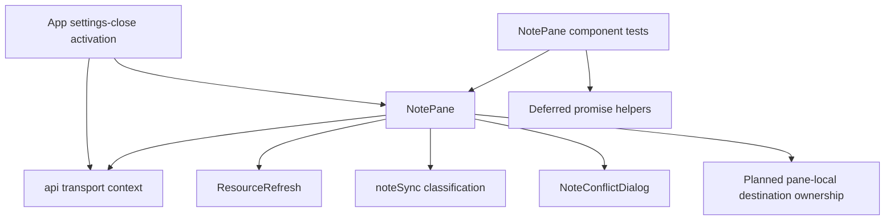

# Brooks-Lint Health Dashboard

- [Dimension Scores](#dimension-scores)
- [Module Dependency Graph](#module-dependency-graph)
- [Top Findings](#top-findings)
- [Review Coverage And Limits](#review-coverage-and-limits)
- [Recommendation](#recommendation)

**Mode:** Health Dashboard
**Scope:** Plan review of `tasks/16-note-save-ownership/2-plan.md` at `2f6f76a`, checked against `1-goal.md`, the previous critical finding, and the affected frontend implementation and tests. This is not a whole-project audit or implementation sign-off.
**Composite Score:** 100/100 for the proposed plan, not the existing codebase.
**Trend:** First Health Dashboard record; previous PR Review scores are not comparable.

Approved for implementation. No actionable plan defects were established within the requested scope.

## Dimension Scores

- Code Quality: 100/100. The plan separates destination ownership from view validity, explicitly covers every pane save entry point, and avoids unrelated production changes.
- Architecture: 100/100. The proposed attempt collection stays within the note pane; transport and server contracts remain unchanged. Distinct URL and local-generation identities match the existing target-change model.
- Tech Debt: 100/100. Identity-checked settlement addresses the underlying ownership invariant rather than adding another generation-reset workaround. A generic queue, global coordinator, URL-alias inference, and speculative retries are explicitly excluded.
- Test Quality: 100/100. Deferred requests, modeled persisted state, real activation helpers, and controlled timers target the reproduced temporal failure without depending on private component state.

Balanced scoring starts each dimension at 100. No findings produce deductions. The composite is `100 × 0.25 + 100 × 0.30 + 100 × 0.25 + 100 × 0.20 = 100`. The code-quality dimension evaluates the proposed changes, not an implementation diff.

## Module Dependency Graph

The ownership node denotes an internal responsibility, not a required new module. `ResourceRefresh` remains an infrastructure-free callback coordinator. No new reverse dependency, cycle, or public ownership interface is proposed.

## Top Findings

None. No critical, warning, or suggestion findings were established in the plan. The existing critical implementation bug remains unfixed until implementation and regression verification are complete; the plan score does not retire it.

## Review Coverage And Limits

- Code quality: checked R1 and R2 against `NotePane.tsx:85-100`, `114-157`, `173-211`, and effect cleanup. The current guard is reset during context invalidation, while settlement is restricted to the old current generation. The plan explicitly separates unconditional identity-checked release from guarded current-context continuation, avoiding both overlapping writes and the obvious stuck-slot alternative.
- Architecture: checked the settings-close activation path, `TransportContext`, note API calls, refresh coordination, and conflict classification. URL/local-generation destination identity is intentionally different from view-generation identity. Keeping the collection pane-local is sufficient for the stated mounted-pane scope; cross-client serialization and URL aliases are expressly outside it.
- Debt: scanned R1 through R6 in the proposed design. A-to-B-to-A support justifies retaining more than the latest attempt; the extra state represents real outstanding writes rather than speculative generality. Reusing existing conflict classification avoids duplicating reconciliation policy. Data-only attempt/context records are appropriate lifecycle and boundary records, not evidence of an anemic domain model.
- Tests: the frontend inventory contains 33 test files: 17 under `components/`, 11 under `lib/`, and five at `src/` level. The task-focused portfolio is DOM/component integration in `NotePane.test.tsx` plus focused unit coverage in `resourceRefresh.test.ts` and `noteSync.test.ts`. This inventory is not a count of individual test cases or a claim that every file was reviewed. No automated GUI E2E coverage is proposed by this plan; manual GUI verification is explicitly conditional.
- Test diagnosis: checked T1 and T2, with a focused T3-T6 completeness pass. Tests target outstanding requests, persisted text, editor text, and explicit conflict decisions rather than the attempt collection's internals. Several assertions support one coherent ordering story. Failure paths, retry blocking, repeated activations, different targets, and local-storage identity are listed. The transport seam already exists, so no test-only production interface is needed.
- Tradeoffs: a conservative conflict after an obsolete successful save is explicitly allowed and preserves the goal's editing safety. A never-settling request continues blocking that destination rather than pretending the request cannot later commit. Both are documented limitations, not hidden guarantees.
- Scope boundary: the prior post-save recovery-await unmount warning is intentionally deferred by `1-goal.md` and the plan. Revalidation required by newly introduced continuation work does not authorize a separate broad lifecycle cleanup. This approval neither approves merging the earlier branch nor establishes that the warning is resolved.
- No tests, builds, temporary probes, or GUI checks were run during this read-only plan review. The plan's implementation commands refer to existing test files and package scripts. No implementation code, version, submodule pointer, goal, plan, or `todo.md` was changed.

## Recommendation

Implement the plan as written, beginning with the failing deferred-save regression. Require the new ownership invariant, current-context reconciliation, full frontend tests, and production build to be demonstrated before closing the critical finding. Keep the separate unmount warning recorded as unresolved; no plan revision or broader audit is required for this scoped task.
