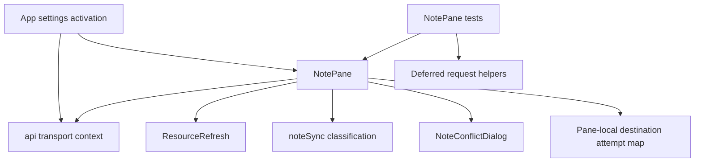

# Brooks-Lint Health Dashboard

- [Dimension Scores](#dimension-scores)
- [Module Dependency Graph](#module-dependency-graph)
- [Top Findings](#top-findings)
  - [Critical](#critical)
  - [Warning](#warning)
- [Verification And Coverage](#verification-and-coverage)
- [Recommendation](#recommendation)

**Mode:** Health Dashboard
**Scope:** Current branch against its actual base branch, `15-server-live-update-recovery`: parent `73638eb..839e539` and app submodule `adcbc1b..694c138`. Reviewed both parent paths and all nine changed app paths. Changes inherited from the base's earlier work against `main` are not new changes in this review. The unrelated working-tree change in `todo.md` is excluded.
**Composite Score:** 95/100. This weighted score is not merge approval.
**Trend:** Previous Health Dashboard score was 100 for the task plan; this implementation review scores 95. These are different review subjects, not evidence of a project-wide quality decline.

Changes requested: same-destination serialization works, but recovery can still silently discard a newer undo that returns the editor to its original baseline.

## Dimension Scores

- Code Quality: 85/100. One critical R1 finding: recovery mistakes equality with an obsolete baseline for proof that no newer draft needs protection.
- Architecture: 100/100. No new cycles or dependency inversions. Ownership remains pane-local, and no transport/server interface was expanded.
- Tech Debt: 95/100. One inherited R1 warning remains in the touched save continuation: editor access after the recovery await lacks lifetime revalidation.
- Test Quality: 100/100. The added deferred-request tests are deterministic and behavior-oriented. The missing undo regression belongs to the critical finding's remedy and is not deducted again as duplicate coverage debt.

Balanced deductions are 15 per critical and five per warning. Each finding is assigned to one dimension only. Composite: `85 × 0.25 + 100 × 0.30 + 95 × 0.25 + 100 × 0.20 = 95`. No project configuration file was found; default risk settings apply.

## Module Dependency Graph

The ownership map is internal state, not a new module or public interface. Existing high fan-out in the pane reflects UI orchestration; no new dependency-disorder finding was established.

## Top Findings

### Critical

**R1: Cognitive Overload — Recovery treats a newer undo as a clean obsolete baseline**

Symptom: `app/src/components/NotePane.tsx:158-161` correctly avoids rebasing from an obsolete PUT completion and requests a fresh read. However, `savedNote.current` still holds the pre-PUT baseline. If the user undoes or edits back to that exact text while the PUT is outstanding, `reconcileNote` at lines 214-219 passes identical baseline/local strings to `classifyNoteEvent`. Its `local === saved` branch in `app/src/lib/noteSync.ts:13` chooses `adopt`, replacing the user's newer text with the older PUT's persisted snapshot. The destination slot prevents overlapping writes but does not preserve the fact that later editing occurred.

Source: Code Complete — Defensive Programming and explicit state invariants; A Philosophy of Software Design — Strategic vs. Tactical Programming. Transport validity, write ownership, baseline knowledge, and draft intent are separate lifecycle facts; equality against an obsolete baseline cannot represent all of them.

Consequence: The critical task outcome is still incomplete. Starting at `base`, saving `base1`, closing unchanged settings, and then undoing to `base` can end with both server and editor holding `base1` without a conflict or explicit discard choice. The same risk applies when a newer edit restores an originally empty note. This is loss of a single client's newer intent, not independent-client last-write-wins behavior.

Remedy: Preserve explicit draft/edit provenance across an invalidated outstanding save and its subsequent reconciliation. A later edit or undo must remain protected even when it equals the old baseline; do not infer cleanliness solely from that equality after the outstanding write may have changed storage. A conservative existing conflict is sufficient when fetched text differs. Keep destination single-flight ownership and current-context reads, and add regressions for Ctrl+Z and ordinary edits returning to the baseline, including empty text and a no-activation control. Assert that recovery preserves the newer text until an explicit conflict choice or safely persists it, rather than silently adopting the older snapshot.

Evidence: Temporary probes import the real component and real activation/classification behavior, deferring only note transport. The primary case starts `base1`'s PUT, optionally activates unchanged settings, requests refresh, executes Ctrl+Z to restore `base`, then completes that PUT. Without activation, the editor stays `base`. With activation, the editor becomes `base1`, and `expect(readNoteText(editor)).toBe("base")` fails. Additional cases reproduce the same loss when undo restores an empty baseline and when ordinary input restores `base`; all three no-activation controls pass. Only one PUT is issued before recovery, so this demonstrates a separate draft-protection gap after the ordering fix, not another overlapping-write failure.

### Warning

**R1: Cognitive Overload — Post-recovery editor access still lacks lifetime revalidation (inherited)**

Symptom: `app/src/components/NotePane.tsx:157-165` guards lifetime before `await recovery.current?.resume()`, then calls `noteDirty()` afterward without rechecking mount, lifetime, or transport ownership. This is the explicitly deferred warning from `tasks/15-server-live-update-recovery/5-code-review.md`, not a newly introduced defect.

Source: Code Complete — Error-Handling Discipline and Defensive Programming. A pre-await guard does not establish ownership after asynchronous suspension.

Consequence: Unmount during the post-save recovery GET can still lead to `readNoteText(null)` and an unhandled rejection on timer/blur save paths. An obsolete continuation can also make scheduling decisions for a replacement context. The added test for unmount before PUT settlement does not exercise this later suspension point.

Remedy: In the separately scoped follow-up, revalidate mount, captured lifetime, and captured transport after the recovery await before reading the editor or scheduling another save. Add the specific PUT-completes, recovery-GET-starts, unmount, GET-completes regression. Do not treat this branch's passing suite as retiring that warning.

Evidence: The previous task review records the reproduced `TypeError` and exact event sequence. Static inspection confirms the same missing post-await guard remains at the new line numbers. That unmount probe was not rerun in this review; this is carried-forward debt, not a new reproduction claim.

## Verification And Coverage

- Re-ran `npm test` in `app/`: all 446 tests across 33 files passed. Expected disk-full backup and failed-reconciliation fixture diagnostics were emitted. Existing tests cover the append-only newer-draft ordering case but miss returning to the pre-save baseline.
- Re-ran `npm run build` in `app/`: TypeScript and Vite production build passed at `0.15.16`.
- Ran `./node_modules/.bin/vitest run --config /tmp/opencode/ntr-save-review/vitest.config.ts` from `app/`: six temporary probe variants, three passed and three failed. All activation variants reproduced the critical finding: undo to `base`, undo to an empty baseline, and ordinary input restoring `base`. All corresponding no-activation controls retained the newer text. Probe files live outside the repository, under `/tmp/opencode/ntr-save-review/`, and do not modify tracked implementation or tests.
- Both branch-range `git diff --check` commands passed. Inspected all release metadata changes: npm package/lockfile, Cargo package/lockfile, and Tauri configuration consistently move from `0.15.15` to `0.15.16` without dependency upgrades. README and live-sync documentation describe the intended safety contract, but the critical probe shows that the draft-preservation claim is not yet universal.
- Test-suite map: 33 frontend files comprise 16 component files, ten library files, and seven root-level files. As a lightweight portfolio classification, 18 files exercise DOM/composition behavior (`components/`, `App`, and `liveSync`), and 15 exercise library/configuration/API-boundary behavior. There are no automated GUI E2E cases in the reviewed change. The new task contributes ten component cases, raising that file from 37 to 47.
- Scanned R1/R2 in the production diff and R1-R6 across the affected design. Destination identity, identity-checked release, independent A/B slots, current-generation checks, and pending-read write guards are coherent. No separate propagation, duplication, speculative abstraction, dependency, or domain-model finding was established. Synchronized version files and same-feature docs are deliberate coordination, not shotgun surgery.
- Scanned T1/T2 and checked the other test risks against the added cases. Multiple assertions tell coherent ordering stories; controlled deferred promises and persisted-text assertions are appropriate for this asynchronous boundary. Context spies observe the transport seam rather than private ownership state. The critical missing transition is recorded once, with its production consequence and regression remedy.
- Native tests, server restart integration, GUI/device behavior, and deployment proxy/TLS checks were not rerun: no native implementation or server changes are part of this branch. This review does not claim those environments were verified. No fixes, version changes, or edits to `todo.md` were made during review.

## Recommendation

Fix the baseline-return draft-protection case before considering the critical task complete. Retain the destination-scoped ownership work and its regressions; the failure requires preserving newer editing intent across recovery, not undoing serialization or changing the server protocol. Keep the separate inherited unmount warning visible for its follow-up; it remains unresolved.
