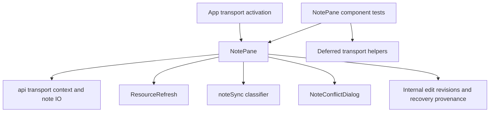

# Brooks-Lint Health Dashboard

- [Dimension Scores](#dimension-scores)
- [Module Dependency Graph](#module-dependency-graph)
- [Top Findings](#top-findings)
- [Review Coverage And Limits](#review-coverage-and-limits)
- [Recommendation](#recommendation)

**Mode:** Health Dashboard
**Scope:** Plan review of `tasks/17-note-baseline-draft-protection/2-plan.md` at `4020e38`, checked against `1-goal.md`, the preceding critical code-review finding, and the affected note pane, classifier, refresh coordinator, and existing test seams. This is not an implementation review or whole-project health assessment.
**Composite Score:** 100/100 for the proposed plan only.
**Trend:** Previous Health Dashboard record scored the earlier implementation at 95; this plan scores 100. Different review subjects prevent interpreting that difference as a codebase improvement.

Approved for implementation. No actionable defects were established in the scoped plan. The existing critical data-loss bug remains open until implementation and regression verification succeed.

## Dimension Scores

- Code Quality: 100/100. Separate local-edit revisions, submitted-write metadata, and recovery provenance address the missing editing-intent invariant. The plan explicitly includes undo and edits during the recovery GET rather than checking only at PUT settlement.
- Architecture: 100/100. New state stays pane-local and destination/lifetime-scoped. Existing transport, refresh coordination, pure three-string classification, and conflict UI retain their boundaries; no public protocol changes are proposed.
- Tech Debt: 100/100. Distinct ownership and provenance lifetimes are justified by the reproduced bug. Retirement rules and a subsequent clean-update test counter the risk of a permanent protection flag; no generic synchronization framework or unrelated cleanup is introduced.
- Test Quality: 100/100. Controlled PUT commits, deferred GETs, real activation/history behavior, no-activation controls, and final stored-text assertions cover the failure rather than internal bookkeeping. Failure, cancellation, convergence, conflict-choice, empty-text, and IME paths are included.

Balanced scoring starts each dimension at 100 with no finding deductions. Composite: `100 × 0.25 + 100 × 0.30 + 100 × 0.25 + 100 × 0.20 = 100`. Code Quality evaluates the proposed change, not an implementation diff. No `.brooks-lint.yaml` was found; defaults apply.

## Module Dependency Graph

The state node denotes an internal responsibility, not a required new module. No new dependency cycle or upward infrastructure dependency is proposed.

## Top Findings

None. There are no critical, warning, or suggestion findings against this plan. The existing data-loss finding and separately deferred unmount warning are implementation facts, not deductions against an otherwise scoped remediation plan.

## Review Coverage And Limits

- R1/R2: checked the proposed edits against `NotePane.tsx:125-168`, `195-228`, and `270-283`. The current pane knows write ownership and baseline equality but not whether a newer undo intentionally restored the baseline. The plan introduces the missing local-edit fact without replacing the destination guard or expanding the change into unrelated modules.
- R3-R6 and architecture: retaining evidence beyond write-slot release is necessary, not duplicate ownership state. The plan keeps classifier policy in its existing home and adds lifecycle-sensitive adoption protection at the pane boundary. Captured context/attempt records are valid lifecycle data, not an anemic domain-model smell. Shared APIs and independent-client last-write-wins semantics remain unchanged.
- Timing diagnosis: the plan covers editing before activation, during the PUT, and during its recovery GET. It also requires evidence to survive repeated activation, failed/canceled reads, and conflicts reopened after settings changes. These requirements avoid a settlement-only patch that would miss later editing or a resettable flag that would recreate the original defect.
- Resolution diagnosis: authoritative convergence, normal `noop` handling, explicit conflict choices, identity-aware retirement, and a later clean remote update establish both safety and recovery from protected state. Rejection is not treated as proof that storage stayed unchanged. The conservative-conflict tradeoff matches the goal and does not require merging or server revisions.
- Test-suite map for the focused command: one DOM/component integration file, `NotePane.test.tsx`, and two library unit-test files, `resourceRefresh.test.ts` and `noteSync.test.ts`; no GUI E2E test is proposed. The broader 446-test baseline is recorded in the previous code review, not independently reverified here. The new permanent tests must not rely on temporary probe files.
- T1/T2 and supporting T3-T6 checks: assertions concern editor text, stored text, explicit choices, and outstanding transport writes. A controlled transport seam is appropriate for asynchronous ordering, and multiple assertions can express one coherent lifecycle story. The plan calls for existing single-flight, destination-isolation, IME, StrictMode, and stale-result controls rather than weakening them to fit the fix.
- Scope boundary: the inherited unmount-during-post-save-recovery-await warning remains explicitly deferred. The plan requires ownership checks in new work but does not authorize a separate lifecycle fix. Its exclusion is consistent with `1-goal.md`; approval is not a claim that the warning is resolved or that the current branch is ready to merge.
- No tests, builds, temporary probes, implementation edits, version changes, or plan revisions were performed in this review. Verification commands and expected results remain obligations for the implementation stage. `todo.md` was left untouched.

## Recommendation

Implement the plan as written, beginning with permanent failing baseline-return regressions. Require the activation variants, no-activation controls, delayed-GET edits, and protection-retirement cases to pass alongside the full frontend suite and production build before closing the critical finding. No plan revision or broader audit is required for this task.
