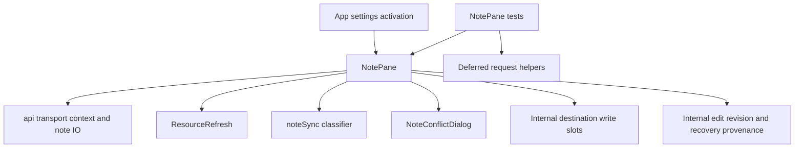

# Brooks-Lint Health Dashboard

- [Dimension Scores](#dimension-scores)
- [Module Dependency Graph](#module-dependency-graph)
- [Top Findings](#top-findings)
  - [Warning](#warning)
- [Verification And Coverage](#verification-and-coverage)
- [Recommendation](#recommendation)

**Mode:** Health Dashboard
**Scope:** Current branch against its actual base branch, `16-note-save-ownership`: parent `2751fd6..30b6968` and app submodule `694c138..0f634d3`. Inventoried and reviewed both parent paths and all nine app paths, including production code, tests, documentation, release metadata, and the implementation report. Earlier changes inherited from the base are not new branch changes. The unrelated working-tree change in `todo.md` is excluded.
**Composite Score:** 99/100 for this scoped review, including one inherited warning.
**Trend:** Latest Health Dashboard score was 100 for the task plan; this implementation review scores 99. Different review subjects prevent treating that difference as a codebase quality trend.

Approved for the scoped critical fix: the original baseline-return data-loss probes now pass. No new critical, warning, or suggestion findings were established in the branch changes. The previously deferred unmount warning remains unresolved.

## Dimension Scores

- Code Quality: 100/100. Local editing intent is now distinct from saved-text equality and read invalidation. Protection is checked when applying the GET, not only when the PUT settles.
- Architecture: 100/100. No new imports, dependency cycles, public APIs, or server protocol changes. Outstanding writes and current-editor recovery evidence remain separate pane-local responsibilities.
- Tech Debt: 95/100. One inherited R1 warning persists in the touched save lifecycle: post-recovery editor access lacks lifetime revalidation.
- Test Quality: 100/100. The added cases exercise observable editing, persistence, conflict choices, and transport ordering with deterministic requests rather than private state assertions.

Balanced scoring deducts five for the inherited warning in Tech Debt only. Composite: `100 × 0.25 + 100 × 0.30 + 95 × 0.25 + 100 × 0.20 = 98.75`, rounded half-up to 99. No `.brooks-lint.yaml` was found; default risk settings apply.

## Module Dependency Graph

Ownership and evidence nodes denote internal state, not new modules. The pane remains an orchestration boundary; its existing fan-out is not a newly introduced dependency-direction defect.

## Top Findings

### Warning

**R1: Cognitive Overload — Post-recovery editor access lacks lifetime revalidation (inherited)**

Symptom: `app/src/components/NotePane.tsx:186-194` checks mount, lifetime, and destination before `await recovery.current?.resume()`, then calls `noteDirty()` without checking ownership again. This continuation is unchanged by the current task and is explicitly deferred in its goal, plan, and implementation report.

Source: Code Complete — Error-Handling Discipline and Defensive Programming. Ownership established before asynchronous suspension must be revalidated before accessing lifetime-bound state afterward.

Consequence: Unmount during the recovery GET started after a save can still produce `readNoteText(null)` and an unhandled rejection on timer/blur save paths. A replaced transport can also leave the obsolete continuation making scheduling decisions. Passing late-PUT settlement tests does not establish safety at this later await.

Remedy: Address this in the separately scoped follow-up: recheck mount, captured lifetime, and captured transport ownership after the recovery await and before reading the editor or scheduling a save. Add the PUT-completes, recovery-GET-starts, unmount, GET-completes regression, asserting no unhandled rejection or follow-up work.

Evidence: The reproduced error and event sequence are recorded in `tasks/15-server-live-update-recovery/5-code-review.md` and carried forward in task 16's review. Static comparison confirms the missing post-await guard persists here. This review did not rerun that separate unmount probe and does not present the warning as a new regression.

## Verification And Coverage

- Re-ran `npm test` in `app/`: 485 tests across 33 files passed at `0.15.17`. Existing disk-full backup and failed-reconciliation fixtures emitted their expected diagnostics. There were no reported unhandled errors in the regular suite.
- Re-ran `npm run build` in `app/`: TypeScript checking and Vite production bundling passed.
- Re-ran the original independent probes using `./node_modules/.bin/vitest run --config /tmp/opencode/ntr-save-review/vitest.config.ts` from `app/`: all six variants passed. Undo to `base`, undo to an empty baseline, and ordinary input restoring `base` now retain the newer text after unchanged activation; the three no-activation controls also pass. These probes check draft retention after the old commit; permanent component tests additionally verify both explicit choices and eventual persisted text. Temporary probes remain outside the repository.
- Inspected the 39 added permanent cases, raising the note component suite from 47 to 86 tests. The 24-case activation matrix varies baseline, undo/input, editing before activation/during PUT/during GET, and Keep mine/Use theirs. Other cases cover no-activation saving, committed IME, canceled reads, retry after rejected responses with and without a commit, reopened conflicts, convergence followed by clean updates, target isolation, and pagehide with settlement-first activation detection.
- Test-suite map: 33 frontend files comprise 16 component files, ten library files, and seven root-level files. A lightweight portfolio classification is 18 DOM/composition files (`components/`, `App`, and `liveSync`) and 15 library/configuration/API-boundary files. The reviewed change adds component integration cases, not automated GUI E2E tests. It retains existing single-flight, local-generation, StrictMode, stale-result, and IME boundary controls.
- Checked R1/R2 in the production diff and R1-R6 across the affected design. `editRevision` advances through shared committed-edit handling and successful undo, independently of remote painting and transport generation. Captured save evidence survives write-slot release and is evaluated against the live edit revision during current-context reconciliation. Conflict reads retain it; safe classification and valid explicit choices retire it. A clean return to a destination with an outstanding PUT seeds the current editor revision instead of importing unrelated editing history. No additional propagation, duplication, speculative framework, dependency, or domain-model finding was established.
- Checked T1/T2 and supporting T3-T6 risks in the new tests. The deferred-storage fixture distinguishes storage commits from response success. Parameterized cases expose their scenario in the test name, and multiple assertions support one coherent save/recovery story. Mock interaction assertions observe the required transport invariant alongside actual editor and persisted-text assertions; they do not expose the ownership map or edit counter.
- Reviewed all metadata and documentation changes. npm package/lockfile, Cargo package/lockfile, and Tauri configuration consistently advance from `0.15.16` to `0.15.17`; dependencies are unchanged. README and live-sync documentation describe the conservative conflict behavior and retain pane-local and last-write-wins limitations. The parent report matches the scoped implementation and explicitly preserves the inherited warning.
- Both branch-range `git diff --check` commands passed. Native implementation and server sources are unchanged; native tests, server restart integration, GUI/device checks, and proxy/TLS behavior were not rerun or claimed as verified. No implementation fixes, version changes, or edits to `todo.md` were made during this review.

## Recommendation

Accept this task's baseline-return critical fix: the independent reproduction and permanent recovery/persistence tests pass, with no newly established defects. Keep the inherited post-recovery unmount warning tracked for its own follow-up; this scoped approval does not retire it or certify the full stacked branch for release. No broader architecture or test-suite audit is warranted by this change.
