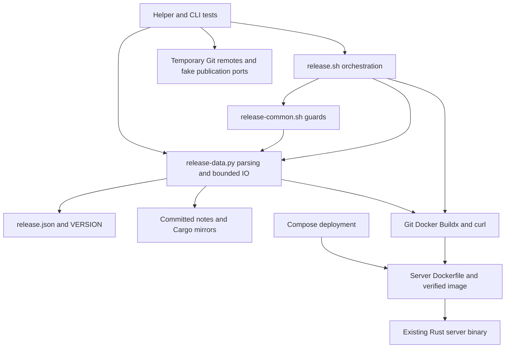

# Brooks-Lint Health Dashboard

- [Dimension Scores](#dimension-scores)
- [Module Dependency Graph](#module-dependency-graph)
- [Top Findings](#top-findings)
- [Review Coverage And Limits](#review-coverage-and-limits)
- [Recommendation](#recommendation)

**Mode:** Health Dashboard
**Scope:** Plan review of `tasks/18-server-container-release-template/2-plan.md` at `816d449`, checked against `1-goal.md`, the existing server publisher/image/Compose/test structure, and the pinned template's settings and publication contract at `3c73528231ac1cbdd43600a5ca723390db804bac`. This is not implementation approval, a whole-project audit, or permission to publish.
**Composite Score:** 100/100 for the proposed plan only.
**Trend:** The previous Health Dashboard record scored an app implementation review at 99; this server plan scores 100. Different components and review subjects make those scores unsuitable as a codebase trend.

Approved for implementation. No actionable plan defects were established. Approval requires the planned local hardening and verification; it does not certify the upstream template, deployed API, or live release process.

## Dimension Scores

- Code Quality: 100/100. The plan makes publication phases and failure authority explicit, including one-way promotion confirmation, exact identity, bounded reads, lost-response reconciliation, and refusal rather than repair.
- Architecture: 100/100. Bash orchestration, standard-library parsing/I/O, external command ports, image construction, and Rust application behavior remain distinct. Server-specific version mirrors and settings adapt the reference without introducing application/runtime dependencies on release orchestration.
- Tech Debt: 100/100. The migration retires the old engine only after behavior mapping, excludes compatibility frameworks/updaters/retention, and directly addresses the two documented upstream warnings rather than copying them silently.
- Test Quality: 100/100. Real temporary Git repositories and fake publication ports verify observable state and prohibited writes. The plan requires actual fault injection and valid Rust mirrors so an unrelated early refusal cannot masquerade as safety coverage.

Balanced scoring starts each dimension at 100 with no finding deductions. Composite: `100 × 0.25 + 100 × 0.30 + 100 × 0.25 + 100 × 0.20 = 100`. Code Quality evaluates the proposed changes, not an implementation diff. No `.brooks-lint.yaml` was found; defaults apply.

## Module Dependency Graph

This is the proposed responsibility graph, not a claim that the port already exists. Application code does not depend on release-tool internals, and no new dependency cycle is proposed.

## Top Findings

None. There are no critical, warning, or suggestion findings against this plan. The template's documented N1/N2 warnings are explicit implementation work and acceptance conditions, not evidence that this plan overlooks them.

## Review Coverage And Limits

- Goal alignment: the plan pins the requested reference, targets only `ntr/ntr-server`, retains the real Rust/non-root image, and explicitly excludes the app, application behavior changes, real publication, and host administration. Replacing the sample Dockerfile with the existing application image is necessary adaptation, not failure to follow the reference.
- R1/R2 diagnosis: publication identity, startup classification, promotion state, and permitted recovery are described separately. The planned N1 correction forbids the predecessor alias after confirmed promotion. The N2 correction preserves selected executable discovery independently of credentials and requires verification under private auth before publication writes. Their full-entry fault tests are acceptance requirements, not optional future cleanup.
- Architecture and R3-R6 diagnosis: the increased script/test footprint serves the requested release contract rather than speculative generality. `VERSION` with validated Cargo mirrors avoids two independently authoritative versions while respecting Rust metadata requirements. Same-feature changes to scripts, Dockerfile, Compose, tests, and docs are deliberate coordination, not unrelated shotgun surgery. The plan does not add arbitrary hooks, archive compatibility layers, a generic updater, or dependency upgrades.
- Migration tradeoffs: the current publisher creates versioned image aliases and archive attachments; the reference publishes staging/digest identity and mutable `latest`. The plan makes the breaking change explicit, updates Compose to a real new-contract alias, recommends immutable index digests for reproducible deployment, and preserves historical artifacts. Deprecated `FORGEJO_*` overrides must fail rather than silently select new defaults. Validation stays local and independent of publication credentials or services.
- Package-association authority: re-read the pinned `docs/bash-publication.md` and `scripts/release.json`. The plan matches the exact identity checks, literal package `latest`, correct-link read-only path, stable `1.25.x` new-link gate, permission-hidden-null concern, one scoped POST/readback, and exclusive-writer prerequisite. Unknown deployment compatibility is explicitly allowed to block completion without authorizing rollback or reassignment. This is a documented operational limit, not a promise that any Gitea/Forgejo family works.
- Test-suite map: the current server has one Python release CLI/fake-command test file and two Rust integration test files, plus inline Rust unit tests. The proposed portfolio adds/adapts helper-level and Bash-entry boundary tests, retains Rust regression verification, and makes real container architecture/runtime smoke checks conditional. No automated live registry/release/package E2E run is authorized or claimed. The current Python filename does not match default `test*.py` discovery; the plan explicitly migrates naming/discovery along with the suite rather than assuming the old file will still run.
- T1/T2 and supporting T3-T6 checks: existing fixture code already isolates temporary Git state, credentials, fake commands, and observable calls. The new plan preserves that seam, requires exact mutation/state assertions and fault reachability, and maps old applicable protections before deletion. It distinguishes build-platform advertising, runnable architecture checks, fake transport behavior, and live service compatibility instead of treating one as proof of another.
- Verification boundaries: the pinned helper and full fixture implementation still require inspection during porting, as stated in step 1. Local unit/shell/Rust checks, offline validation, and conditional non-publishing builds cannot certify live API support, account permissions, native plugin routing, or cross-service atomicity. Missing Docker/emulation/trust is a recorded verification limit, not authorization for root installs, production daemon use, or remote writes.
- No tests, builds, credential access, publication commands, implementation edits, plan revisions, version changes, or submodule-pointer changes were performed during this review. Reference retrieval was read-only. `todo.md` was left untouched.

## Recommendation

Implement the plan as written. Preserve the behavior-mapping evidence, require N1/N2 fault cases to reach their intended boundaries, and keep unsupported package association fail-closed. Complete the stated local checks and record unavailable runtime checks before implementation approval; any live publication requires separate explicit approval. No plan revision or broader audit is required for this scoped task.
