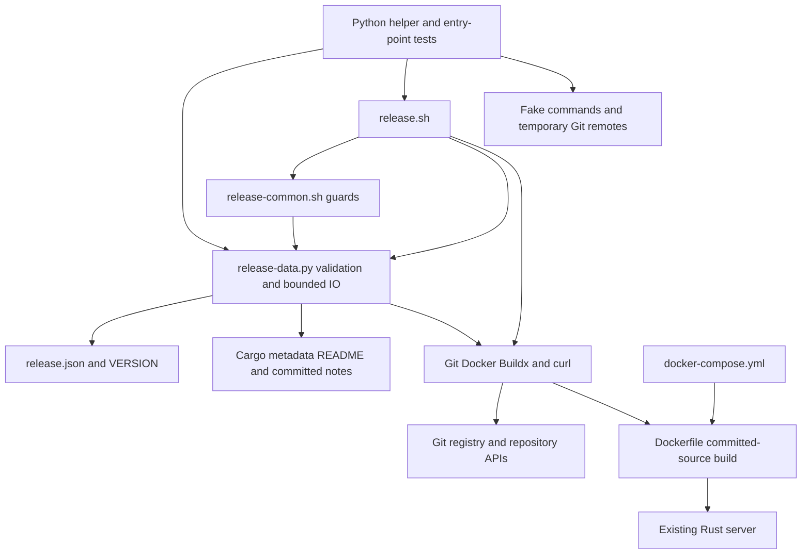

# Brooks-Lint Health Dashboard

- [Dimension Scores](#dimension-scores)
- [Module Dependency Graph](#module-dependency-graph)
- [Top Findings](#top-findings)
  - [Critical](#critical)
  - [Warning](#warning)
- [Test Suite Map](#test-suite-map)
- [Verification And Limits](#verification-and-limits)
- [Recommendation](#recommendation)

**Mode:** Health Dashboard
**Scope:** All committed changes on `18-server-container-release-template` relative to local `main`: parent `430a964..30fe343`, including the implementation report and server pointer; server `48a2ce0..26057d9`, covering all 22 changed server files, including retired publisher/tests. The parent and server merge bases equal those base revisions. The app pointer and application source are unchanged. The unrelated working-tree `todo.md` change is excluded.
**Composite Score:** 95/100
**Trend:** Previous Health Dashboard score 100; current score 95, a numerical change of −5. The previous record reviewed this task's plan, not implementation, so this is not a codebase-health trend.

Do not approve publication yet: the publisher can push unrelated local tags, and valid ARM64 v8 evidence is rejected.

## Dimension Scores

- Code Quality: 85/100. One critical R2 finding: ambient Git settings expand the tag mutation beyond the requested tag.
- Architecture: 100/100. No dependency-cycle or layering finding in the changed release subsystem. Application code remains independent of release orchestration.
- Tech Debt: 95/100. One warning R6 finding: platform matching treats equivalent ARM64 representations as different, regressing the previous publisher's supported input contract.
- Test Quality: 100/100. No separate T1/T2 structural finding established. Real temporary Git repositories and fake command ports provide useful behavioral seams; the missing cases below belong to the corresponding production findings rather than duplicate deductions.

No `.brooks-lint.yaml` was found. Balanced deductions apply: critical −15, warning −5, suggestion −1. Composite: `85 × 0.25 + 100 × 0.30 + 95 × 0.25 + 100 × 0.20 = 95`. Findings are counted once, in their primary dimension. Scores describe this bounded review, not live release readiness.

## Module Dependency Graph

The Bash layer owns sequence and mutation authority; Python owns parsing, identity, bounded transport, and local evidence. Shell sourcing and calls back into the Python helper do not create an import cycle. The helper's dispatch surface is internal boundary glue, not an application API. Runtime dependencies and source behavior remain unchanged.

## Top Findings

### Critical

**F1 — R2, Code Quality: `push.followTags` publishes tags outside the release transaction.**

Location: `server/scripts/release.sh:126`; supporting command execution in `server/scripts/release-data.py:174-178`.

Symptom: The tag publication uses `git push origin "$oid:refs/tags/$tag"` without disabling Git's configured follow-tags behavior. Git still honors local/global `push.followTags=true`, so an explicit refspec does not restrict the operation to that one tag. Reproduced using the existing owned fixture: set `push.followTags=true`, create an annotated local `unrequested-tag` pointing at the current source commit, then invoke the real Bash entry point. It returned zero, and the temporary bare remote contained both `refs/tags/unrequested-tag` and `refs/tags/v1.0.0`, including their peeled references. No publisher code was modified for this reproduction.

Source: *Code Complete* — Defensive Programming and explicit error-handling discipline; *The Pragmatic Programmer* — Orthogonality. Ambient tool configuration changes the release operation's mutation set independently of the captured publication identity.

Consequence: A normal user Git preference can publish unrelated local annotated tags without approval, potentially triggering remote tag automation. Inventories and final verification examine the requested release identity but do not flag the extra mutation. Successful output therefore conceals an out-of-scope remote write, contrary to the exact-tag publication contract.

Remedy: Explicitly disable follow-tags on the publication command, for example with `git push --no-follow-tags origin ...`, without changing user configuration. Add a full-entry regression with `push.followTags=true` and a reachable, unpublished annotated local tag; verify only the intended remote tag appears and the unrelated tag remains local. Preserve non-force behavior and lost-response reconciliation.

### Warning

**F2 — R6, Tech Debt: equivalent ARM64 v8 evidence is rejected at two boundaries.**

Location: `server/scripts/release-data.py:499` and `server/scripts/release-data.py:707-711`.

Symptom: Builder validation compares literal platform tokens, rejecting `Platforms: linux/amd64, linux/arm64/v8`. Image validation rejects every nonempty manifest `variant`, including `{"os":"linux","architecture":"arm64","variant":"v8"}`. Both refusals were reproduced through the actual helper using synthetic bounded builder/index evidence. The previous publisher explicitly normalized `linux/arm64/v8` builder support and accepted ARM64 `v8` descriptors. Containerd's platform model also documents ARM64 v8 as the default representation when the variant is omitted; see its [platform documentation](https://github.com/containerd/platforms/blob/main/platforms.go), consulted read-only during this review.

Source: *Domain-Driven Design* — faithful value semantics and boundary translation; *Software Engineering at Google* — Backward Compatibility. Two wire representations of the same supported platform are mistaken for a new unsupported platform.

Consequence: An otherwise compatible prepared builder can fail preflight. An otherwise valid newly built or reusable AMD64/ARM64 index can be refused before tag publication, leaving accepted staging state and blocking release completion. Fake fixtures always emit the variant-free representation, so their passing results do not establish compatibility with explicit-v8 evidence. This is a false refusal, not evidence that every actual Buildx build fails.

Remedy: Normalize only the supported ARM64 default variant at the builder and manifest boundaries, keeping configured targets exactly `linux/amd64` and `linux/arm64`. Accept missing/empty ARM64 variant and `v8`; continue rejecting unsupported variants, duplicate normalized platforms, missing architectures, and other operating systems. Add builder/helper tests and a full-entry fixture case that actually emits v8 evidence. Document the narrow local deviation from the reference.

## Test Suite Map

- Changed release suite: 40 Bash-entry integration/contract methods plus 11 Python helper methods. Helpers include bounded real subprocess checks and temporary Git checks, so this is not a claim of 11 pure unit tests.
- Existing Rust suite, unchanged: 23 inline unit-test declarations in `src/*.rs` and 14 integration-test declarations across `tests/api.rs` and `tests/task_dates.rs`.
- No automated live-service or actual-container E2E test was run. Fake Docker/curl ports do not certify native routing, API deployments, TLS, or execution on either architecture.
- The prior full Python run took 696.635 seconds. Its subprocess-heavy shape is justified by publication risk, not automatically a T6 violation based on a ten-minute threshold. The eleven helper tests provide a faster supporting layer.
- T1/T2: scenario names, subtests, isolated fixtures, injection markers, and externally observable write/state assertions are generally clear. The N1 negative control deliberately changes only an owned fixture to prove that eventual nonzero exit is insufficient; it is not production test-only behavior. Exact command assertions mostly protect safety contracts rather than incidental ordering.
- T3–T6 cross-check: shared setup avoids material duplication; fakes observe real state transitions rather than just call counts; negative paths cover substantial publication risk. F1/F2 expose missing environmental/representation cases despite the broad suite. Prior unexplained transient failures remain a disclosed diagnostic limit, not proof of an identified shared-state defect.

## Verification And Limits

- Fresh review checks passed: `bash -n scripts/release.sh scripts/release-common.sh`, `./scripts/release.sh --validate`, server `git diff --check`, and the targeted N1/N2 methods plus all 11 helper methods: 13 methods in 38.263 seconds.
- F1 reproduction completed successfully against temporary real Git/bare repositories with fake Docker/curl ports and synthetic tokens, demonstrating the unintended extra remote tag. F2's two focused helper reproductions raised `Builder must advertise linux/amd64 and linux/arm64` and `Invalid image platforms` for explicit-v8 evidence.
- Prior implementation evidence was inspected, not represented as a new review run: all 51 Python methods passed in 696.635 seconds; configuration, Compose, AST, and local documentation-link checks passed. The implementation report accurately records earlier unexplained failures and targeted reruns.
- Rust test, Clippy, and formatting verification remain blocked by absent Cargo/rustc. The operator needs Rust with Cargo, rustfmt, and Clippy. No toolchain was installed during review.
- No image build or runtime smoke check ran. The available daemon was not confirmed non-production. Actual AMD64/ARM64 image construction, non-root/API/persistence execution, live registry behavior, account authority, and deployed package-association semantics remain unverified.
- N1's one-way post-promotion guard and N2's selected-plugin identity preservation are present and their targeted tests pass. Package linking retains the stable Gitea `1.25.x` new-link gate and conflict refusal; this does not establish that the deployed server qualifies.
- The version is consistently prepared as `0.2.5`, not published. The Rust image, non-root user, persistent paths, port, and Compose storage/health behavior remain intact. Intentional retirement of version-image aliases and archive attachments is documented; historical artifacts are not removed.
- No implementation fixes, production credentials, Docker login, real source push, publication/deployment, package mutation, application changes, or `todo.md` edits occurred. Only this review report and review history are persisted.

## Recommendation

Address F1 before approving merge or publication, then restore narrow ARM64 v8 normalization for F2 and add the corresponding regressions. Rerun the release suite and obtain the outstanding Rust and approved non-production container checks. The architecture is coherent and the scoped migration is well documented, but passing fake-port tests cannot override the reproduced mutation-authority defect or certify a live release. No fixes were implemented in this review stage.
