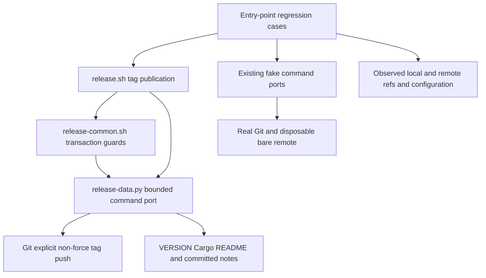

# Brooks-Lint Health Dashboard

- [Dimension Scores](#dimension-scores)
- [Module Dependency Graph](#module-dependency-graph)
- [Top Findings](#top-findings)
- [Review Coverage And Limits](#review-coverage-and-limits)
- [Recommendation](#recommendation)

**Mode:** Health Dashboard
**Scope:** Plan review of `tasks/19-release-tag-push-isolation/2-plan.md` at `c595a55`, checked against its goal, task 18's F1 finding, and the current server publisher, real-Git fixture, metadata validation, and documentation conventions. This evaluates the proposed work, not implementation correctness or live publication readiness.
**Composite Score:** 100/100 for the plan only.
**Trend:** Previous Health Dashboard score 95; current plan score 100, a numerical change of +5. Different review subjects make this unsuitable as an implementation-health trend.

Approved for implementation. No actionable plan defects were established; the existing F1 defect remains unfixed until implementation and verification complete.

## Dimension Scores

- Code Quality: 100/100. The proposed command-local override narrows tag mutation without changing source identity, explicit refspecs, force policy, or response reconciliation.
- Architecture: 100/100. The existing Bash orchestration and Python transport/data boundaries remain intact. No new abstraction, dependency, application coupling, or cycle is proposed.
- Tech Debt: 100/100. The remedy addresses the demonstrated cause rather than adding cleanup, persistent configuration changes, or a generic Git sanitization subsystem. Metadata updates preserve the established checked-mirror convention.
- Test Quality: 100/100. The plan requires observable real-remote state, valid regression preconditions, red/green sensitivity, accepted-but-lost writes, and read-only completed retries, rather than only flag or exit-status assertions.

No `.brooks-lint.yaml` was found. Balanced scoring starts each dimension at 100, with no deductions because no findings were established. Composite: `100 × 0.25 + 100 × 0.30 + 100 × 0.25 + 100 × 0.20 = 100`. This score does not retire task 18's findings.

## Module Dependency Graph

The proposed production change stays at the command boundary. The test wrapper already delegates actual pushes to Git; the plan correctly retains that seam rather than mocking away the behavior under review. Runtime application modules are outside the change graph.

## Top Findings

None. No critical, warning, or suggestion findings against this plan. Task 18's critical F1 is the explicit implementation target; its ARM64 v8 warning F2 is deliberately excluded, not dismissed or claimed resolved.

## Review Coverage And Limits

- Goal alignment: the request is to fix the prior critical finding only. The plan targets the demonstrated `push.followTags` expansion, leaves F2 and application behavior unchanged, and excludes real publication and historical tag deletion.
- R1/R2 diagnosis: adding `--no-follow-tags` to the existing explicit push keeps the mutation intent local and visible. Existing `attempt`, bounded transport, pre-write guards, exact remote object/commit readback, and non-force semantics remain unchanged. Persistent Git configuration edits would introduce unrelated side effects; the plan explicitly rejects them.
- R3–R6 diagnosis: the version/Cargo/README/notes changes are required release mirrors, not competing authorities. Current validation checks these mirrors and hashes release scripts, so a prepared `0.2.6` with unchanged dependencies and preserved historical notes fits the existing convention. Related documentation/test changes are deliberate coordination within the release subsystem, not Shotgun Surgery across unrelated modules. No speculative framework or richer application model is needed for this transaction script.
- Fixture feasibility: `Fixture.__enter__` initializes and pushes source before returning. `Fixture.commit()` also pushes source, which is why creating the unrelated tag only after setup matters. `Fixture.git()` uses real `/usr/bin/git`; the command wrapper forwards publication pushes and injects `lose_tag` only after real acceptance. The planned sequencing and observations are compatible with those interfaces.
- T1/T2 diagnosis: ordinary and lost-response cases share one safety claim, while subcases can isolate their failure stories. Captured ref sets, local tag IDs, and configuration bytes make failure meaning explicit. The completed-retry check protects observable no-write behavior, not incidental internal call ordering. No exact-argument fake assertion replaces the remote-state oracle.
- T3–T6 cross-check: existing shared fixture setup avoids a duplicate harness. The red/green requirement prevents a test that passes merely because credentials, source, or metadata validation refused early. Retaining existing all-lost-writes and tag-loss tests preserves distinct transaction boundaries instead of replacing them with the new happy path.
- Test suite map: the current release suite has 40 Bash-entry integration/contract methods and 11 helper methods, some of which use real subprocesses/Git. The plan adds entry-point isolation scenarios with ordinary, lost-response, and completed-retry coverage; the final method count is an implementation detail. Existing unchanged Rust tests comprise 23 inline unit declarations and 14 integration declarations. No live-service or actual-container E2E verification is proposed for this flag fix.
- Authority and limits: the plan explicitly does not claim protection against arbitrary malicious hooks or every ambient Git setting. Previous remote tags are not repair targets. Missing Cargo, native container execution, deployed API compatibility, and distributed-writer exclusion remain independent limits, not reasons to weaken the regression or run privileged preparation.
- This review used read-only inspection. No tests, builds, credential access, source pushes, publication commands, implementation edits, version changes, plan revisions, app-pointer changes, or `todo.md` edits were performed. Only this report and review history are persisted.

## Recommendation

Implement the plan as written. Require the real-Git red/green evidence, exactly one accepted push in the lost-response case, unchanged user configuration, and read-only completed retries before declaring F1 resolved. Record exact verification blockers and retain F2 as outstanding. Plan approval is not authorization to publish, push source, or remove any remote tag.
