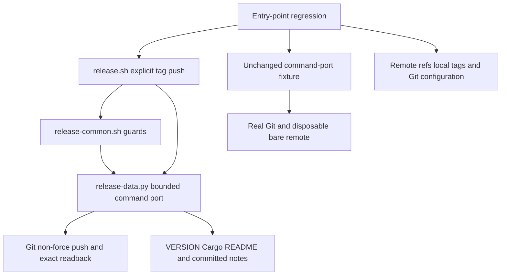

# Brooks-Lint Health Dashboard

- [Dimension Scores](#dimension-scores)
- [Module Dependency Graph](#module-dependency-graph)
- [Top Findings](#top-findings)
- [Test Suite Map](#test-suite-map)
- [Verification And Limits](#verification-and-limits)
- [Recommendation](#recommendation)

**Mode:** Health Dashboard
**Scope:** All task-19 branch changes relative to its actual base branch, `18-server-container-release-template`: parent `bbb5e7e..623c8f6`, comprising the server pointer and implementation report; server `26057d9..7bc9b8c`, comprising all 12 changed files. Merge bases equal those base revisions. Local `main` is older (`430a964` parent, `48a2ce0` server), so its cumulative diff additionally includes the already-reviewed task-18 migration and task records. This review evaluates task 19's complete delta, with inherited issues identified separately. The unrelated working-tree `todo.md` modification is excluded.
**Composite Score:** 100/100 for the task-19 delta.
**Trend:** Stable at 100 compared with the latest Health Dashboard record, which reviewed this task's plan. That comparison is not a longitudinal implementation-health measure.

No new actionable findings. Task 18's critical F1 is resolved by the reviewed change; its separate ARM64 v8 warning F2 remains inherited and unresolved.

## Dimension Scores

- Code Quality: 100/100. The one-line production change explicitly suppresses follow-tags while retaining the exact object-to-tag refspec, non-force push, bounded execution, pre-write guards, and read-back reconciliation.
- Architecture: 100/100. No new dependency, cycle, application coupling, or boundary change. The override remains at the Git command boundary.
- Tech Debt: 100/100. The fix avoids persistent configuration mutation, generic sanitization frameworks, and cleanup-based repair. Checked version mirrors and dedicated release documents remain consistent.
- Test Quality: 100/100. The added regression verifies actual real-Git remote state, preserved local state/configuration, accepted-but-lost writes, and no-write retries. No new T1/T2 structural defect was established.

No `.brooks-lint.yaml` was found. Balanced deductions apply; there are no new findings to deduct. Composite: `100 × 0.25 + 100 × 0.30 + 100 × 0.25 + 100 × 0.20 = 100`. Inherited F2 is outside the changed implementation and is not rescored as a new task-19 defect. This score is not overall publisher or live-publication certification.

## Module Dependency Graph

Application modules, Dockerfile, Compose, helper implementation, and fake command-port implementation are unchanged. Runtime code does not depend on the release-tool adjustment.

## Top Findings

None introduced by task 19. No critical, warning, or suggestion findings against the reviewed delta.

F1 resolution: `server/scripts/release.sh:126` now passes `--no-follow-tags` directly on the explicit push. The regression enables effective `push.followTags=true` only after fixture source setup, proves the unrelated tag is annotated/reachable/unpublished, and observes the actual bare remote rather than a fake success or exact-argument assertion. Both ordinary and lost-response cases require exactly one publication sequence, only the intended tag/ref advertisement added, unchanged source/pre-existing refs, the unrelated tag retained locally, and unchanged Git configuration bytes. Completed retries require no publication writes and identical refs/configuration. The command port still delegates pushes to `/usr/bin/git` and loses the response only after acceptance. These facts directly address the demonstrated cause and consequence of F1.

Inherited F2 remains recorded in `tasks/18-server-container-release-template/5-code-review.md`: the unchanged helper rejects explicit ARM64 `v8` evidence. Task 19's goal explicitly excludes that warning, and its report/docs do not claim to fix it. Approval of this delta does not dismiss F2 or authorize publication.

## Test Suite Map

- Release suite: 41 Bash-entry integration/contract methods and 11 helper methods, 52 total. Some helper methods use real subprocesses/Git, so they are not all pure unit tests. Task 19 adds one method with ordinary and lost-response subcases, each followed by a completed retry.
- Existing Rust suite: 23 inline unit tests, 11 API integration tests, and 3 task-date integration tests, all unchanged and passing. Binary/doc-test targets contain no additional tests.
- No live-service or actual-container E2E test was run. Temporary real Git/bare remotes provide direct coverage of the changed Git behavior; Docker/curl remain fakes.
- T1/T2: the new test's multiple assertions support one mutation-boundary claim; subtest labels identify the lost-response mode. Remote refs and configuration are observable contracts, not incidental internal details. A shared fixture is appropriate because both cases need the same valid release preconditions.
- T3–T6 cross-check: no duplicate harness or new test-only production path was added. The existing all-lost-writes method remains intact. The recorded red run failed on extra real remote refs in both subcases, preventing coverage illusion from an early refusal. The subprocess-heavy full suite remains slow, but the real-Git seam is warranted by the release risk; no new structural timing defect was established.

## Verification And Limits

- Fresh review run passed four methods in 59.129 seconds: the new follow-tags regression, existing all-lost-writes reconciliation, successful publication/completed retry, and consumer settings/runtime-contract checks. Log: `/tmp/opencode/ntr-task19-review-tests.log`.
- Fresh Rust verification passed: `"$HOME/.cargo/bin/cargo" test --locked` (37 tests), `"$HOME/.cargo/bin/cargo" clippy --all-targets --locked` (no warnings), and `"$HOME/.cargo/bin/cargo" fmt --check`.
- Fresh shell/local checks passed: `bash -n scripts/release.sh scripts/release-common.sh`, `./scripts/release.sh --validate`, and parent/server `git diff --check`. The consumer check confirms the prepared `0.2.6` version, configured notes, and retained image/runtime contract.
- Prior implementation evidence, not a fresh full review run: all 52 Python methods passed in 723.151 seconds; the six-method targeted run passed in 109.081 seconds; the pre-fix regression failed both subcases on unintended tag refs in 19.386 seconds. AST, version/notes/link checks, and Compose validation passed during implementation. No contradictory implementation evidence was found.
- All changed metadata/docs were checked against the diff. `VERSION`, Cargo package mirrors, configured committed notes, README, and consumer assertions agree on prepared `0.2.6`. Historical `0.2.5` notes, dependencies, template pin/version, Compose `latest`, app pointer, and application source are unchanged.
- Rust verification is no longer blocked after the operator's toolchain installation. Native AMD64/ARM64 image builds/execution, container persistence/non-root/API smoke checks, live registry/TLS, deployed package API semantics, account permissions, and distributed-writer exclusion remain unverified. Neither this fix nor fake-port success addresses those limits or inherited F2.
- No implementation fixes, real credentials, registry login, real source push, publication/deployment, remote tag deletion, package mutation, or `todo.md` edits occurred during review. Only this report and review history are persisted.

## Recommendation

Approve task 19's scoped F1 fix. The production override and real-Git regression demonstrate the intended isolation without changing user configuration or weakening non-force and retry behavior. Keep inherited F2 and outstanding native/live verification tracked separately. No source push or publication is authorized by this review.
