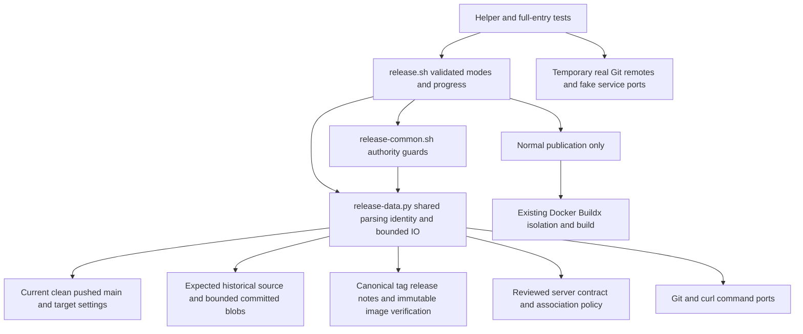

# Brooks-Lint Health Dashboard

- [Dimension Scores](#dimension-scores)
- [Module Dependency Graph](#module-dependency-graph)
- [Top Findings](#top-findings)
- [Review Coverage And Limits](#review-coverage-and-limits)
- [Recommendation](#recommendation)

**Mode:** Health Dashboard
**Scope:** Plan review of `tasks/20-package-association-compatibility-logs/2-plan.md` at `1a9742d`, checked against its goal, current server release identity/credential/inventory/association boundaries, existing fixtures, and upstream Gitea `28.2.0` contract evidence pinned to `829b49c1ae96015e345f9d2a0eb1ea7acd5f31e1`. This evaluates the proposed work, not implementation correctness, installed-server attestation, or authorization for live mutation.
**Composite Score:** 100/100 for the plan only.
**Trend:** Stable at 100 compared with the latest Health Dashboard record. The previous record reviewed task 19's implementation delta, so this comparison does not establish an implementation-health trend.

Approved for implementation. No actionable plan defects were established; package recovery and deployed-server compatibility still require the planned implementation and verification.

## Dimension Scores

- Code Quality: 100/100. Explicit current-tool versus historical-publication identity, narrow version recognition, one allowed link mutation, and evidence-based outcomes make the intended authority understandable.
- Architecture: 100/100. The plan reuses parsing/verification and association policy, separates credential preparation from Docker isolation, and keeps recovery at the release-tool boundary without executing historical code.
- Tech Debt: 100/100. Added recovery complexity serves the explicit requirement to preserve the accepted publication. It does not relax normal identity checks or add cleanup, generic repair, arbitrary hooks, or an unreviewed compatibility framework.
- Test Quality: 100/100. The planned fixtures advance to a different valid tool revision, exercise real historical bindings, assert prohibited writes and unchanged state, and verify prompt stderr/heartbeat behavior and secret isolation.

No `.brooks-lint.yaml` was found. Balanced scoring starts every dimension at 100; no finding deductions apply. Composite: `100 × 0.25 + 100 × 0.30 + 100 × 0.25 + 100 × 0.20 = 100`. This score does not resolve inherited F2 or certify publication readiness.

## Module Dependency Graph

This is the proposed graph, not a claim that recovery already exists. Runtime application modules remain outside the release subsystem. Historical inputs are data; historical executable code is never part of the runtime dependency graph.

## Top Findings

None. No critical, warning, or suggestion findings against this plan.

## Review Coverage And Limits

- Goal alignment: the plan addresses verified Gitea `28.2.0` association support, safe completion of the existing `v0.2.6` publication, and user-visible progress. It excludes application changes, ARM64 v8/F2, real-token test access, live mutation, cleanup, privileged preparation, and `todo.md` edits.
- Server contract: re-read the pinned `services/packages/package_update.go` and `services/convert/package.go` during review. The former rejects owner mismatch and existing positive `RepoID`, then requires package-unit write permission; the latter can conceal inaccessible repository links as null. This supports the plan's hidden-link refusal argument under its explicit exclusive-writer assumption. The planned route/middleware/status/test inspection remains necessary before implementation claims are finalized.
- Version scope: official upstream `28.2.0` evidence justifies an exact additional reviewed version, not a blanket `28.x`, newer-version, or Forgejo rule. Preserving stable `1.25.x` and correct-link read-only behavior avoids unrelated compatibility loss. Public branding/version observations are not treated as binary attestation or proof of token permissions; unknown custom deployments remain a blocker.
- R1/R2 diagnosis: the plan explicitly recognizes that current `inspect_tag` compares the annotation against current config/scripts and that a patch/version bump changes those values. A regex-only fix would not recover the old publication. Separate expected source/tag pins and historical verification prevent the new executable from silently adopting foreign or changed identity.
- Recovery feasibility: current `source()` enforces clean/pushed `main` and exact destinations; current `inventory()` is bounded and selects evidence by tag/version; current `blob()` reads regular committed inputs; canonical annotation helpers bind source/config/scripts/notes/image identity. The proposed factoring can reuse these responsibilities with distinct current and historical contexts, without checking out old files or weakening ordinary publication. Historical inventory selection and conservative newer-state refusal are expressly covered.
- R3–R6 diagnosis: shared canonical validation and shared association policy avoid competing recovery/publisher implementations. Version/Cargo/README/notes updates are checked release mirrors within one bounded context, not unrelated Shotgun Surgery. Recovery is justified present functionality rather than speculative generality; the plan forbids the dangerous alternatives of re-tagging, rollback, arbitrary historical execution, and a generic resume framework.
- Credentials and mutation authority: Docker-free recovery does not mean a read-only operation or read-only API token. Git/API/registry reads use current protected credentials; the one authorized association POST still requires the documented package/repository permissions. This follows the plan's explicit single-POST exception and operator token-rights prerequisites; no Docker login or historical credential adoption is needed.
- Test suite map: the existing suite has 41 Bash-entry integration/contract methods and 11 helper methods, some using real subprocesses/Git. The unchanged Rust portfolio has 23 unit tests and 14 integration tests. The plan adds compatibility, historical recovery, parser/lock, and logging cases at the helper/full-entry seams, not live production E2E tests. Final method counts depend on implementation organization.
- T1/T2 diagnosis: recovery fixtures first create authentic accepted publication evidence, then advance valid committed/pushed source/config/scripts/notes. This distinguishes old publication authority from new tool identity and avoids a misleading same-checkout retry test. Subcases and injection markers make intended failures diagnosable; actual ref/image/release/config state and prohibited-write assertions test public behavior rather than incidental wiring.
- T3–T6 cross-check: existing fake ports and real temporary Git remotes are appropriate seams. Retaining F1/plugin/context/TLS tests preserves prior safety. Nearby unsupported versions, hidden conflicts, lost responses, final evidence drift, malformed/oversized historical blobs, and correct-link repeats cover critical negative paths. Controlled clock tests plus short real timeout/signal cases avoid relying on long sleeps; prompt output is checked before process completion rather than inferred from a final buffer.
- Logging safety: fixed/validated stderr labels, monotonic rate-limited heartbeats inside bounded capture, unchanged stdout data contracts, evidence-based confirmation, and no raw command/body/output relay address the main leakage and false-success risks. Exact implementation of process/signal/error handling remains review work after coding, not something this plan approval certifies.
- Remaining limits: the package endpoint returned unauthenticated 401 during planning; current association, immutable registry evidence, actual installed binary provenance, account permissions, package UI rendering, native ARM64 execution, and distributed writer exclusion are not proven. The plan accurately requires safe refusal and later separate operator approval rather than a live mutation to discover compatibility.
- Review actions were read-only inspection and unauthenticated pinned upstream source reads. No tests/builds, production credential access, authenticated production API calls, publication/recovery execution, implementation changes, plan revisions, version changes, app-pointer changes, or `todo.md` edits occurred. Only this report and review history are persisted.

## Recommendation

Implement the plan as written. Keep current-tool stability and historical publication authority distinct, require exact source/tag pins and unchanged final image/release evidence, and allow only the reviewed single association write. Require the full-entry recovery and prompt secret-safe logging regressions before claiming completion. Retain explicit permission/provenance/concurrency limits and separate approval for any real recovery or publication; no broader server-family support or F2 fix is approved by this plan review.
