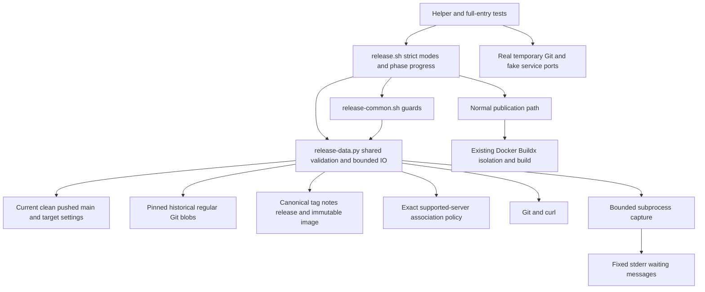

# Brooks-Lint Health Dashboard

- [Dimension Scores](#dimension-scores)
- [Module Dependency Graph](#module-dependency-graph)
- [Top Findings](#top-findings)
- [Test Suite Map](#test-suite-map)
- [Verification And Limits](#verification-and-limits)
- [Recommendation](#recommendation)

**Mode:** Health Dashboard
**Scope:** All committed changes on `20-package-association-compatibility-logs` relative to local `main`: parent `fa7d604..0625714`, comprising the server pointer and implementation report; server `7bc9b8c..55ded61`, comprising all 19 changed files. Merge bases equal those base revisions. The review includes CLI/locking, shared validation/credentials, historical recovery, association/version policy, subprocess progress, fixtures/tests, version mirrors, and documentation. Application source, app pointer, Dockerfile, Compose, dependencies, and historical `0.2.6` notes are unchanged.
**Composite Score:** 100/100 for the task-20 delta.
**Trend:** Stable at 100 compared with the latest Health Dashboard record, which reviewed this task's plan. This does not establish a longitudinal implementation-health trend.

No new actionable findings. The implementation preserves normal publication authority while adding explicit historical association recovery and secret-safe progress. Inherited ARM64 v8/F2 and live operational verification remain outstanding.

## Dimension Scores

- Code Quality: 100/100. Strict mode parsing, exact source/tag pins, separate current/historical contexts, shared association policy, and final guards make the new mutation boundary explicit.
- Architecture: 100/100. Historical source is data rather than executable code. Shared input readers and API-only credential preparation avoid a second publisher or Docker coupling in recovery. No import cycle or upward application dependency was introduced.
- Tech Debt: 100/100. Exact `28.2.0` recognition is source-justified and bounded. Recovery serves an existing operational requirement without weakening ordinary identity checks, adding cleanup, or introducing generic bypass/repair hooks.
- Test Quality: 100/100. Real Git/bare remotes, changed valid tool revisions, execution sentinels, injected pre/post-link drift, and observable state/write assertions cover the central new risks. Prompt stderr and heartbeat checks verify visibility before completion rather than only final buffered output.

No `.brooks-lint.yaml` was found. Balanced scoring applies; no new findings were established, so no deductions apply. Composite: `100 × 0.25 + 100 × 0.30 + 100 × 0.25 + 100 × 0.20 = 100`. This score is not installed-server attestation, overall publisher certification, or authorization for a live package write. Unchanged inherited F2 is not counted as a new task-20 defect.

## Module Dependency Graph

Recovery does not invoke historical scripts, Docker, snapshot/build, tag push, promotion, or release creation. The optional pre-write verification callback keeps recovery's historical authority checks separate from normal publication without duplicating association semantics. Runtime application modules remain independent of this graph.

## Top Findings

None introduced by the reviewed delta. No critical, warning, or suggestion findings were established.

The previously unsupported `28.2.0` case now reaches the reviewed Gitea contract through an exact classifier; it does not authorize arbitrary `28.x` or development/custom version strings. Correct visible links remain read-only; null/hidden/conflicting evidence retains its refusal semantics. A supported missing-link write remains one bodyless POST with empty-201 validation and exact readback, including a single lost-transport-response reconciliation without replay.

Historical recovery requires the requested remote tag object and peeled source to match supplied pins, requires ancestral source and matching current target scope, and reconstructs historical configuration/script/notes bindings from regular committed blobs. Canonical bytes/OID, old image labels, old release body, current latest, and current-tool stability remain checked. `before_write` repeats publication verification after association reads; post-write verification preserves any accepted link on subsequent failure. Ordinary no-argument publication retains current-checkout identity and non-force no-follow-tags behavior.

Inherited F2 remains in the unchanged platform parsing/image validation: explicit ARM64 `v8` evidence can be rejected. This task explicitly excludes that warning, documents it, and does not claim ARM64 build/runtime certification. Its continued presence does not constitute a new task-20 finding.

## Test Suite Map

- Existing release test file: 41 Bash-entry integration/contract methods plus 11 helper methods. Helpers include actual subprocess/Git checks and are not all pure unit tests.
- New release test file: 10 recovery methods and 4 progress methods, mixing full-entry and focused helper/subprocess checks. Total Python suite: 66 methods. Recovery fixtures advance source/config/scripts/notes before invoking the old publication's explicit pins.
- Existing unchanged Rust suite: 23 unit tests and 14 integration tests, comprising 11 API and 3 task-date tests. Binary/doc-test targets add no tests.
- T1/T2: named scenarios, labeled subcases, injection events, exact refusal boundaries, and real state snapshots generally make failures diagnosable. Multiple assertions serve coherent mutation/identity claims rather than unrelated behaviors. Local ref/credential preservation and no-forbidden-write assertions are observable safety contracts, not incidental implementation wiring.
- T3–T6 cross-check: fixtures reuse the established command ports instead of duplicating a harness. Historical-code sentinels and real-Git canonical identities protect substantive behavior. Version/permission/conflict failures and progress timeouts/signals are covered. The full suite is subprocess-heavy and took roughly 17 minutes; its risk-driven integration shape is intentional, while focused helper tests support faster feedback. No new actionable structural timing defect was established from duration alone.

## Verification And Limits

- Fresh review run: six methods passed in 74.291 seconds, covering historical recovery with changed tooling/no Docker/lost response/no-write repeat, all pre/post-link latest/tag/tool drift subcases, and all four progress methods. Log: `/tmp/opencode/ntr-task20-review.log`.
- Fresh read-only historical compatibility check: loaded actual `0.2.6` committed inputs from local source `7bc9b8c344f4654f90f494e1fe7966d13526bfb5`, reconstructed their canonical annotation using the planning-observed digest and null predecessor, and independently computed Git's tag-object SHA-1. It exactly matched observed OID `48ef6113e6fb296554193c11a147abcdb0aa002e`, including historical script hash `sha256:44601266c326e1e4407fdd5b9ce24f8dcb2e5bbb8c9baff08f8fbc99d2ebfd04`. This verifies format compatibility with actual historical inputs, not present live registry state or permission to associate.
- Additional owned-fixture check with `fetch.prune=true`, `fetch.pruneTags=true`, and an unpublished local annotated tag completed association without changing local refs; its sole recorded remote mutation was the allowed package-link POST. No production Git fetch or mutation was used for this check.
- Fresh checks passed: shell syntax, credential-free local `--validate`, server `git diff --check`, all 37 Rust tests through `"$HOME/.cargo/bin/cargo" test --locked`, Clippy without warnings, and `cargo fmt --check`. Rust review test log: `/tmp/opencode/ntr-task20-review-cargo.log`.
- Implementation evidence inspected, not represented as a fresh full review run: all 66 Python methods passed in 1022.002 seconds; the focused 25-method run passed in 210.258 seconds. Help/validation, Compose, AST, version/notes, documentation links, and staged/unstaged whitespace checks passed. The implementation report accurately distinguishes the initial test's incorrect expected refusal boundary from a production defect.
- All changed metadata/docs were checked. Prepared `0.2.7`, Cargo package mirrors, settings notes, README, consumer expectations, and new notes agree; old notes and source-pinned contract/recovery documentation remain consistent with the implemented authority and no-republication behavior. Current credentials, not historical token settings, are used. New-link permission still requires actual package/account access, not merely a readable token file.
- The source-reviewed Gitea model link update is not compare-and-set. Supported version recognition does not attest a custom installed binary. Exclusive package/association writers, no in-flight UI/API changes, independent trust in supplied pins, and separately approved use remain required. Those limits are documented rather than hidden behind passing fixtures.
- No real production recovery/publication, authenticated production API call, real-token access, registry login, package mutation, tag/release/image cleanup, deployment, or host preparation occurred during review. Native AMD64/ARM64 container behavior, present live registry/package identity, account permissions, TLS/API/UI compatibility, and distributed exclusion remain unverified. Only the review report/history are changed in Git; no implementation fixes or `todo.md` edits were made.

## Recommendation

Approve the scoped task-20 implementation. The reviewed code and fresh targeted checks support exact-version association compatibility, identity-bound Docker-free recovery, and prompt secret-safe progress without weakening normal publication. Keep inherited F2 and native/live verification tracked separately. Before any real recovery, independently verify the accepted source/tag pins, deploy trusted pushed tooling, establish account permissions and exclusive writers, and obtain separate approval. Do not interpret this review as permission to publish or mutate the live package.
