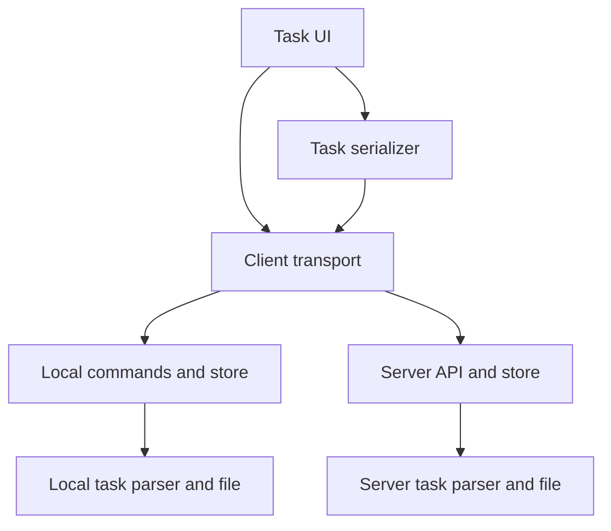

# Brooks-Lint Health Dashboard

- [Module dependency graph](#module-dependency-graph)
- [Top findings](#top-findings)
- [Recommendation](#recommendation)

**Mode:** Health Dashboard
**Scope:** Revised `tasks/21-remove-priority/2-plan.md` and affected task parsing, editing, and persistence paths; not a whole-project audit.
**Composite Score:** 97/100

| Dimension | Score | Top finding |
| --- | --- | --- |
| Code Quality | 95/100 | New descriptions can collide with legacy token syntax. |
| Architecture | 100/100 | No additional finding in the inspected plan boundary. |
| Tech Debt | 95/100 | Repeated `pri:` preservation lacks an editing rule. |
| Test Quality | 95/100 | The regression matrix omits new-input syntax collisions. |

Balanced scoring assigns each finding to one dimension: 95 × 0.25 + 100 × 0.30 + 95 × 0.25 + 95 × 0.20 = 96.5, rounded half-up to 97. These scores describe this plan review only. No project configuration was found. History is not modified for this document-only review.

## Module dependency graph

## Top findings

### Warning: Newly entered text can become hidden legacy metadata

**Symptom:** `2-plan.md:20-24,28-29,52` recognizes every leading `(A)`–`(Z)` token as hidden legacy data while retaining free-text task entry. Currently `AddForm.tsx:37-42` passes the user's description to `composeText`, and both Rust parsers interpret a leading `(A)` as priority before adding a creation date.

**Source:** Domain-Driven Design — Ubiquitous Language.

**Consequence:** A user entering `(A) call` after priority removal can create a new task whose text is treated as hidden legacy data, conflicting with the no-new-priority acceptance criterion and potentially obscuring part of the intended description.

**Remedy:** Specify how new free-text input that resembles a legacy token is handled without silently hiding or discarding user text. Include add and edit cases for both backends and document any ambiguity inherent in the existing file format. Distinguish user-provided text from application-generated priority metadata.

### Warning: Repeated `pri:` tags lack a defined edit merge rule

**Symptom:** `2-plan.md:24,29,45` requires preserving repeated `pri:` tokens but does not say how they interact with changes to the description. `bareDescription` currently strips effective tags using a map, while `composeEditedTask` restores tags by key; neither represents all original occurrences faithfully.

**Source:** A Philosophy of Software Design — Information Leakage.

**Consequence:** A save could duplicate old tokens, discard earlier values, or restore a value the user intentionally changed. Different implementations could satisfy the broad preservation wording while producing different results.

**Remedy:** Define whether `pri:` tokens are editable text or hidden unmanaged metadata. Specify how original occurrences, ordering, and explicitly submitted changes are merged, including duplicate identical tokens and distinct values. Test unchanged and changed descriptions against both backends and older server responses.

### Warning: Tests do not cover newly created ambiguous lines

**Symptom:** `2-plan.md:43-46` covers existing legacy lines and malformed boundaries but does not explicitly include adding or editing descriptions beginning with valid priority-shaped tokens, or verify their visible text after save and reload.

**Source:** How Google Tests Software — Change Coverage.

**Consequence:** Existing-data preservation tests can pass while the new task flow silently hides user-entered text.

**Remedy:** Add behavior-level cases for `(A) call`, `(A)` alone, malformed lookalikes, and priority-shaped text inside a description. Verify displayed and editable text and persisted data after add, edit, completion, and reload for the selected policy.

The previous review's main findings are substantially addressed: the revised plan identifies `raw` as the token source, defines a mixed-version limitation, rejects legacy filters, and adds persistence tests. The remaining findings above concern new-input ambiguity and the exact repeated-tag edit contract. No tests were run for this document-only review.

## Recommendation

Clarify the new-input and repeated-tag policies before implementation. The existing file format makes valid priority-shaped leading text ambiguous, so choose and test an explicit user-visible behavior rather than relying on parser defaults.
