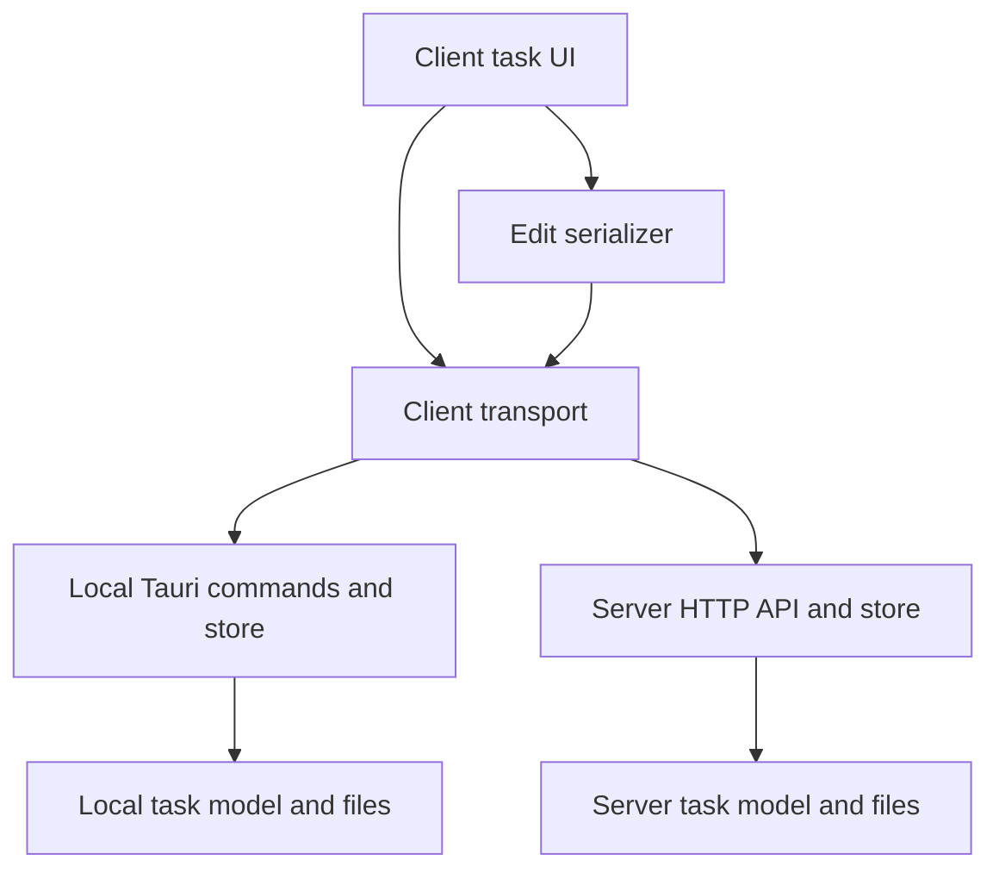

# Brooks-Lint Health Dashboard

- [Module dependency graph](#module-dependency-graph)
- [Top findings](#top-findings)
- [Recommendation](#recommendation)

**Mode:** Health Dashboard
**Scope:** `tasks/21-remove-priority/2-plan.md`, checked against affected client and server paths; this is a plan review, not a whole-project audit.
**Composite Score:** 94/100

| Dimension | Score | Top finding |
| --- | --- | --- |
| Code Quality | 90/100 | Legacy token source and mixed-version lifecycle behavior are unspecified. |
| Architecture | 95/100 | The plan leaves the edit transport boundary unresolved. |
| Tech Debt | 95/100 | Removing the query field alone can silently ignore the old filter. |
| Test Quality | 95/100 | Preservation tests do not specify end-to-end persisted outcomes. |

Scores use balanced deductions for the five plan findings below, assigned to one dimension each. The weighted result is 93.75, rounded to 94. They measure review coverage of this plan, not the health of the entire codebase. No `.brooks-lint.yaml` was found. History was not modified because this task requests only a plan review.

## Module dependency graph

## Top findings

### Warning: Legacy tokens have no defined edit path

**Symptom:** `2-plan.md:21-29` requires preserving leading tokens during edits while removing the priority DTO field, but does not specify how the serializer obtains the token. Both DTOs currently put the parsed token in `priority`, omit it from `description`, and expose it in `raw`; `app/src/labels.ts:58-98` rebuilds the whole line without reading `raw`.

**Source:** A Philosophy of Software Design — Information Leakage.

**Consequence:** An otherwise valid edit can discard a legacy token, especially with an older server that still strips it from the description.

**Remedy:** Define one explicit compatibility representation and extraction rule across old and new DTOs, with placement before dates for active and completed lines. Specify how hidden tokens survive edits without appearing as a priority control, and test actual edit/save/reload behavior.

### Warning: Mixed-version lifecycle behavior conflicts with preservation

**Symptom:** `2-plan.md:20-22,29,35` requires completion and reopening not to move or create legacy tokens and also asks for compatibility with older servers. The current `server/src/task.rs:98-155` converts leading priority to `pri:X` on completion and restores it on reopening.

**Source:** Software Engineering at Google — Backward compatibility.

**Consequence:** A new client connected to an older server cannot meet the stated lifecycle guarantee merely by ignoring extra response fields.

**Remedy:** Define supported version combinations and choose whether to detect and block unsafe actions, require a coordinated server upgrade, or explicitly narrow the guarantee. Add mixed-version completion and reopening tests for the chosen policy.

### Warning: The compatibility boundary is underspecified

**Symptom:** `2-plan.md:21,27,33-35` distributes legacy parsing between two Rust models and a TypeScript serializer without defining which representation is authoritative when `raw`, parsed dates, and description disagree.

**Source:** Clean Architecture — Interface Segregation.

**Consequence:** Local and server behavior can diverge, and future edits can confuse legacy syntax with task description or dates.

**Remedy:** Define the representation and ownership at the task DTO/serializer boundary, including exact token position and behavior for missing, malformed, or inconsistent input. Use the same explicit examples against both backends.

### Warning: Removed filters can return misleading results

**Symptom:** `2-plan.md:34` says to remove the query definition and reject a legacy filter only if the interface permits. `server/src/api.rs:146-153,198-208` currently deserializes the priority query into `ListQuery`; removing that field without an explicit check risks accepting it as an unknown parameter.

**Source:** Code Complete — Defensive Programming.

**Consequence:** An old caller requesting a filtered list may receive every task and mistake it for the filtered result.

**Remedy:** Specify an explicit HTTP 400 for any supplied `priority` query, including empty, invalid, and repeated values, without rejecting unrelated supported filters. Decide and test the corresponding old Tauri invocation behavior separately.

### Warning: Preservation tests lack a concrete persistence matrix

**Symptom:** `2-plan.md:40` lists parse/serialize and lifecycle cases but does not require cross-layer save/reload assertions for each backend or an unrelated task mutation, even though `app/src-tauri/src/store.rs:214-246` renders the entire store on every save.

**Source:** How Google Tests Software — Change Coverage.

**Consequence:** Isolated parser and mocked transport tests could pass while a real edit or unrelated write corrupts legacy data on disk.

**Remedy:** Specify shared fixtures covering active and completed legacy tokens, dates and `pri:` text. Assert persisted and reloaded lines after edit, complete, reopen, and mutation of a different task through real local and HTTP paths, including new-client/old-server cases under the chosen compatibility policy.

The inspected test inventory includes 33 frontend test files and two server integration test files; Rust inline unit tests also exist. Test counts are file counts, not executed test results. No tests were run for this document-only review.

## Recommendation

Revise the plan before implementation: define the legacy-data transport contract and mixed-version policy first, then specify concrete filter errors and persisted-data regression cases. The proposed non-destructive approach is appropriate, but its current boundary details do not yet guarantee preservation.
