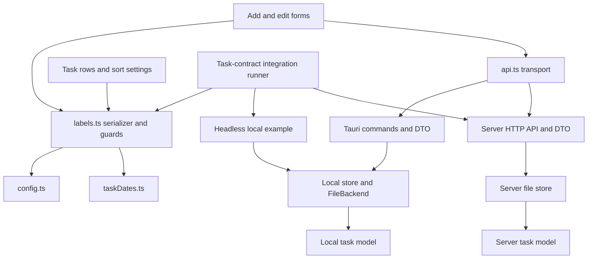

# Brooks-Lint Health Dashboard

- [Brooks-Lint Health Dashboard](#brooks-lint-health-dashboard)
- [Scope and scores](#scope-and-scores)
- [Module Dependency Graph](#module-dependency-graph)
- [Test Suite Map](#test-suite-map)
- [Top Findings](#top-findings)
  - [Warning F1: Validate the final serialized task, not only the submitted prefix](#warning-f1-validate-the-final-serialized-task-not-only-the-submitted-prefix)
  - [Warning F2: Existing unambiguous descriptions cannot be edited unchanged](#warning-f2-existing-unambiguous-descriptions-cannot-be-edited-unchanged)
  - [Warning F3: The new add-contract coverage bypasses actual creation](#warning-f3-the-new-add-contract-coverage-bypasses-actual-creation)
- [Verification](#verification)
- [Recommendation](#recommendation)

## Scope and scores

**Mode:** Health Dashboard

**Scope:** All changes on `21-remove-priority` relative to `main`: parent `6e662c7..f5db087` (4 changed paths), app `0f634d3..4f4f871` (34 files), and server `55ded61..9a635f1` (16 files). Submodule changes were reviewed against the parent base's pinned commits, not merely as pointer updates. This is a branch review, not a whole-project audit.

**Composite Score:** 97/100

**Trend:** 100 → 97 (−3) versus the previous recorded Health Dashboard. That record concerns task 20, so the scopes differ; this is not evidence of a whole-project quality decline.

- **Code Quality: 95/100.** F2: a new guard breaks otherwise safe existing edits.
- **Architecture: 100/100.** No new layering violation or dependency cycle found in the reviewed modules.
- **Tech Debt: 95/100.** F1: text serialization does not enforce the new hidden-data invariant at its boundary.
- **Test Quality: 95/100.** F3: add scenarios avoid the actual create contract and miss semantic reinterpretation.

No `.brooks-lint.yaml` was found. Balanced scoring deducts five points for each warning in its assigned dimension, counting each finding once. Weighted score: `95×0.25 + 100×0.30 + 95×0.25 + 95×0.20 = 96.5`, rounded half-up to 97. The score describes the abbreviated scans, not merge approval.

## Module Dependency Graph

The frontend serializer remains independent of transport implementation; configuration's task import is type-only. Rust task models do not depend on stores or UI frameworks. Matching local/server models are an existing explicitly accepted duplication boundary, and this change keeps their implementations aligned. Coordinated priority removal across these intentional interfaces is not itself Shotgun Surgery. Compatibility-only Tauri input and explicit HTTP rejection are intentional boundary policies, not speculative abstractions.

## Test Suite Map

- Frontend: 33 Vitest files, comprising 15 `.test.ts` files and 18 `.test.tsx` files; 501 tests passed. These include pure helpers, transport mocks, and jsdom component behavior, not native desktop/Android E2E tests.
- Local Rust: 60 registered unit tests; 59 passed and one existing real-server restart test was ignored by default during this review.
- Server Rust: 25 unit tests and 15 router integration tests across two files, all passed.
- New contract runner: one standalone matrix exercising local storage, new HTTP server, and optional old HTTP server with the real client serializer. All three modes passed when rerun with the existing old-server binary.
- The runner provides useful persistence and lifecycle checks beyond mocks. F3 concerns its specific create-path gap, not the use of integration tests or justified duplicate fixtures across independent backends. Unchanged release-tool Python suites were outside this review's test reruns.

## Top Findings

### Warning F1: Validate the final serialized task, not only the submitted prefix

**Dimension/risk:** Tech Debt, R6 — Domain Model Distortion.

**Symptom:** `app/src/labels.ts:47-49` checks only whether the original description begins with `(A)`–`(Z)`. `composeEditedTask` calls that guard at line 78, then removes `due:` and `updated:` tokens at lines 84-85 without validating the resulting line. For an existing undated active task `call`, submitting `due:later (A) call` or `updated:old (A) call` succeeds and serializes `(A) call updated:2026-10-30`. Both backends reload this with description `call updated:2026-10-30`; the submitted `(A)` has become hidden legacy data despite not existing in the original raw prefix. Separately, `composeText` accepts `x (A) call` and `x (A)`: actual HTTP creation with default date stamping returns completed tasks with descriptions `call` and an empty string, respectively. The completion marker exposes the token to the backend parser at `server/src/task.rs:42-50` and `app/src-tauri/src/task.rs:45-53`.

**Source:** Domain-Driven Design — Aggregate Roots and invariant ownership; Code Complete — defensive programming at input/output boundaries.

**Consequence:** Ordinary submitted text silently changes into hidden metadata, and add/edit can change completion state instead of preserving description text. The raw token survives, but users lose its visible/editable representation because the dedicated priority UI is gone. This defeats the new no-generation and embedded-text preservation contract in `2-plan.md:20,23,26,48`. The old raw-string ambiguity predates this branch, but it is not safely closed by the new guard or the new hidden-data policy.

**Remedy:** Check the final normalized serialization against the intended completion state, lifecycle dates, description, and only the legacy token recovered from the original raw line. Define and handle completion-prefixed add input as well as tokens exposed by managed-field removal. Reject unsafe reconstructions visibly with form state intact unless a lossless representation is available; do not allow the save parser to invent a legacy prefix. Add real create/edit/save/reload regressions for the reproduced cases in both local and HTTP modes.

### Warning F2: Existing unambiguous descriptions cannot be edited unchanged

**Dimension/risk:** Code Quality, R2 — Change Propagation through backward incompatibility.

**Symptom:** `app/src/labels.ts:77-83` rejects the visible description before considering the existing parsed dates or raw structure. Both `2026-06-01 (A) call` and `x 2026-06-02 2026-06-01 (A) call` have valid description `(A) call`; their dates make the position unambiguous. Changing only the due date still throws the reserved-token error. `app/scripts/test-task-contract.mjs:85-91` explicitly asserts this rejection, and `app/docs/task-text.md:22` documents it. This is the unresolved warning from `3-plan-review.md:35-53`, not an undocumented implementation deviation from the written guard policy.

**Source:** Software Engineering at Google — Backward compatibility and Hyrum's Law.

**Consequence:** Removing priority blocks previously valid edits to unrelated fields and forces users to rewrite existing task text. Documentation and no-write behavior avoid silent corruption but do not preserve the prior editing capability. The broader restriction is unnecessary for these dated fixtures, because retaining the existing dates preserves their description interpretation.

**Remedy:** Revise the plan policy and guard together to distinguish newly ambiguous input from an unchanged existing description whose full serialized line remains safe. Verify raw state first and validate the reconstructed line rather than rejecting solely on the editable substring. Preserve both dated examples through due/project-only edits and reload; continue rejecting truly ambiguous undated submissions. Review lifecycle transitions separately where removing the only completion date could expose a token.

### Warning F3: The new add-contract coverage bypasses actual creation

**Dimension/risk:** Test Quality, T5 — Coverage Illusion.

**Symptom:** The runner's description cases at `app/scripts/test-task-contract.mjs:65-70` call `composeText`, then persist through `run("raw", text)` instead of add/create. Its only `run("add", ...)` call at line 56 creates an unrelated plain task. The HTTP helper at lines 132-139 subsequently returns the first existing task rather than the newly created task. The local bridge's add command at `app/src-tauri/examples/task_contract.rs:29-30` always disables creation-date stamping, and the runner disables it on HTTP servers at script line 115. Component add tests mock `onAdd`, so they cannot observe the stored description or completion state. No fixture composes completion-marker prefixes or exposes a priority-shaped token by removing a managed field.

**Source:** How Google Tests Software — Change Coverage; The Art of Unit Testing — completeness of boundary-path tests.

**Consequence:** The new suites can all pass while add input is stored as a different task state or visible text becomes hidden metadata, as demonstrated by F1. The assertions prove serializer/raw persistence for selected fixtures, not the planned complete create/save/reload behavior under real default settings.

**Remedy:** Add an actual create operation that returns the newly created task, leaving the unrelated-write helper separate. Test default creation-date stamping and disabled stamping, assert completion state and full visible description after creation and reload, and include normalization/marker interactions. Keep the existing raw-import and old-server lifecycle tests because they protect different boundaries.

## Verification

- Reran `npm test` and `npm run build` in `app`: all 501 tests and the production build passed. Expected stderr from intentional existing failure-path tests remains.
- Reran `cargo test --locked` in `app/src-tauri`: 59 passed, one ignored by default. Reran the same command in `server`: all 40 tests passed.
- Reran `TMPDIR=/tmp/opencode OLD_NTR_SERVER_BIN=/tmp/opencode/ntr-21-old-server-bin npm run test:task-contract`: local, new-server, and old-server modes passed. The old binary was reused from implementation verification, not rebuilt in this review.
- Bundled the actual committed serializer into a generated directory under `/tmp/opencode` and exercised the real local-store bridge. Confirmed F1's accepted inputs become hidden legacy tokens and/or completed tasks; confirmed F2's due-only edits are rejected. Temporary generated files were removed afterward.
- Separately started the committed new server on an ephemeral loopback port with isolated temporary files. Actual `POST /api/tasks` calls with default creation stamping reproduced both `x (A)` cases. Actual `PUT /api/tasks/{id}` calls plus GET and on-disk readback reproduced both managed-field-removal cases. No production service or user task file was touched.
- No fixes were applied. Optional app Clippy was not rerun; the compiler crashes recorded in `4-implemented.md` are not treated as code findings or as passing verification. Native UI interaction, Android execution, publication, and deployment were not tested.

## Recommendation

Request changes before merge. Close the final-serialization invariant gap first, add genuine create-path coverage, and resolve the already-reviewed existing-description restriction through an explicit policy revision. The compatibility-only boundary removal, legacy lifecycle preservation, and layering are otherwise coherent in the inspected scope. A focused follow-up on the task text boundary is more useful than a whole-project refactor. This stage changes only this report and the required review-history record; implementation and task plans remain unchanged.
