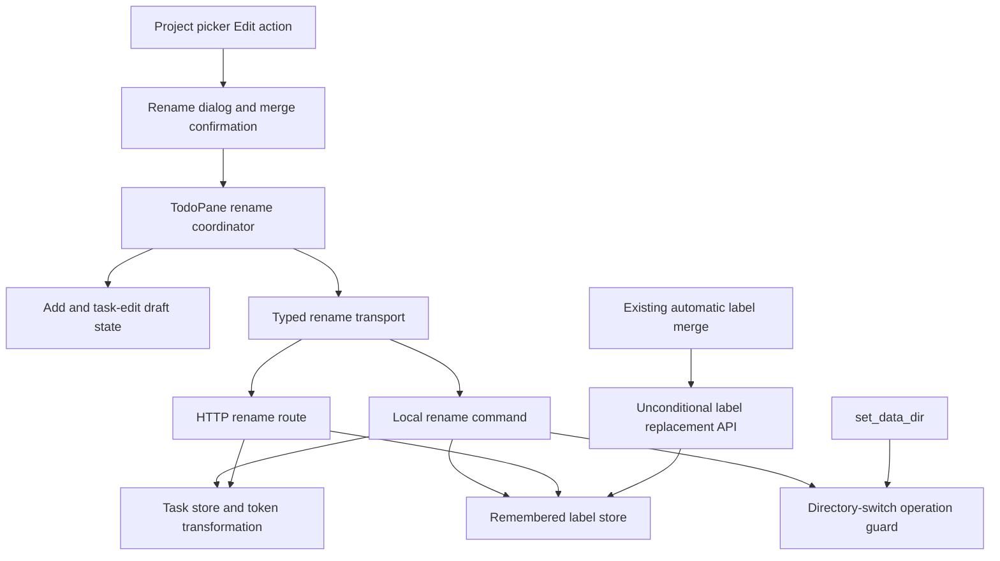

# Brooks-Lint Health Dashboard

- [Brooks-Lint Health Dashboard](#brooks-lint-health-dashboard)
- [Scope and scores](#scope-and-scores)
- [Module Dependency Graph](#module-dependency-graph)
- [Test Suite Map](#test-suite-map)
- [Top Findings](#top-findings)
  - [Warning F1: Convergence does not establish that remembered labels were repaired](#warning-f1-convergence-does-not-establish-that-remembered-labels-were-repaired)
  - [Warning F2: Another client's stale label replacement can undo a rename](#warning-f2-another-clients-stale-label-replacement-can-undo-a-rename)
  - [Warning F3: Draft coverage omits project tokens inside editable text](#warning-f3-draft-coverage-omits-project-tokens-inside-editable-text)
- [Inspection and limits](#inspection-and-limits)
- [Recommendation](#recommendation)

## Scope and scores

**Mode:** Health Dashboard

**Scope:** `tasks/22-edit-projects/2-plan.md` at `e41d263`, checked against the current project picker, task serializer, label writers, backend stores, and local directory-switch boundaries. Scores concern the proposed plan, not implemented feature quality or the entire project. The unrelated working-tree change to `todo.md` is excluded.

**Composite Score:** 97/100

**Trend:** Stable at 97 compared with the previous recorded Health Dashboard. That record reviewed task 21 implementation; different scopes mean the scores are not a measured implementation trend.

- **Code Quality: 100/100.** No additional R1/R2 finding in the proposed UI/transport change structure.
- **Architecture: 100/100.** The proposed backend coordinator and pure token transformation preserve layering; no proposed dependency cycle was found.
- **Tech Debt: 90/100.** Two warnings concern incomplete state and writer-ownership contracts across the task and label resources.
- **Test Quality: 95/100.** The draft-state matrix omits an existing second representation of project references.

No `.brooks-lint.yaml` was found. Balanced scoring assigns F1 and F2 to Tech Debt and F3 to Test Quality, counting each warning once. The weighted score is `100×0.25 + 100×0.30 + 90×0.25 + 95×0.20 = 96.5`, rounded half-up to 97. Each dimension remains within the abbreviated scan caps; the score is not implementation approval.

## Module Dependency Graph

Task and label stores above represent their separate local/server implementations, not a proposed shared runtime dependency. Keeping domain token replacement out of the form serializer is appropriate. Existing accepted local/server duplication is not itself a new defect. Bulk task writes and honest two-file partial-state reporting are justified by present requirements; avoiding a general transaction system is also reasonable. F2 concerns the alternative label writer's consistency contract, not an import-layer violation.

## Test Suite Map

The existing frontend has 15 `.test.ts` and 18 `.test.tsx` files covering pure helpers, mocked transport, and jsdom interactions. Relevant Rust coverage resides in the task/store/label-store modules and server router integration tests; the existing task-contract runner provides a headless local-store and real HTTP seam. These are available test layers, not evidence that project rename is implemented or verified.

The plan appropriately calls for equivalent local/server fixtures, actual command/HTTP persistence checks, write-failure injection, collision handling, directory coordination, deferred dialog-close tests, and stale-response tests. F1/F2 need concrete state schedules added to those planned tests. F3 identifies an additional input representation absent from the draft scenarios. No native desktop/Android E2E claim or test-count ratio requirement is inferred from the plan.

## Top Findings

### Warning F1: Convergence does not establish that remembered labels were repaired

**Dimension/risk:** Tech Debt, R6 — Domain Model Distortion at the cross-resource invariant boundary.

**Symptom:** `2-plan.md:27-28` defines project existence using the union of remembered and derived names, then calls an absent source plus present destination converged state. Lines 43 and 46-47 require adding the destination to remembered labels and recovering after the task commit but label-write failure, without defining a distinct readback postcondition or source-missing retry rule for that case. Consider a derived-only `+work`, no remembered `work` or `office`, and a rename to `office`: the task write succeeds, the label write fails, and the mutation response is lost. Readback now has no `work` and a derived `office`, satisfying the stated convergence check even though the remembered destination was never saved.

**Source:** Domain-Driven Design — Aggregate Roots and invariant ownership; Code Complete — explicit error-state handling.

**Consequence:** An implementation can close the dialog as converged while leaving the required remembered-project update undone. If the renamed tasks are later deleted, the project disappears from saved choices. Alternatively, source/collision validation can prevent completion because no source remains in either store. This is a gap in the proposed recovery contract, not a demand for crash-atomic multi-file storage.

**Remedy:** Define completion separately for both resources: no remaining source references in tasks or remembered names, and the destination actually present in the remembered project list, not merely in the derived union. Specify source-absent/destination-derived retry behavior, collision approval, and a label-only finishing path after authoritative readback; never replay task changes solely to repair labels. Add derived-only fixtures with task commit, label failure, lost response, reload/restart, explicit repair, and subsequent task deletion to prove the destination remains remembered. State what counts as satisfied versus actually written in the result payload.

### Warning F2: Another client's stale label replacement can undo a rename

**Dimension/risk:** Tech Debt, R6 — Invariant ownership bypassed by an alternative write path.

**Symptom:** `2-plan.md:45,56,73` relies on store locking and coordinating automatic label reads/writes to prevent the old name returning. The existing `TodoPane.tsx:105-147` performs a read/derive/union/PUT sequence, and `app/src/api.ts:255-262`, `server/src/api.rs:318-324`, and `server/src/labelstore.rs:33-38` accept whole-label replacement without a revision precondition. Client B can capture labels containing `work`; client A then successfully renames `work` to `office`; B's already prepared PUT can acquire the same server label lock afterward and restore the old list. This needs neither an external editor nor a stale task edit. The plan's last-write-wins exception at line 83 mentions old clients and other clients' task drafts but does not define this same-version automatic-label-write case.

**Source:** Domain-Driven Design — Aggregate Roots and invariant ownership; The Pragmatic Programmer — Orthogonality.

**Consequence:** Local generation invalidation or draining client A's requests cannot prevent client B's delayed replacement. The old remembered project can reappear, and a remembered-only destination can disappear despite a successful rename. Two resource locks serialize requests but cannot determine whether a later replacement was based on stale data, so the acceptance guarantee is not actionable across the existing writer paths.

**Remedy:** Choose a narrow, explicit label-writer policy before implementation: for example, revision-checked replacements with refresh/recompute on conflict, or an authoritative backend update path that removes the stale client union/replacement behavior. Define compatibility for unversioned writers separately rather than implying locks protect them. If protection is intentionally limited to the initiating client, narrow the acceptance criteria and documentation accordingly. Add a controlled two-client test that holds B's old label PUT, completes A's rename, then releases B's request and checks both task and remembered-label state. This does not require general task conflict resolution or a distributed transaction.

### Warning F3: Draft coverage omits project tokens inside editable text

**Dimension/risk:** Test Quality, T5 — Coverage Illusion through an incomplete representation matrix.

**Symptom:** `2-plan.md:55,64,73` remaps selected/staged project names and hidden extra references while preserving unfinished description input, but does not define or test matching project tokens typed directly into that input. `AddForm.tsx:21-26,43` keeps description and project selection separately, and `labels.ts:21-26` appends the selected project without removing projects already in the description. For a pending description `call +work` and selected project `work`, remapping only the selection to `office` leaves a later add serialized as `call +work +office`. A user can also type a project token into an open task edit even though initial project tokens are hidden by that editor.

**Source:** How Google Tests Software — Change Coverage; The Art of Unit Testing — completeness of boundary-path tests.

**Consequence:** Selection-only tests can pass while a pending draft in the initiating client immediately recreates the old project after a successful rename. This is distinct from the explicitly excluded stale draft on another client and from clearing unrelated description text; `+work` is itself the related project reference.

**Remedy:** Specify whether an approved local rename rewrites exact source-project tokens in pending draft descriptions or visibly blocks their submission until the user resolves the stale reference. Preserve unrelated prose, whitespace where required, URL/email substrings, and similarly named projects. Add regular/compact AddForm and task-edit cases with source tokens in editable text, selected and unselected sources, duplicate tokens, and cancellation. Submit the preserved draft through a real local/HTTP save path and assert the old project is not unintentionally recreated.

## Inspection and limits

Read the latest goal and plan, project picker/dialog components, draft initialization and submission, serializer token composition, automatic label merging, transport boundaries, label-store replacement, and local directory movement/rollback paths. Findings are static plan risks supported by those current interfaces, not claims about code that has not been written.

No implementation, test, task-plan, README, or user `todo.md` file was modified. No tests, native-device checks, backend mutations, publication, or remote pushes were performed for this review. Only this review and the required health-history record are committed.

## Recommendation

Revise the plan before implementation. First define per-resource convergence and derived-only partial recovery, then settle stale label-writer ownership, and add the inline-draft reference policy and tests. Retain the proposed pure token transformation, one-save bulk task update, explicit merge approval, and honest two-file failure semantics. A focused follow-up on the rename/label consistency boundary is sufficient; a whole-project refactor is unnecessary.
