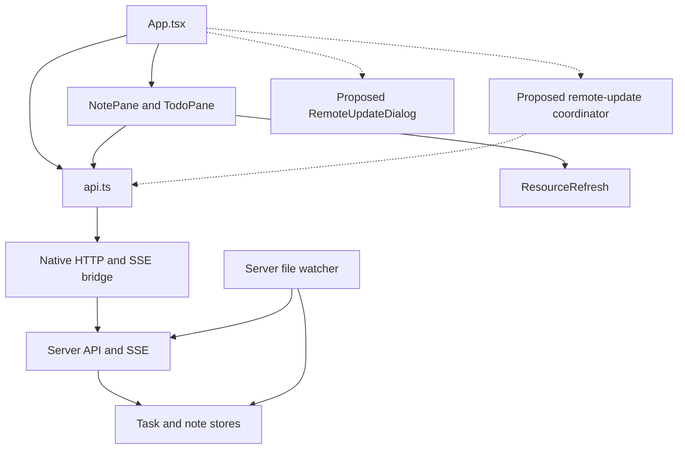

# Brooks-Lint Health Dashboard

- [Dashboard](#dashboard)
- [Module Dependency Graph](#module-dependency-graph)
- [Top Findings](#top-findings)
  - [Warning](#warning)
- [Verification scope](#verification-scope)
- [Recommendation](#recommendation)

## Dashboard

**Mode:** Health Dashboard

**Scope:** `tasks/23-live-update-notifications/2-plan.md` at `30f85b8`, checked against `1-goal.md` and the current client/server implementation. This is a plan review, not an implementation health assessment.

**Composite Score:** 95/100. Balanced deductions; four warnings, no critical findings. No `.brooks-lint.yaml` was found in the project root.

**Trend:** Previous Health Dashboard score 97; current score 95, a decrease of 2. Different task scopes make this unsuitable as evidence of codebase deterioration.

- Code Quality: 95/100, weight 0.25. Settings lifecycle exceptions remain contradictory.
- Architecture: 95/100, weight 0.30. Snapshot ownership and mutation ordering need an explicit contract.
- Tech Debt: 95/100, weight 0.25. Declined updates lack a reachable reconsideration action.
- Test Quality: 95/100, weight 0.20. Origin-filtered stream overflow needs a recovery regression.

The plan correctly separates notification from adoption and protects drafts, but it needs the following clarifications before implementation.

## Module Dependency Graph

Arrows mean “calls or depends on.” Dashed arrows describe proposed interfaces; this graph is not a claim that those modules already exist.

No dependency cycle is demonstrated. The proposed coordinator should own approval policy; panes should own rendering and drafts. Server/native origin metadata is justified by the actual self-notification requirement, not speculative generality.

## Top Findings

### Warning

**F1 — R2, Code Quality: unchanged settings can still invoke write-through reconciliation.**

Symptom: The plan preserves startup/server-local reconciliation in Scope and Risks, while step 5 requires unchanged settings not to accept declined updates. Currently `app/src/App.tsx:49-60` runs reconciliation for every `connectionKey`, and `onSettingsClose` at lines 103-111 unconditionally changes that key, activates transport, and refreshes panes. `app/src/api.ts:389-410` can automatically write local or server content under the configured strategy. Auditing pane refreshes alone does not remove this separate write path.

Source: *The Pragmatic Programmer* — Orthogonality; *Software Engineering at Google* — observable behavior as a compatibility contract.

Consequence: Closing unchanged settings can reset declined state, adopt remote content, or push an old local backup to the server without the runtime update choice. Keeping both instructions leaves the implementation outcome dependent on which path is updated.

Remedy: Define a destination identity separately from subscription/certificate generations. Explicitly restrict startup reconciliation to first initialization and genuine destination changes; unchanged settings and same-destination reconnections must retain approval state and perform detection only. Add unchanged-settings tests under all three conflict strategies, asserting both visible content and absence of local/server writes.

**F2 — R3, Architecture: two accepted baselines have no atomic ownership or ordering contract.**

Symptom: Step 1 assigns accepted snapshots to the coordinator; step 4 shares the note pane's existing accepted baseline; step 5 introduces a task pane accepted snapshot. Step 2 advances accepted content on successful local writes, but the plan specifies request/transport generations without specifying how local mutations invalidate earlier detection reads. Existing note code already has `savedNote`, `baselineRevision`, and edit/save provenance with their own lifetimes.

Source: *A Philosophy of Software Design* — Information Hiding and Leakage; *The Pragmatic Programmer* — DRY, applied to decisions rather than copied lines.

Consequence: A GET can capture version A, a local write can commit version B, and that earlier GET can then resolve against the new baseline. The client may incorrectly prompt about A as a remote change despite origin filtering. Separately updated pane and coordinator baselines can clear a pending prompt or authorize the wrong snapshot.

Remedy: Specify one authoritative accepted-snapshot owner and explicit pane application acknowledgments. Add a per-resource local mutation epoch alongside read and transport generations; stale detection results must be rejected or retried after mutation settlement. Define when pending evidence may be cleared and how failed/uncertain writes affect that decision. Test a deferred GET resolving after a successful local write, plus an intervening foreign write, without duplicating note save-ownership policy in the coordinator.

**F3 — R6, Tech Debt: declining has no defined path back to the same update.**

Symptom: Steps 1 and 3 suppress identical declined snapshots indefinitely. Step 4 retains the note save guard after decline, while step 5 can require an update before stale task actions. No persistent update indicator or explicit action is specified to reopen a dismissed snapshot. “A later local save must obtain a choice” does not explain how a clean note or blocked task action reopens the suppressed update.

Source: *Domain-Driven Design* — Ubiquitous Language and lifecycle modeling; *Code Complete* — explicit state and error-path design.

Consequence: `Not now` can mean “cannot update this version again” until another remote edit or restart. Tasks may remain blocked, and subsequent note edits may remain unsaved without an obvious recovery action. This is a user-visible dead end rather than merely missing UI polish.

Remedy: Retain an accessible pending-update indicator with a `Review update` action after dismissal. Suppress unsolicited repeat prompts, not user-requested reconsideration. Define idle, offered, deferred, applying, and resolved transitions, including how task actions and save attempts lead back to review. Test decline followed by explicit acceptance of the identical snapshot with no new SSE event, plus note-save and stale-task action recovery.

**F4 — T5, Test Quality: filtered self-events can leave a lost foreign update undetected after broadcast overflow.**

Symptom: Step 2 introduces server-side origin filtering, while step 6 covers concurrent clients but not lagged subscribers. The current channel capacity is 16 in `server/src/api.rs`, and `/api/events` at lines 337-345 silently continues on `RecvError::Lagged`. Recovery currently depends on a later delivered resource event or reconnect. A lagged foreign event followed only by retained self-events can now produce neither: the retained events are filtered and keep-alives preserve the connection.

Source: *How Google Tests Software* — change coverage rather than line coverage; *The Art of Unit Testing* — completeness of edge-path tests.

Consequence: A real foreign task or note change can remain unannounced indefinitely, even with both clients connected and all ordinary origin-header tests passing. Preserving SSE retry behavior alone does not address this live-but-lagged connection.

Remedy: Specify a rescan path on broadcast lag that bypasses origin filtering. For example, emit both existing resource tokens on lag so updated clients detect content without applying it; document the compatibility effect for legacy clients. Add a deterministic stalled-subscriber test with more than 16 changes, a dropped foreign change, and retained self-originated changes. Assert eventual notification and unchanged panes until approval, without relying on another mutation or forced network failure.

## Verification scope

- Reviewed all four dimensions against the plan and relevant implementation paths. Findings describe plan gaps, not implemented defects in task 23.
- Existing test map: 33 client test files across libraries and React components, two Rust server integration test files, and native HTTP/SSE tests in `app/src-tauri/src/http_tests.rs` plus inline parser tests. Counts are files, not test cases. The server also has Python release tests outside this feature's scope.
- Sampled `app/src/liveSync.test.tsx`, which exercises real panes with mocked Tauri transport; its current automatic-reconnect adoption expectation needs intentional replacement. Server integration tests and native transport tests cover different seams; manual two-client verification remains complementary.
- No tests or builds were run. No claims are made about runtime correctness, suite performance, or the complete codebase's test quality.
- The current plan's side-effect assertions, transport ownership checks, retained draft regressions, and backward-compatible SSE strings are appropriate. Cross-layer changes are not penalized merely for spanning multiple files.
- `1-goal.md` and `2-plan.md` remain unchanged. No implementation code was modified.

## Recommendation

Revise the plan before implementation. First separate unchanged-settings activation from startup reconciliation, then define one snapshot authority and mutation ordering. Add a reachable deferred-update action and lag-recovery coverage. Preserve the plan's existing draft protections and read-only decline semantics; these findings do not require collaborative editing, persistent revisions, or a general-purpose sync framework.
