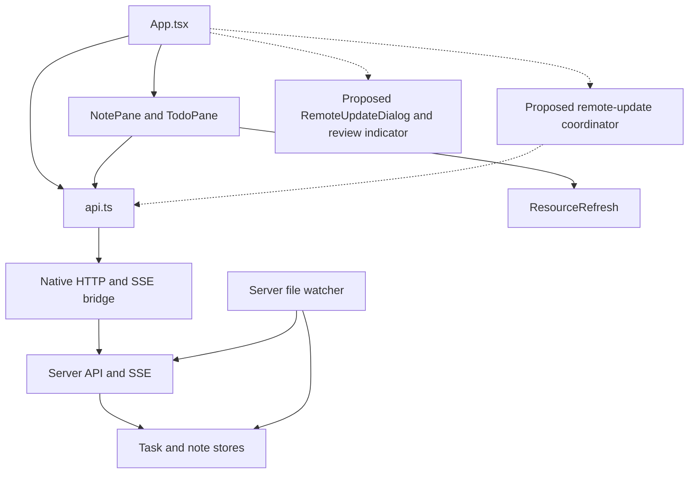

# Brooks-Lint Health Dashboard

- [Dashboard](#dashboard)
- [Module Dependency Graph](#module-dependency-graph)
- [Top Findings](#top-findings)
- [Previous findings](#previous-findings)
- [Verification scope](#verification-scope)
- [Recommendation](#recommendation)

## Dashboard

**Mode:** Health Dashboard

**Scope:** Revised `tasks/23-live-update-notifications/2-plan.md` at `515f3c1`, checked against `1-goal.md`, the preceding review, and the relevant current client/server paths. This score measures the plan, not implementation health or runtime correctness.

**Composite Score:** 100/100. Balanced scoring; no unresolved findings. No `.brooks-lint.yaml` was found in the project root.

**Trend:** 95 → 100 (+5) for the same task's plan review. The four previous warnings are addressed in the revised plan; implementation has not yet been verified.

- Code Quality: 100/100, weight 0.25. Destination changes and same-destination reconfiguration now have distinct lifecycle rules.
- Architecture: 100/100, weight 0.30. One coordinator owns approval snapshots; pane acknowledgments and mutation epochs define ordering.
- Tech Debt: 100/100, weight 0.25. Deferred updates remain actionable without another event or restart.
- Test Quality: 100/100, weight 0.20. The revised test plan covers the previously missing settings, ordering, reconsideration, and lag paths.

The revised plan is ready for implementation. No additional actionable plan-level findings were identified.

## Module Dependency Graph

Arrows mean “calls or depends on.” Dashed arrows describe planned interfaces, not existing implementations. App composes policy and panes without requiring the coordinator to import React components.

The proposed dependency direction is coherent. Panes retain draft, DOM, and save-slot ownership; the coordinator owns approval policy. Origin metadata stays at transport boundaries. No new dependency cycle is required by the plan.

## Top Findings

None. All four dimensions were reviewed; no score deductions apply. This does not certify that the future implementation will satisfy the plan.

## Previous findings

- **F1, unchanged-settings reconciliation — addressed.** Step 1 explicitly separates destination identity from transport generation and limits write-through reconciliation to first initialization and genuine destination changes. Unchanged settings do not reload panes; same-destination reconfiguration retains approval state. Step 6 tests `ask`, `server`, and `local` strategies and asserts absence of local and server reconciliation writes. This addresses the current coupling between `connectionKey`, `onSettingsClose`, and `reconcileWithServer` in `app/src/App.tsx` and `app/src/api.ts`.
- **F2, snapshot ownership and mutation ordering — addressed.** Step 1 assigns accepted snapshots to one coordinator and specifies immutable application tokens, immediate validation, synchronous application acknowledgment, and resource mutation epochs at write start and settlement. Step 4 keeps the note pane's saved baseline and provenance private rather than duplicating save-slot policy. Step 6 explicitly tests deferred pre-write GET results, intervening foreign changes, uncertain writes, and invalidated application tokens. This is a local ordering contract, not an unsupported promise of server-side transactional isolation.
- **F3, declined-update dead end — addressed.** Step 3 adds a persistent accessible `Review update` action, explicit deferred/offered/applying/resolved transitions, and revalidation without another event. Steps 4 and 5 define paused-note status and blocked task-action recovery without automatically replaying stale IDs. Step 6 verifies reconsideration of identical declined snapshots, retained drafts, and read-only dismissal.
- **F4, origin-filtered broadcast lag — addressed.** Step 2 requires both existing resource tokens on `RecvError::Lagged`, bypassing origin filtering and preserving the queued second signal. Step 6 specifies a deterministic stalled receiver with a lost foreign change and more than the 16-event capacity of self-originated changes, plus client-side approval assertions. Legacy automatic refresh behavior is documented as an intentional compatibility effect.

## Verification scope

- Applied the abbreviated code-quality, architecture, debt, and test-quality checks to the revised plan. No implementation diff is part of this review; the code-quality dimension assesses the planned changes rather than claiming implemented correctness.
- Rechecked the existing task goal, the four preceding warnings, the revised acceptance criteria, and their planned regression tests. Existing implementation context includes `app/src/App.tsx`, `app/src/api.ts`, both pane components, `ResourceRefresh`, the native HTTP/SSE bridge, and server API/store/watch behavior inspected during this task's planning and preceding review.
- Existing suite map: 33 client test files spanning libraries and components; two Rust server integration test files; native HTTP/SSE tests in `app/src-tauri/src/http_tests.rs` and inline parser tests. These are file counts, not test-case counts. Python release tests are outside this feature's scope.
- The planned portfolio combines coordinator unit tests, pane/dialog integration tests, server stream tests, native header/reconnect tests, and manual two-client checks. The lag tests use controlled stream consumption rather than timing-dependent network sleeps. No test brittleness or missing seam is demonstrated by the plan itself.
- Cross-layer changes are justified by self-event attribution and approval semantics. No new operating-system notification plugin, persistent revision system, collaborative merge engine, or duplicated note save-lock mechanism is proposed.
- Older-server author attribution remains explicitly limited; last-write-wins and already-issued-write races remain documented. These are acknowledged compatibility/storage constraints, not unresolved promises of lossless collaboration.
- No tests or builds were run. The plan, goal, implementation code, and submodule pointers remain unchanged by this review. Only the review report and review history are updated.

## Recommendation

Proceed with implementation of the revised plan. Preserve the explicit ownership and lifecycle contracts rather than reducing the change to a dialog around existing reload handlers. Implementation sign-off must still verify read-only decline, safe draft handling, same-destination settings behavior, deferred-update recovery, and lag-triggered detection using the planned tests and recorded manual checks.
