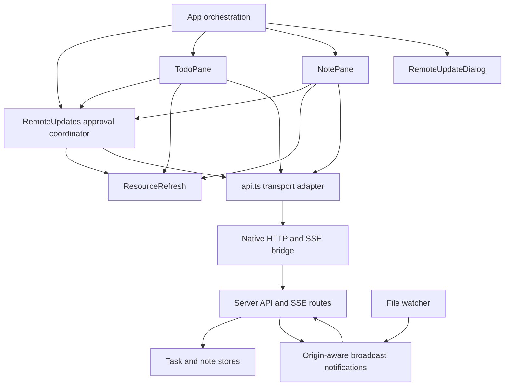

# Brooks-Lint Health Dashboard

- [Brooks-Lint Health Dashboard](#brooks-lint-health-dashboard)
  - [Scope and verdict](#scope-and-verdict)
  - [Dimension scores](#dimension-scores)
  - [Module Dependency Graph](#module-dependency-graph)
  - [Test suite map](#test-suite-map)
  - [Top Findings](#top-findings)
    - [F1: Warning — R2 Change Propagation: A mutation's own rescan interrupts bulk removal](#f1-warning--r2-change-propagation-a-mutations-own-rescan-interrupts-bulk-removal)
    - [F2: Warning — T5 Coverage Illusion: Removal tests bypass remote approval coordination](#f2-warning--t5-coverage-illusion-removal-tests-bypass-remote-approval-coordination)
  - [Verification](#verification)
  - [Recommendation](#recommendation)

## Scope and verdict

**Mode:** Health Dashboard

**Scope:** All changes on `23-live-update-notifications` relative to local `main`, using merge base `096ded860c8c3332bd382c156bf216862e1eb533` and reviewed HEAD `24ed3fb`. Expanded both Git submodule changes: `app` from `4f4f87105e982f2f831b545c0354c25f794dde97` to `cb617f864b9e478b35e9c9096abfdef6b158b447`, and `server` from `9a635f193d4e3b6c8557673537b92f0357c8610f` to `06f28ab31b34c647bca216ced7e988184665ee69`. This covers four parent paths, 26 app paths, and 12 server paths, including implementation, tests, versions, and documentation. Supporting unchanged code was read for context; inherited issues are not scored as new findings. No `.brooks-lint.yaml` was found; balanced defaults apply.

**Composite Score:** 98/100

**Trend:** 100 → 98 (−2) against the preceding Health Dashboard entry. That entry reviewed only the plan, so this is not a like-for-like implementation trend.

Request changes before merge. Remote approval has substantial regression coverage, but a reproduced scheduling interaction leaves bulk project removal partially applied. No implementation fixes were made, and `todo.md` was not changed.

## Dimension scores

- Code Quality: **95/100**. One warning: mutation settlement schedules detection that can interrupt the next step of the same bulk action.
- Architecture: **100/100**. No new dependency-direction or runtime-cycle finding was established. App orchestration connects panes, transport, and the approval coordinator; server origin metadata remains an additive SSE routing detail. The `config.ts` dependency on the `Task` type is erased at runtime and is not a runtime cycle.
- Tech Debt: **100/100**. No separate actionable R1–R6 debt finding met the evidence threshold beyond F1. The additional state machinery serves the explicit approval, save-safety, and transport requirements; size alone is not a finding.
- Test Quality: **95/100**. One warning: bulk-removal tests do not exercise the new coordinator boundary. No additional T1/T2 obscurity or brittleness finding was established.

Balanced scoring deducts five points per warning. Composite: `round-half-up(95 × 0.25 + 100 × 0.30 + 100 × 0.25 + 95 × 0.20) = 98`. F1 is charged only to Code Quality; F2 concerns a distinct test boundary, not a second implementation defect. The score is a capped review metric, not merge approval.

## Module Dependency Graph

The notification arrows describe producer/consumer data flow, not circular source imports. F1 occurs across the pane/coordinator/recovery contract, rather than through a new dependency cycle. Existing store ownership and legacy SSE resource tokens remain intact.

## Test suite map

- App: 36 Vitest files and 530 passing tests. File-level map: 16 non-React test files, 17 React component test files, and three app-level integration files (`App.test.tsx`, `liveSync.test.tsx`, and `remoteApproval.test.tsx`). These categories describe test boundaries, not a strict execution-cost pyramid.
- Native app: 60 passing tests, including loopback HTTP/SSE coverage, plus one normally ignored real-server restart integration test.
- Server: 25 unit tests and 17 HTTP integration tests across two integration files.
- Release tooling: the implementation report records 66 Python tests; this review did not rerun that suite.
- Real-device desktop/mobile UI end-to-end tests were not run. The native restart test does not exercise browser focus, modal accessibility, or actual IME input.

## Top Findings

### F1: Warning — R2 Change Propagation: A mutation's own rescan interrupts bulk removal

**Location:** `app/src/components/TodoPane.tsx:226–245,288–301`; `app/src/lib/remoteUpdates.ts:60,140–149`.

**Symptom:** Each successful task mutation calls its settlement closure, which immediately requests task detection. `blocked("tasks")` treats any pending or running detection as unsafe. `confirmRemove()` checks `safeAction()` before each task, so a slow detection triggered by the first successful update makes the second iteration return early. It clears the removal dialog state and never reaches the remaining task updates or final remembered-label deletion. A temporary diagnostic test used two `+work` tasks, successful PUT responses, and a deferred post-write detection GET without any foreign change. Expected updated IDs were `[1, 2]`; actual updated IDs were `[1]`.

**Source:** The Pragmatic Programmer — Orthogonality; A Philosophy of Software Design — Information Hiding and Leakage. A single-item mutation's recovery scheduling becomes an implicit prerequisite for a higher-level multi-step action.

**Consequence:** Normal network timing can turn “remove project” into an unexpected partial operation. Some tasks retain the project and its remembered label remains. The UI asks for remote review even though no differing remote snapshot has been established, and it does not automatically finish the requested operation after the read completes.

**Remedy:** Define an explicit bulk-operation boundary. Wait for each required validation read before continuing, or coalesce the operation's own convergence scan until an appropriate safe boundary. Preserve the rule that genuine foreign divergence stops further stale-ID writes. Surface partial progress when stopping is necessary, and never replay stale task IDs automatically after approval.

### F2: Warning — T5 Coverage Illusion: Removal tests bypass remote approval coordination

**Location:** `app/src/components/TodoPane.test.tsx:12–23,58–86`; `app/src/remoteApproval.test.tsx:117–131,232–255`.

**Symptom:** The bulk-removal tests render `<TodoPane compact={false} />` without `updates` and mock task mutation functions. That exercises the `!remote()` fast path in `safeAction()` and cannot expose the settlement → detection → busy interaction introduced on this branch. The real-pane remote-approval tests cover adds, stale actions, and retained edit drafts, but not multi-task project removal with a delayed post-write scan. The complete 530-test suite passed while the F1 diagnostic failed.

**Source:** How Google Tests Software — change coverage versus line coverage; The Art of Unit Testing — test completeness. Coverage must include the changed boundary between mutation settlement and approval coordination, not only each component in isolation.

**Consequence:** Passing removal tests give no protection against partial bulk updates caused by realistic remote-read timing. Future changes to scheduling can reintroduce the same failure without breaking either the existing removal suite or coordinator unit tests.

**Remedy:** Add a server-mode real-pane/coordinator regression with at least two affected tasks and a deferred post-mutation detection read. Verify all intended task updates and final label removal when no foreign divergence exists. Add the complementary foreign-divergence case, asserting partial-progress reporting, blocked stale-ID writes, and no automatic replay after review. Keep the existing isolated tests for local behavior.

## Verification

- `app/`: `npm test` passed, 36 files and 530 tests. Backup-failure and reconciliation warnings came from intentional failure fixtures.
- `app/`: `npm run build` passed, including TypeScript checking and Vite production build.
- `server/`: `cargo test` passed, 25 unit tests, 14 API integration tests, and three task-date integration tests.
- `server/`: `cargo clippy --all-targets` passed without warnings.
- `app/src-tauri/`: `cargo test` passed, 60 tests and one ignored restart test; `cargo clippy --all-targets` passed without warnings.
- `app/src-tauri/`: `MY_NTR_SERVER_BIN=/home/container/workdir/ntr/server/target/debug/my-ntr-server TMPDIR=/tmp/opencode cargo test two_clients_sync_and_recover_missed_files_after_real_server_restart -- --ignored` passed separately, one real-server restart test.
- Temporary F1 diagnostic: `npx vitest run src/reviewProbe.test.tsx` failed as expected with `expected [ 1 ] to deeply equal [ 1, 2 ]`. The temporary file was removed after reproduction; no regression test or implementation change is included in this review commit.
- Branch-range `git diff --check` passed for the parent and both submodules before report creation. Both submodules remained clean after verification.
- No dependency installation, deployment, publication, tag, push, or live user-data mutation was performed. Manual desktop/mobile acceptance, reverse-proxy checks, and the Python release-tooling suite remain outside this review's executed checks.

## Recommendation

Fix F1 and add the missing remote bulk-removal coverage before merging. Re-run the full app suite and production build afterward. The approval coordinator and additive server protocol otherwise have meaningful coverage for decline, reconnect, mutation epochs, draft preservation, origin filtering, and broadcast lag. For a deeper follow-up, focus a test-quality review on multi-step remote workflows rather than expanding generic coverage targets. Preserve the documented last-write-wins limitation; transactional conflict prevention was explicitly excluded from this task.
