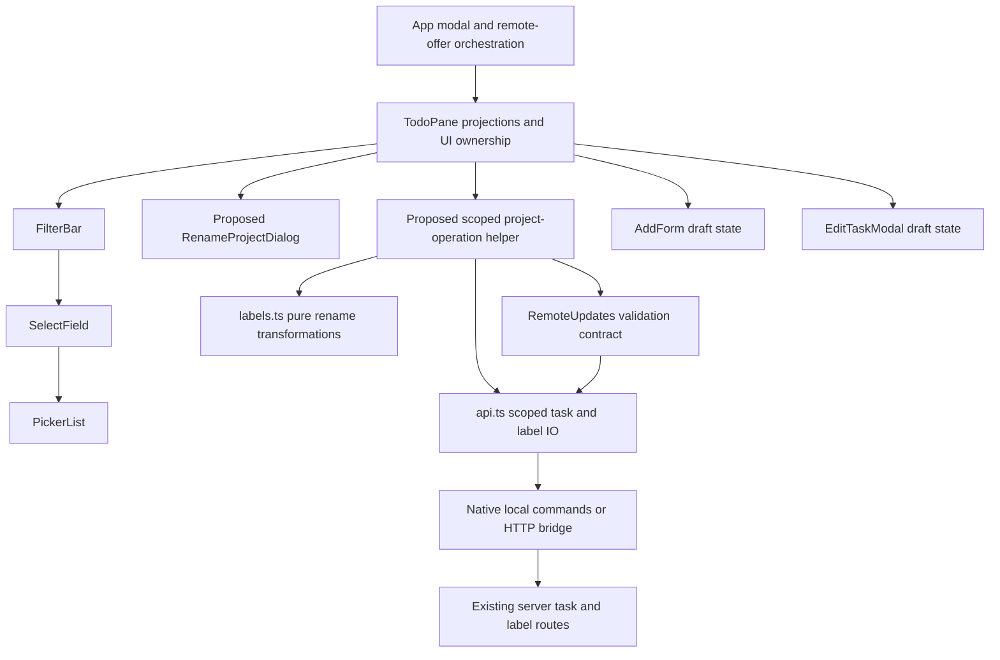

# Project name editing plan review

- [Project name editing plan review](#project-name-editing-plan-review)
  - [Scope and verdict](#scope-and-verdict)
  - [Dimension scores](#dimension-scores)
  - [Module Dependency Graph](#module-dependency-graph)
  - [Test suite map and coverage assessment](#test-suite-map-and-coverage-assessment)
  - [Top Findings](#top-findings)
    - [F1: Warning — R6 Domain Model Distortion: Collision checks do not distinguish own progress](#f1-warning--r6-domain-model-distortion-collision-checks-do-not-distinguish-own-progress)
    - [F2: Warning — R2 Change Propagation: Partial rename has no explicit remote-review handoff](#f2-warning--r2-change-propagation-partial-rename-has-no-explicit-remote-review-handoff)
  - [Verification and limits](#verification-and-limits)
  - [Recommendation](#recommendation)

## Scope and verdict

**Mode:** Health Dashboard

**Scope:** Plan-only review of `tasks/24-edit-project-names/2-plan.md` at `e5789f3`, checked against its goal and the current app's project, draft, mutation, and remote-approval boundaries. This assesses proposed design and verification readiness, not implemented feature health. No `.brooks-lint.yaml` was found; balanced defaults apply.

**Composite Score:** 98/100

**Trend:** Stable at 98 against the preceding Health Dashboard record. That record reviewed task-23 implementation, so it is not a like-for-like plan comparison.

Revise two lifecycle details before implementation: distinguish a rename's own target references from collisions, and define how a partially completed operation yields modal ownership to remote review. The rest of the plan addresses the goal, existing bulk-rescan defect, partial resource failures, draft references, transport scoping, and last-write-wins limits without claiming transactional guarantees.

## Dimension scores

- Code Quality/design readiness: **95/100**. F2 identifies a missing handoff between the proposed operation lifecycle and existing modal/approval orchestration.
- Architecture: **100/100**. The proposed pure transformations, scoped operation helper, pane projections, and existing transport adapter have appropriate boundaries. No planned import cycle or domain-to-native dependency is established.
- Tech Debt/domain readiness: **95/100**. F1 identifies an incomplete operation-owned namespace invariant that affects both normal completion and retry.
- Test Quality/verification readiness: **100/100**. The plan requests pure, component, real-pane/coordinator, partial-failure, transport, and manual checks with observable assertions. No separate T1/T2 finding is established from the proposed tests; add the concrete F1/F2 scenarios below to make their expected outcomes explicit.

Each warning deducts five points in its assigned dimension only. Composite: `round-half-up(95 × 0.25 + 100 × 0.30 + 95 × 0.25 + 100 × 0.20) = 98`. Code Quality evaluates the proposed plan change, not a production-code diff. A high capped score does not waive the two warnings.

## Module Dependency Graph

This is a proposed responsibility map, not a verified future import graph. Keep the helper independent of React components, with narrow callbacks or results for projection and progress. The shared operation boundary is justified by rename and existing removal; no generic workflow engine is needed. F2 concerns runtime ownership between these modules, not an import-direction violation.

## Test suite map and coverage assessment

- Current app inventory: 36 Vitest files, comprising 16 non-React files, 17 React component files, and three app-level integration files (`App.test.tsx`, `liveSync.test.tsx`, `remoteApproval.test.tsx`). No rename implementation or rename-specific tests exist yet.
- Relevant unit seams include `labels.test.ts`, `remoteUpdates.test.ts`, and `resourceRefresh.test.ts`. Component coverage includes pickers, modal lifecycle, forms, filters, and TodoPane. The plan appropriately adds remote bulk-operation tests using real panes and the coordinator rather than relying on isolated mutation mocks.
- Supporting native/server tests exist; server HTTP integration tests are in `server/tests/api.rs` and `server/tests/task_dates.rs`. The plan does not require a new server protocol and scopes extra backend checks to actual implementation changes.
- Planned real-device checks cover focus, keyboard/mobile handoff, and multi-client interaction. No browser/device end-to-end execution or new passing test count is claimed in this review.
- The proposed delayed-rescan removal regression directly addresses task-23's known coverage gap. Last-write-wins concurrency and labels-only notification limits are explicitly documented tradeoffs, not undisclosed defects in this plan.

## Top Findings

### F1: Warning — R6 Domain Model Distortion: Collision checks do not distinguish own progress

**Location:** `2-plan.md:26,49–53,58–60,90`.

**Symptom:** The plan rejects any target present in task-derived, remembered, or staged projects and repeats that check before final label persistence. It also requires retries to preserve completed task writes. After the first acknowledged `old → new` task update, `new` necessarily appears in task-derived projects; after a successful but uncertain label PUT, it may appear in remembered labels too. No explicit rule distinguishes those operation-owned references from an independently pre-existing or newly conflicting project. Literal reapplication of the initial check would reject successful finalization and partial retries as attempts to merge projects.

**Source:** Domain-Driven Design — Aggregate Roots and invariant ownership. The invariant is not simply “the target never exists”; it is “the target was available when this operation began, and later target references are consistent with its verified progress.”

**Consequence:** A rename can complete task writes but fail its own final collision check, leaving labels, filters, and draft mappings incomplete. A label-only retry can remain blocked even after the desired task changes have safely landed. Ignoring all later target references instead would accidentally permit genuine foreign collisions.

**Remedy:** Specify separate initial and continuation collision predicates. Capture the initial target namespace, track exact acknowledged task responses and verified label outcomes under the same scoped operation, and permit only target references attributable to that progress. On retry, retain that provenance and revalidate it against current approved content; unknown target references or unrelated changes require explicit resolution. Define uncertain label PUT handling as verification of completion or an actionable unresolved result, not automatically as a new collision. Add normal multi-task completion, partial-task retry, label-only retry, and an independent late-target collision test with distinct expected results.

### F2: Warning — R2 Change Propagation: Partial rename has no explicit remote-review handoff

**Location:** `2-plan.md:35,41–44,51–53,59,68–69`; current `app/src/App.tsx:169–171` and `app/src/components/TodoPane.tsx:199–203,221`.

**Symptom:** The plan keeps the rename dialog and its input/error state after failure, registers it as a task-modal owner, and requires foreign divergence to stop writes until remote approval plus a new confirmation. It does not define how that dialog suspends or closes for Review update while preserving partial progress. App currently hides remote offers whenever a task or other native dialog owns the interaction. TodoPane's existing `reviewRemote()` suspends editing and clears removal state only; it has no rename state to release. Its application guard must also distinguish an actively running rename from a suspended result.

**Source:** The Pragmatic Programmer — Orthogonality; A Philosophy of Software Design — Information Hiding and Leakage. Operation recovery depends on modal ownership in a separate orchestration layer, but the required lifecycle contract is unspecified.

**Consequence:** A straightforward implementation can leave a partial rename holding the very dialog ownership that hides its required approval prompt. Closing the dialog by clearing all rename state can instead lose task/label progress and the provenance needed for safe retry. Synthetic clicks on controls outside a native modal can make a headless test appear to work while the real interaction remains inaccessible.

**Remedy:** Define explicit running, paused-for-review, failed, labels-pending, and completed outcomes, including which state owns the modal and task-action lock. Provide an accessible in-dialog Review update or Close and review action that synchronously releases modal ownership, retains source/target/progress/provenance separately from open state, and routes through the normal task review/application path. Reopening the result or accepting remote content must not resume old writes; require a fresh explicit confirmation. Define Escape/backdrop behavior after partial writes without implying rollback. Test the full partial-write → foreign divergence → modal handoff → approval → explicit retry flow, asserting that no stale mutation occurs between approval and confirmation.

## Verification and limits

Read the goal and full plan, then inspected current task/draft components, filter/picker ownership, App's remote-offer gating, the coordinator's mutation and application lifecycle, representative approval tests, the current test-file inventory, and score history. Findings are plan contradictions or missing contracts supported by current code; they are not reproduced defects in an unimplemented rename feature.

No implementation code, goal, or plan was modified. No tests, builds, deployments, or live requests were run for this documentation-only review. The previous task's test results are not presented as fresh verification. `todo.md` remains untouched.

## Recommendation

Update the plan with operation-aware collision ownership and an explicit suspend/review/reconfirm lifecycle. Keep the existing non-atomic API decision and documented cross-client label limitations; neither warning requires a new server transaction or permanent alias registry. Once these contracts and their test expectations are explicit, proceed with implementation and the planned focused removal regression. A deeper follow-up should focus on domain-operation state ownership rather than adding more generic abstractions.
