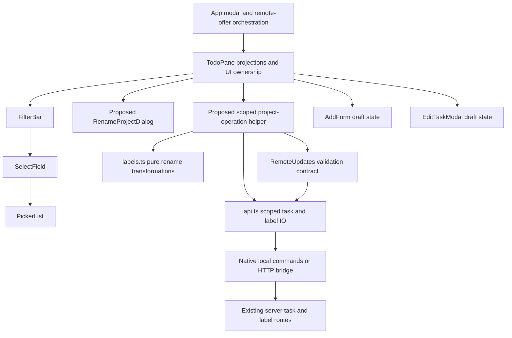

# Project name editing plan review

- [Project name editing plan review](#project-name-editing-plan-review)
  - [Scope and verdict](#scope-and-verdict)
  - [Dimension scores](#dimension-scores)
  - [Module Dependency Graph](#module-dependency-graph)
  - [Test suite map and coverage assessment](#test-suite-map-and-coverage-assessment)
  - [Top Findings](#top-findings)
  - [Previous finding resolution](#previous-finding-resolution)
  - [Verification and limits](#verification-and-limits)
  - [Recommendation](#recommendation)

## Scope and verdict

**Mode:** Health Dashboard

**Scope:** Revised plan-only review of `tasks/24-edit-project-names/2-plan.md` at `dafa746`, including the full plan and its changes since the initial review at `e5789f3`. Checked against the goal and current app project, draft, mutation, and remote-approval boundaries. This assesses proposed design and verification readiness, not implemented feature health. No `.brooks-lint.yaml` was found; balanced defaults apply.

**Composite Score:** 100/100

**Trend:** 98 → 100 (+2) against the preceding review of this task's plan.

Ready for implementation at the plan level. Both previous warnings are addressed with explicit invariants, lifecycle contracts, and regression scenarios. No new actionable finding was established; implementation and device behavior remain unverified.

## Dimension scores

- Code Quality/design readiness: **100/100**. Modal visibility, retained progress, and mutation authority are separated; review handoff and explicit reconfirmation are defined.
- Architecture: **100/100**. The proposed pure transformations, scoped operation helper, pane projections, and existing transport adapter have appropriate boundaries. No planned import cycle or domain-to-native dependency is established.
- Tech Debt/domain readiness: **100/100**. Initial namespace checks and operation-aware continuation checks now distinguish own verified progress from unexplained target references.
- Test Quality/verification readiness: **100/100**. The plan requests observable pure, component, real-pane/coordinator, partial-failure, transport, and manual checks, including explicit success/failure expectations for both previous findings. No separate T1/T2 finding was established.

With no active findings, every dimension scores 100 under balanced defaults. Composite: `100 × 0.25 + 100 × 0.30 + 100 × 0.25 + 100 × 0.20 = 100`. Code Quality evaluates the proposed plan change, not a production-code diff. This score is not implementation or release approval.

## Module Dependency Graph

This is a proposed responsibility map, not a verified future import graph. Keep the helper independent of React components, with narrow callbacks or results for projection and progress. The shared operation boundary is justified by rename and existing removal; no generic workflow engine is needed. The revised runtime contract explicitly releases modal ownership before remote review without discarding operation evidence.

## Test suite map and coverage assessment

- Current app inventory: 36 Vitest files, comprising 16 non-React files, 17 React component files, and three app-level integration files (`App.test.tsx`, `liveSync.test.tsx`, `remoteApproval.test.tsx`). No rename implementation or rename-specific tests exist yet.
- Relevant unit seams include `labels.test.ts`, `remoteUpdates.test.ts`, and `resourceRefresh.test.ts`. Component coverage includes pickers, modal lifecycle, forms, filters, and TodoPane. The plan appropriately adds remote bulk-operation tests using real panes and the coordinator rather than relying on isolated mutation mocks.
- Supporting native/server tests exist; server HTTP integration tests are in `server/tests/api.rs` and `server/tests/task_dates.rs`. The plan does not require a new server protocol and scopes extra backend checks to actual implementation changes.
- Planned real-device checks cover focus, keyboard/mobile handoff, and multi-client interaction. No browser/device end-to-end execution or new passing test count is claimed in this review.
- The proposed delayed-rescan removal regression directly addresses task-23's known coverage gap. Last-write-wins concurrency and labels-only notification limits are explicitly documented tradeoffs, not undisclosed defects in this plan.
- Revised collision tests distinguish normal multi-task finalization, partial-task retry, label-only retry, verified uncertain label completion, and independent late-target collisions. Revised lifecycle tests exercise an in-dialog Review update action, modal release, approved application, retained progress, and absence of writes until a new explicit confirmation.

## Top Findings

No active Critical, Warning, or Suggestion findings in this revised plan.

## Previous finding resolution

- **F1 — resolved in the plan:** `2-plan.md:26–27,43,53–57,71,89,100` separates initial availability from continuation ownership, records exact task and label evidence, preserves provenance across explicitly confirmed retry attempts, and retains collision blocking for unknown target references. An uncertain label PUT whose intended outcome is observed can complete without a second write or false collision. These are observable-content checks, not claims of reliable author attribution or transactional protection. This addresses the previous Domain-Driven Design invariant-ownership concern without introducing a permanent alias mechanism.
- **F2 — resolved in the plan:** `2-plan.md:36–39,75,90,101` defines ready/checking/running/stopped outcomes, separates result retention from dialog visibility and write authority, specifies in-dialog Review update and synchronous modal release, and requires application guards to allow a paused result while blocking an active operation. Close/Escape/backdrop after partial completion preserve a reopenable result; remote approval and reopening cannot resume writes. Explicit revalidation and Retry/Finish labels confirmation are required. The end-to-end lifecycle test explicitly rejects stale replay and inert-background-control shortcuts, addressing the previous Orthogonality and Information Leakage concern.

Both resolutions are design commitments to verify during implementation, not statements that the current code already implements them. The initial review remains available in commit `622cd10`.

## Verification and limits

Read the full revised plan and the previous findings, compared the change from `e5789f3` to `dafa746`, and rechecked current App remote-offer gating, TodoPane review/application guards, coordinator mutation settlement, submodule state, and score history. The existing app remains at `cb617f8` and server at `06f28ab`; neither submodule has uncommitted changes. The previously inspected test-suite map is unchanged by these documentation-only revisions.

No implementation code, goal, or plan was modified. No tests, builds, deployments, or application-data requests were run for this documentation-only review. No fresh test result or completed manual acceptance is claimed. Existing multi-request partial completion, GET/PUT races, older label writers, and labels-only discovery delays remain explicitly accepted limits. `todo.md` remains untouched.

## Recommendation

Proceed to implementation using the revised plan. Preserve its operation-aware collision rules, suspend/review/reconfirm lifecycle, draft protection, and explicit concurrency limits. Prioritize real-pane regressions for partial retry and modal handoff alongside the delayed-rescan removal fix; passing isolated helper tests alone is not feature sign-off.
