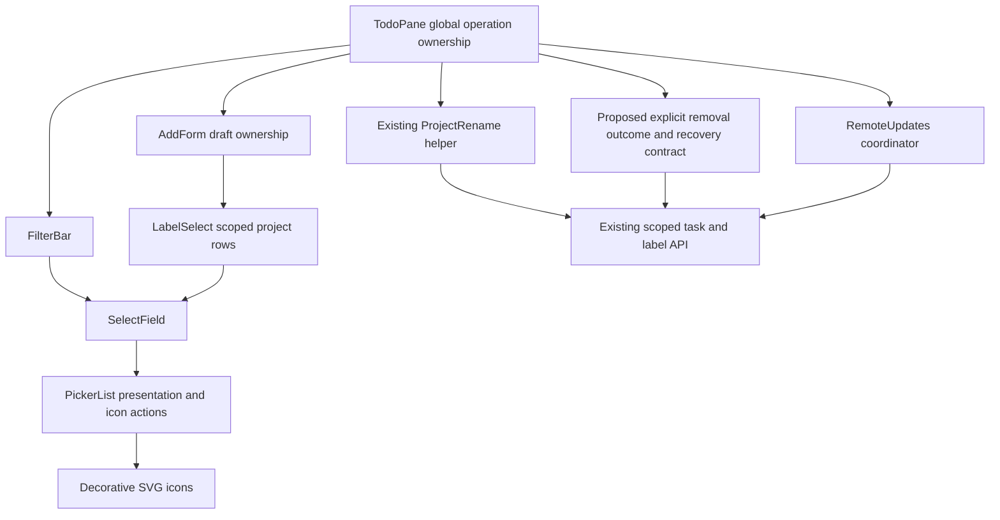

# Project selector actions plan review

- [Project selector actions plan review](#project-selector-actions-plan-review)
  - [Scope and verdict](#scope-and-verdict)
  - [Dimension scores](#dimension-scores)
  - [Module Dependency Graph](#module-dependency-graph)
  - [Test suite map](#test-suite-map)
  - [Top Findings](#top-findings)
    - [F1: Warning — R6 Domain Model Distortion: Recovery and staged-only dispatch have no precedence rule](#f1-warning--r6-domain-model-distortion-recovery-and-staged-only-dispatch-have-no-precedence-rule)
    - [F2: Warning — R2 Change Propagation: Partial removal guards lack an owned recovery lifecycle](#f2-warning--r2-change-propagation-partial-removal-guards-lack-an-owned-recovery-lifecycle)
  - [Verification and limits](#verification-and-limits)
  - [Recommendation](#recommendation)

## Scope and verdict

**Mode:** Health Dashboard

**Scope:** Plan-only review of `tasks/25-project-selector-actions/2-plan.md` at `bd2ee9a`, checked against its goal and the current app at `f1687bf`. All four dashboard dimensions assess proposed design and verification readiness, not an implemented task-25 feature. No `.brooks-lint.yaml` was found; balanced defaults apply. Unrelated server work and `todo.md` are excluded.

**Composite Score:** 98/100

**Trend:** 100 → 98 (−2) against the preceding Health Dashboard record. That record reviewed task-24's revised plan, so this is not a same-plan regression trend.

Clarify two action-ownership rules before implementation. Icon presentation, accessible names, compact modal handoff, draft/global scope distinctions, and selector-based rename recovery are otherwise well scoped. Both findings concern incomplete proposed contracts, not reproduced task-25 runtime bugs.

## Dimension scores

- Code Quality/design readiness: **95/100**. F2 identifies a missing lifecycle connecting removal outcomes, guarded drafts, and recovery UI.
- Architecture: **100/100**. Optional selector callbacks can preserve presentation-only pickers, form-owned staged state, and TodoPane-owned global mutation. No planned import cycle or layering violation is established.
- Tech Debt/domain readiness: **95/100**. F1 identifies overlapping dispatch policies for a name that belongs both to a retained operation and to staged form state.
- Test Quality/verification readiness: **100/100**. Proposed unit/component/real-pane coverage is behavior-oriented and includes failure, modal, and approval paths. No separate T1/T2 finding is established. Add explicit expected outcomes for the two scenarios below rather than relying only on broad partial-failure coverage.

Balanced scoring deducts five points per warning in its assigned dimension only. Composite: `round-half-up(95 × 0.25 + 100 × 0.30 + 95 × 0.25 + 100 × 0.20) = 98`. The Code Quality dimension evaluates the proposed plan change rather than a production-code diff. The score does not waive unresolved design decisions.

## Module Dependency Graph

This is the plan's responsibility map, not a verified future import graph. User actions flow back through callbacks; they must not make PickerList infer storage scope or give AddForm a second global write loop. The proposed staged-only branch belongs to the form, while retained global operation identity belongs to TodoPane.

## Test suite map

- Current inventory: 38 Vitest files, comprising 17 non-React files, 17 component files, and four app-level integration files (`App.test.tsx`, `liveSync.test.tsx`, `remoteApproval.test.tsx`, and `projectRename.test.tsx`). No task-25 implementation or passing task-25 test result is claimed.
- Existing useful seams include PickerList, SelectField, FilterBar, AddForm, OptionsModal, modal lifecycle, pure label helpers, the rename operation helper, and real-pane approval/rename suites.
- Existing recovery tests directly click `Review rename progress`; the plan correctly replaces those paths rather than deleting their behavioral assertions when the control disappears.
- Proposed tests cover icon semantics, capability gating, local-only staging, global persistence, preserved drafts, focus, pending notes, uncertain writes, missing recovery rows, and no automatic replay. Native/backend checks remain conditional on actual code changes. Device accessibility, touch, and actual focus behavior require manual acceptance; jsdom dialog shims are not evidence of those results.

## Top Findings

### F1: Warning — R6 Domain Model Distortion: Recovery and staged-only dispatch have no precedence rule

**Location:** `2-plan.md:31–34,48–51`; current `app/src/components/LabelSelect.tsx:17–25`, `app/src/components/AddForm.tsx:29–38`, and `app/src/components/TodoPane.tsx:366–378`.

**Symptom:** Step 2 classifies a name present only in AddForm's staged list as draft-local and routes its rename/removal inside AddForm. Step 4 independently requires clicking a retained rename's source or target icon to reopen that exact global result. These rules overlap when a rename has changed persisted task/label references but remains unresolved, while the old source still exists in an unmapped staged draft. After current known choices move to the target, the source can be staged-only in that selector yet still belong to the retained global rename. The plan does not establish which handler wins or how a related removal action interacts with that retained operation.

**Source:** Domain-Driven Design — Aggregate Roots and invariant ownership. A retained operation's source/target identity cannot be determined solely from the current union of selectable project names.

**Consequence:** An implementation can open a fresh local rename instead of the required recovery result, reject the operation's own existing target as a collision, or modify draft references while global progress remains unresolved. Routing every matching bare name to old recovery without checking destination can instead intercept a legitimate project action on another server.

**Remedy:** Define a single dispatch precedence contract before local/global classification: identify same-destination retained-operation relations first, then classify ordinary rows as known or staged-only. Matching Rename actions must reopen the existing result read-only. Matching Remove actions must explicitly resolve/block on that result rather than silently performing a local mutation. Keep cross-destination recovery explicitly separate and read-only. Pass this relationship through the selector contract alongside row scope. Add a test with the old source staged-only, target known, and an unresolved label/verification result; assert retained progress, no local draft rewrite or network write on opening, and explicit retry/stop access. Add the same bare-name/different-destination case.

### F2: Warning — R2 Change Propagation: Partial removal guards lack an owned recovery lifecycle

**Location:** `2-plan.md:41–43,50,59,68`; current `app/src/components/TodoPane.tsx:308–335,366–369`.

**Symptom:** The plan introduces explicit partial removal outcomes and promises to keep ambiguous draft submissions guarded until continuation/resolution. Its retained state, selector recovery, Retry/Finish labels, and Stop retry contracts are defined only for rename. Current removal clears its dialog target before writing, reports errors through transient pane state, and retains no removal operation result; `guardDraft()` consults only `renameRef`. Returning a completed/partial/failed value alone does not define who owns a removal restriction after the original dialog closes, how to reopen it, or when that restriction is released.

**Source:** The Pragmatic Programmer — Orthogonality; A Philosophy of Software Design — Information Hiding and Leakage. A form's submission authority would depend on an incomplete lifecycle in a separate persistence/UI owner.

**Consequence:** Implementers can either leave partial-removal drafts able to recreate the source, or block them without a reachable finish/abandon action. Label-only/uncertain removal failures can lose their recovery entry if the source disappears from normal choices. Clearing restrictions merely when the dialog closes would contradict the plan's partial-write safety promise.

**Remedy:** Specify a narrow TodoPane-owned removal result with source, destination, acknowledged task progress, remaining task/label work, and any uncertain-write status. Define how the source's trash action or an in-selector fallback reopens that result without writing, how fresh explicit confirmation retries remaining work, and how explicit abandonment releases draft restrictions without rollback. Keep this separate from the rename-to-empty workaround the plan correctly forbids; no generic workflow engine is required. Publish the removal mapping event only after observed task/label completion, not on dialog closure or a caught exception. Add end-to-end partial-task failure and task-complete/label-only failure tests that close/reopen the selector, verify guarded draft retention, and then finish or explicitly abandon the result, including when no source row remains.

## Verification and limits

Read the goal and full plan, inspected current selector/form scope, removal and rename entry points, draft guards, rename label-verification logic, representative real-pane recovery tests, the test inventory, Git/submodule state, and score history. The app submodule is clean at `f1687bf`; unrelated server untracked work and the existing `todo.md` modification were not inspected or changed.

No implementation code, goal, or plan was modified. No tests, builds, device checks, deployments, or application-data requests were run for this documentation-only review. The current code supplies context for missing plan contracts; its prior passing tests do not establish task-25 behavior. Multi-request last-write-wins and mounted-pane-only progress retention remain documented accepted limits, not additional findings.

## Recommendation

Update the plan with operation-aware dispatch precedence and a concrete retained partial-removal lifecycle before implementation. Keep the existing icon, event-ownership, accessibility, and no-duplicate-global-write-loop decisions. Focus the follow-up review on those two state-ownership contracts; neither requires a new backend protocol, transaction, or permanent alias registry.
