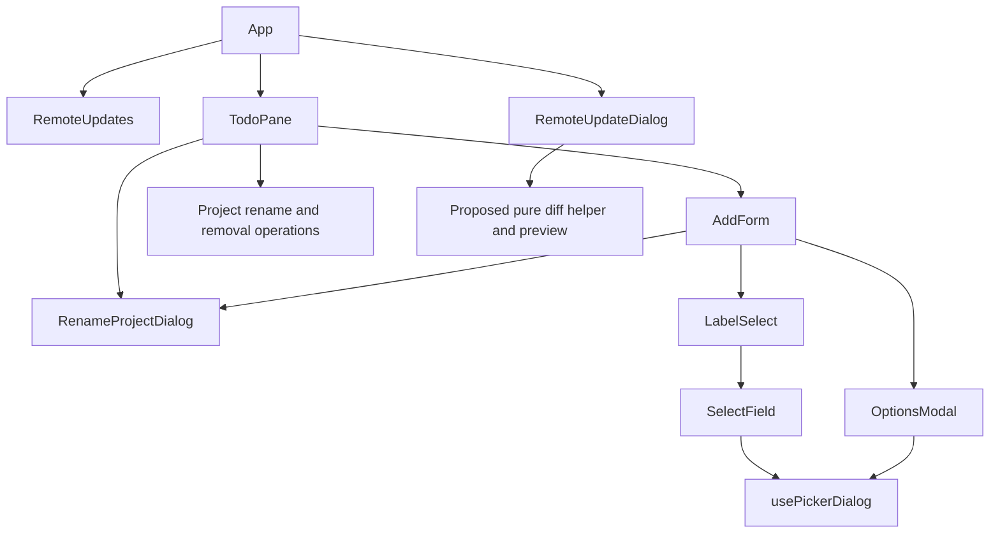

# Modal design and update diff plan review

- [Modal design and update diff plan review](#modal-design-and-update-diff-plan-review)
  - [Health Dashboard](#health-dashboard)
  - [Module Dependency Graph](#module-dependency-graph)
  - [Findings](#findings)
    - [Warning](#warning)
    - [Suggestion](#suggestion)
  - [Coverage and strengths](#coverage-and-strengths)
  - [Recommendation](#recommendation)

## Health Dashboard

**Mode:** Health Dashboard

**Scope:** `tasks/26-modal-design-update-diff/2-plan.md` at `d526504`, checked against its goal and current app modal/coordinator code. This is a plan review, not an implementation health assessment or whole-project audit. No implementation changes or runtime tests were performed. No `.brooks-lint.yaml` was found at the project root; balanced defaults apply.

**Composite Score:** 98/100

**Trend:** Stable at 98 relative to the previous recorded Health Dashboard; the scopes differ, so this is not evidence of unchanged codebase health.

- Code Quality: 100/100. The planned change preserves validation and failure handling; no additional finding.
- Architecture: 99/100. One suggestion about the commit boundary for picker focus restoration.
- Tech Debt: 95/100. One warning about unbounded preview expansion after the initial bounded view.
- Test Quality: 100/100. The proposed unit/integration split covers the changed behavior and names native-dialog limitations explicitly; no additional finding.

Scoring uses the plan delta as the Code Quality dimension, weights of 0.25/0.30/0.25/0.20, and deductions of five per warning and one per suggestion within the assigned dimension. The weighted result is 98.45, rounded to 98. Findings are counted once, not deducted again in overlapping dimensions.

## Module Dependency Graph

This is the relevant current dependency direction and proposed boundary, not a claim that the new session interface already exists. Callback edges point toward the lower-level component that receives them; operation resolution remains in TodoPane/AddForm rather than in the generic picker.

The planned ownership is sound: the coordinator owns accepted/incoming evidence, the diff consumes it without I/O, operation owners retain write authority, and picker-local presentation handles hide native dialog details. No new dependency cycle or speculative global modal framework is required.

## Findings

### Warning

**F1 — R4: The expanded preview can bypass the rendering budget.**

**Symptom:** `2-plan.md:56` bounds the comparison and initially rendered rows/characters, but permits user-triggered expansion or a full before/after view without specifying a bound for that path. The stated large-content invariant at `2-plan.md:84` is therefore stronger than the actual expansion design. A single very long line also needs a character limit, not only a row limit.

**Source:** *Code Complete* — Defensive Programming; *A Philosophy of Software Design* — Strategic vs. Tactical Programming. A bounded first render is useful, but a later escape hatch must preserve the same responsiveness invariant.

**Consequence:** A large note can open safely, then stall the UI when expanded, making Update/Not now and text inspection temporarily unusable. Tests of only the initial fallback would miss the failing user path.

**Remedy:** Specify bounded incremental expansion or paging for both diff and full-content views, with named row/character/work budgets enforced on every render. Do not rerun an unrestricted LCS or mount all content on Show more. Add a regression that repeatedly expands oversized content, including a huge single line, while asserting bounded chunks, explicit remaining-content disclosure, and usable approval controls. This needs no new dependency or global virtualization framework.

### Suggestion

**F2 — R2: Make focus restoration explicitly post-commit.**

**Symptom:** `2-plan.md:31,40-42` requires updated choices before focus restoration, but does not identify the React commit that makes those choices available. Current global rename publishes an event in `app/src/components/TodoPane.tsx:430-433`; `app/src/components/AddForm.tsx:44-49` then maps staged/selected names in an effect. Draft-local rename similarly schedules state updates before calling its current close/focus path at `AddForm.tsx:84-92`. Awaiting the operation does not itself mean these controlled picker rows have committed.

**Source:** *The Pragmatic Programmer* — Orthogonality; *A Philosophy of Software Design* — Information Hiding and Leakage. Operation completion and DOM readiness are different lifecycle boundaries and should not rely on incidental scheduling between owners.

**Consequence:** A synchronous close callback can focus the old staged-source action just before React removes it, or choose Cancel even though the new target row appears on the next commit. This would weaken the intended usable-selector behavior without losing the underlying data.

**Remedy:** Have the selector-owned session record a focus intent and resolve it after rename closes and the relevant controlled options have committed, using a layout effect or an equivalent owned post-commit acknowledgment. Guard the intent by session identity and connected/open elements; do not use arbitrary timers or retry loops. Add focused tests for staged-only success and a global success where the old source survives briefly in staged options before its mapping effect runs.

## Coverage and strengths

- The goal is covered: consistent modal surfaces, `Original` plus a new-name input, successful rename auto-dismissal, retained create-task picker stacks, and read-only remote diffs.
- The plan correctly accounts for compact Options conditionally mounting the selector. It also follows the actual resolved operation rather than assuming the clicked icon determines stack disposition.
- Review update deliberately releases every blocking origin dialog. This avoids App's existing suppression of offers while another dialog remains open, without weakening explicit retry requirements.
- Automatic dismissal waits for settled verified completion, including the unchanged-name path that bypasses the normal completion callback. Failed/partial/label-pending results preserve recovery authority and draft guards.
- Remote preview evidence remains coordinator-owned and is refreshed when either baseline or incoming content changes. Deferred-state preservation, stale-token rejection, preparation failures, ID/lifecycle changes, and protected dirty drafts are explicitly covered.
- Proposed tests are layered appropriately: pure diff cases belong at the helper boundary, offer/token races at the coordinator boundary, and stacks/draft persistence at real-pane integration boundaries. Current source discovery finds 40 TypeScript/TSX test files: 17 component/lifecycle files, 13 library files, and ten top-level files covering utilities, API, app, and flows. These are file categories, not executed test counts or a claimed browser E2E suite. The jsdom setup at `app/src/test/setup.ts:5-11` only toggles `open` and dispatches close; the plan correctly requires separate native stacking/focus checks.
- Broader codebase debt, server health, unrelated user changes, and historical implementation quality were not scored. The review does not infer test success from earlier task reports.

## Recommendation

Keep the design and scope. Tighten Step 5 so every expansion remains bounded, and clarify the post-commit focus boundary in Steps 2-3 before implementation. No critical finding or fundamental redesign is needed. This review leaves `2-plan.md` and all implementation files unchanged; only this report and the review-history record are added or updated.
