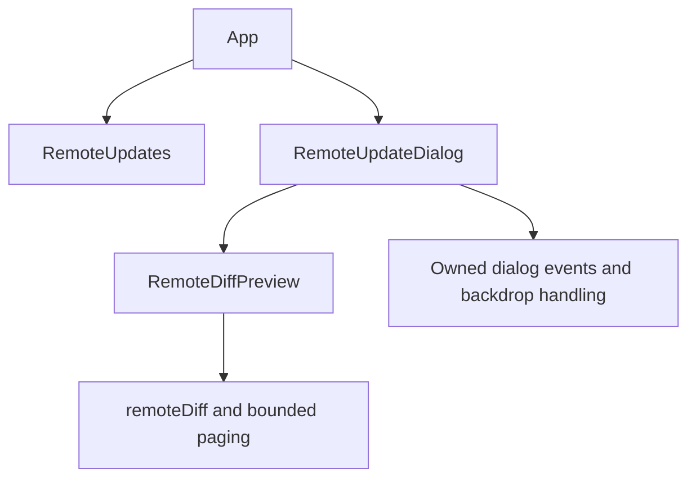

# Diff-only update notification plan review

- [Diff-only update notification plan review](#diff-only-update-notification-plan-review)
  - [Health Dashboard](#health-dashboard)
  - [Module Dependency Graph](#module-dependency-graph)
  - [Findings](#findings)
  - [Coverage and tradeoffs](#coverage-and-tradeoffs)
  - [Recommendation](#recommendation)

## Health Dashboard

**Mode:** Health Dashboard

**Scope:** `tasks/27-update-notification-diff-only/2-plan.md` at `f75d38f`, checked against `1-goal.md` and the current remote dialog, preview, diff helper, styles, and relevant tests. This is a plan review, not an implementation review or whole-project health assessment. No implementation changes or runtime tests were performed. No root `.brooks-lint.yaml` was found; balanced defaults apply.

**Composite Score:** 100/100

**Trend:** 98 → 100 (+2) relative to the preceding recorded Health Dashboard. Different task scopes mean this is not a measured improvement in implementation health.

- Code Quality: 100/100. The planned presentation delta is cohesive and keeps existing approval/event behavior unchanged.
- Architecture: 100/100. Changes remain in remote dialog presentation and its pure diff helper; no new cycle, infrastructure dependency, or modal framework is proposed.
- Tech Debt: 100/100. Summary-only formatting is removed instead of maintained in parallel; useful evidence becomes compact diff metadata rather than new notification prose.
- Test Quality: 100/100. The proposed tests cover removed UI text, retained evidence, errors, paging limits, and real-pane approval safety at appropriate boundaries.

All four dimensions have no scored findings. The 0.25/0.30/0.25/0.20 weighted composite is 100. These scores express readiness of this plan within its reviewed scope, not proof that an unimplemented change works.

## Module Dependency Graph

The relevant runtime direction remains unchanged; type-only helper imports are omitted. App owns the offer queue and approval orchestration, RemoteUpdates owns accepted/incoming evidence, and the preview consumes snapshots without persistence authority.

## Findings

No critical findings, warnings, or suggestions requiring a plan revision were identified. The plan satisfies the goal without widening the change into coordinator, rename, or server behavior.

## Coverage and tradeoffs

- `2-plan.md:21-23` handles the visible title removal without breaking the dialog's accessible name. Existing modal ID, native lifecycle, exact-offer callbacks, busy refusal, and once-only dismissal remain intact. This avoids treating a cosmetic cleanup as permission to change approval ownership.
- `2-plan.md:23,52,60` explicitly resolves the error-presentation tradeoff: the request forbids visible messages, so Retry update is the visible failure affordance while the exact error remains accessibly associated and stored. This is intentional scope, not a recommendation to hide failures elsewhere. Component and real-pane error/retry tests are included at `2-plan.md:43,45`.
- `2-plan.md:27-31` removes the actual explanatory paragraphs, legend, empty-state prose, and verbose paging sentence currently emitted by `RemoteDiffPreview.tsx:14-16,22-27`. Compact controls still disclose continued inspection, and single-page navigation is hidden only when content is complete. All three inspection views retain the same bounded paging path.
- `2-plan.md:35-38` preserves the information that would otherwise disappear with `document.summary`: note EOF distinctions and task identity/lifecycle changes. Compact EOF/hunk markers are treated as diff evidence, not replacement prose. Metadata is explicitly subject to the existing rendering budgets, and full accepted/incoming inspection stays available.
- The design keeps useful ownership boundaries. Following *Clean Architecture* — Dependency Rule and *The Pragmatic Programmer* — Orthogonality, coordinator state and token validation remain unchanged while presentation consumes their evidence. Following *A Philosophy of Software Design* — Information Hiding, summary removal does not require a new parallel explanation pipeline or leak persistence decisions into the view.
- The test plan avoids confusing user content with UI copy: `2-plan.md:42` scopes absence checks to UI-owned elements, so a note containing an old notification sentence remains valid escaped content. Existing tests at `RemoteUpdateDialog.test.tsx:15,28-38,48-62` and `remoteDiff.test.ts:14-24` show concrete expectations that must be updated rather than silently deleted.
- The proposed test portfolio matches the risk: pure EOF/hunk/metadata/budget behavior belongs in helper tests; accessible naming, compact controls, escaped content, and retry labels belong in component tests; unchanged panes/drafts, deferred updates, and stale offers belong in real-pane approval tests. This follows *Working Effectively with Legacy Code* — Characterization Tests and *How Google Tests Software* — Change Coverage. Current source discovery finds 42 TypeScript/TSX test files: 18 component files, 14 library files, and ten top-level utility/API/app/flow files. These are file categories, not executed test counts or a browser E2E certification.
- No speculative dependencies, new write paths, unbounded Show all path, or unrelated rename refactor is proposed. The verification section correctly distinguishes automated checks from manual native/mobile appearance, focus, and accessibility checks. Previously passing implementation tests were not rerun or counted as evidence that this future change passes.

## Recommendation

Proceed with the plan as written. Preserve the distinction between compact diff metadata and removed notification prose, and retain the planned error/retry and bounded-paging regressions during implementation. No additional focused audit or architectural redesign is needed for this scoped change. This review leaves `2-plan.md`, implementation files, existing `todo.md` changes, and unrelated server work untouched; only this report and the review-history entry are added or updated.
