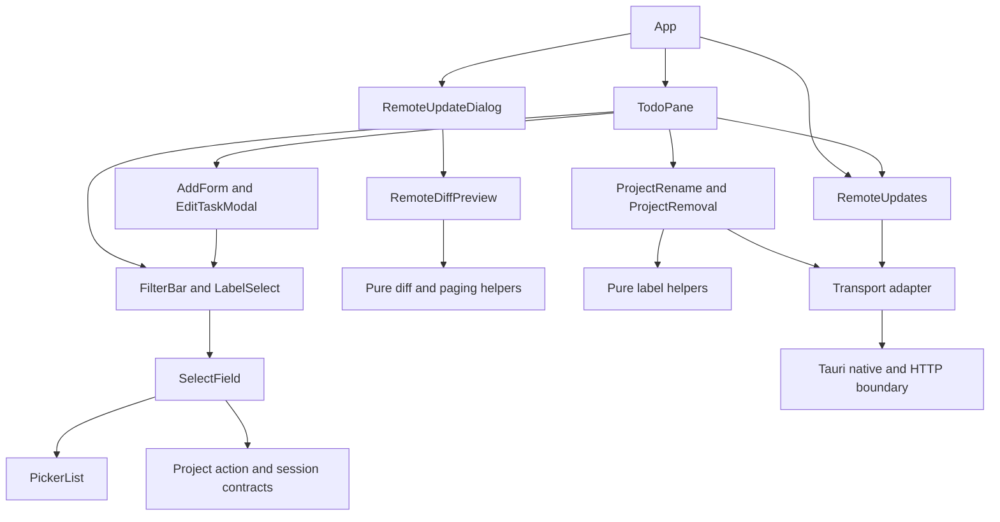

# Branch code review

- [Branch code review](#branch-code-review)
  - [Health Dashboard](#health-dashboard)
  - [Scope](#scope)
  - [Module Dependency Graph](#module-dependency-graph)
  - [Findings](#findings)
    - [Warning](#warning)
  - [Verification](#verification)
  - [Recommendation](#recommendation)

## Health Dashboard

**Mode:** Health Dashboard

**Scope:** All committed changes on `27-update-notification-diff-only` relative to `main`, including inherited tasks 24–26.

**Composite Score:** 99/100

**Trend:** 100 → 99 (−1) against the previous Health Dashboard record. That record reviewed a plan, so this is not a like-for-like implementation trend.

- Code Quality: 95/100. One Warning: project completion rewrites a suspended edit draft from another destination.
- Architecture: 100/100. No additional branch-introduced layering or dependency-cycle finding.
- Tech Debt: 100/100. No additional actionable finding in the changed modules.
- Test Quality: 100/100. No T1/T2 obscurity or brittleness finding; the uncovered destination interaction is documented with the functional finding below.
- Balanced deductions: one Warning costs five points in Code Quality only. Composite: `round(95 × 0.25 + 100 × 0.30 + 100 × 0.25 + 100 × 0.20) = 99`. Scores describe this bounded review, not whole-project certification.

## Scope

- Parent: `6cfe1b70567addad87b340882430e5f966f78edf` (`main` and merge base) through `f5f2838`; 15 commits and 16 changed paths.
- App submodule: `cb617f864b9e478b35e9c9096abfdef6b158b447` through `2c35fb5b069b30767011b2f0ba011ac39bd69d92`; four implementation commits and 44 changed files.
- Reviewed project rename/removal progress, selector dispatch and retained-modal ownership, draft mapping, remote snapshot ownership, diff construction/paging, presentation, tests, version metadata, and accompanying documentation.
- The server gitlink did not change. Native implementation did not change in the app range.
- No `.brooks-lint.yaml` was found at the parent or app root; default balanced settings apply.
- Existing dirty app files, untracked server content, and `todo.md` changes were excluded and left untouched. Tests used an archive of the committed app under `/tmp/opencode/ntr-review-27`, linked to the existing installed dependencies.

## Module Dependency Graph

Edges summarize runtime and contract dependencies relevant to the changes. `remoteDiff.ts` uses type-only imports for offer/task contracts. UI orchestration legitimately wires concrete transport functions; its fan-out alone is not a layering violation. Operation progress is retained outside dialog visibility, and diff construction remains separate from approval authority.

## Findings

### Warning

**R2 — Project actions on one destination mutate another destination's suspended edit draft.**

Symptom: `app/src/components/EditTaskModal.tsx:54–71` checks completion events against the current transport, but not the transport owning the edit draft. Both rename and removal then rewrite description, selected project, and staged projects. Its baseline replacement also matches only task ID and transformed raw text. `app/src/components/TodoPane.tsx:435` correctly checks `editOwner` before rebasing the parent's edit expectation, but that ownership is not supplied to the modal's mapping effects.

Source: *A Philosophy of Software Design* — Information Hiding and Leakage; *The Pragmatic Programmer* — Orthogonality. Destination ownership is enforced for persistence in one component but omitted from a second component's draft projection.

Consequence: Suspend an edit on server A, switch to server B, and rename `work` to `team` on B. Resuming A's draft shows `private draft +team` instead of `private draft +work`; a removal on B uses the analogous unguarded path. Matching IDs and raw text can also replace the modal's baseline with B's task. The parent's destination check still prevents saving directly to B, so this finding does not claim an unauthorized cross-server write. It does establish unintended changes to unsaved user content.

Remedy: Capture the edit draft's destination when its task is opened and require completion events to match that owner before changing any draft field or baseline. Keep same-destination transport replacement supported. Add rename/removal regressions that suspend an A draft, switch to B with overlapping project names and task IDs, complete an operation, then resume the unchanged A draft. Retain the parent's existing save guard.

Evidence: An isolated probe added only to the temporary archive rendered the real `TodoPane`, opened and suspended an edit on `http://one`, activated `http://two`, completed a rename there, and resumed the edit. Its assertion failed: expected `private draft +work`, received `private draft +team`. The repository's existing destination test covers retained operation records across servers, while its suspended-edit mapping tests use a single destination; neither covers their intersection.

## Verification

- On the unmodified committed archive, `npm test -- --maxWorkers=2 --minWorkers=1` passed: 668 tests across 42 files, with no unhandled errors. Expected backup/read-failure fixtures emitted their intentional warnings.
- Frontend suite map: 37 small unit/component test files and five app/pane integration test files (`App`, live sync, remote approval, project rename, and selector actions). No browser/device E2E files were present in this reviewed frontend suite. Both groups use mocked native/transport boundaries, not a real server.
- On the unmodified committed archive, `npm run build` passed, including TypeScript checking and Vite production output.
- The separate command `npx vitest run src/projectSelectorActions.test.tsx -t 'review probe' --maxWorkers=2 --minWorkers=1` failed as expected: one failed probe, 37 skipped existing tests. This confirms the reported draft mutation; it is not a claim that the original 668-test suite failed.
- Parent `git diff --check main...HEAD` and app `git diff --check cb617f8..2c35fb5` passed.
- Native tests and Clippy were not rerun because this range changes no native implementation. Earlier implementation reports retain their own native verification results.
- Manual desktop/mobile layout, actual browser modal stacking, keyboard/touch behavior, and screen-reader announcements were not verified in this headless review. The jsdom dialog shim does not certify those behaviors.
- No implementation fixes or repository test changes were made. Only this review and the parent review-history record are committed.

## Recommendation

Fix the destination-owned draft mapping before merging. The diff-only presentation, bounded inspection, explicit approval, and existing recovery tests otherwise passed this branch-scoped review. If deeper follow-up is needed, prioritize a focused code review of draft ownership across destination changes rather than broad structural refactoring.
