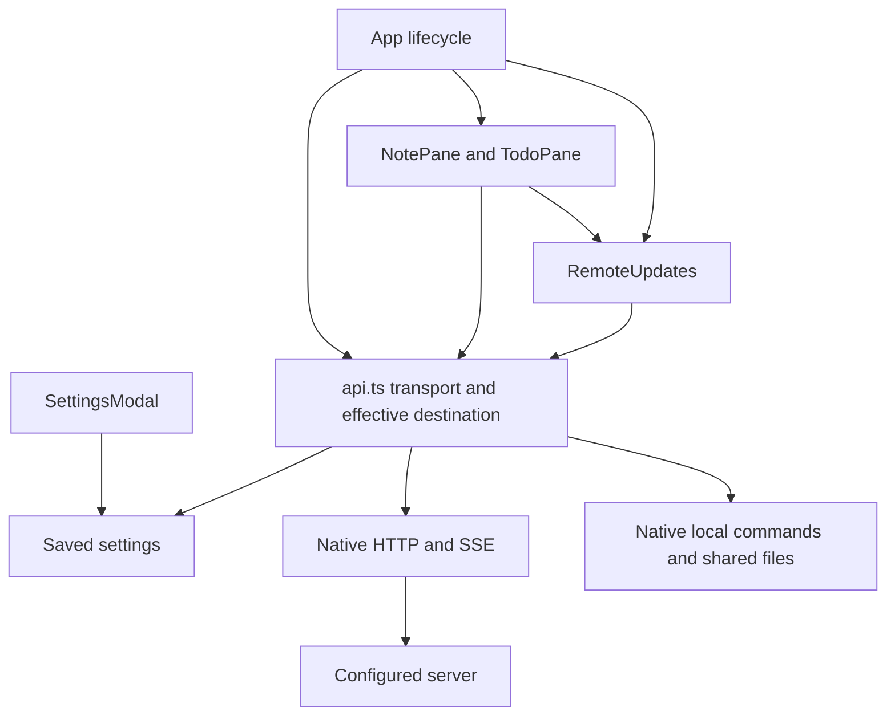

# Brooks-Lint Health Dashboard

- [Dashboard](#dashboard)
- [Module Dependency Graph](#module-dependency-graph)
- [Test Suite Map](#test-suite-map)
- [Top Findings](#top-findings)
  - [Warning](#warning)
- [Recommendation](#recommendation)

## Dashboard

**Mode:** Health Dashboard

**Scope:** `tasks/28-show-local-files-when-server-unavailable/2-plan.md` at `76f9f41`, checked against the current transport, app lifecycle, pane ownership, native local commands, and existing test seams. This assesses the plan, not implemented feature health. No implementation changes or tests run. No `.brooks-lint.yaml` exists at the parent or app root; balanced defaults apply.

**Composite Score:** 96/100

**Trend:** Previous recorded Health Dashboard score 99; current score 96. Scopes differ, so this is not evidence of codebase deterioration.

- Code Quality: 95/100; failed reconnect promises conflict with sequential reconciliation side effects (F3).
- Architecture: 95/100; destination activation lacks an explicit mutation-readiness barrier (F1).
- Tech Debt: 95/100; context checks cannot stop an already-dispatched native backup (F2).
- Test Quality: 100/100; no separate test-design finding. Deferred promises, fake timers, real panes, and native boundary mocks are appropriate. The findings below require specific added scenarios.

Scores deduct five points for one Warning in each affected dimension. Composite: `round(95 × 0.25 + 95 × 0.30 + 95 × 0.25 + 100 × 0.20) = 96`. Findings are counted once, not again as test gaps.

## Module Dependency Graph

Current and proposed ownership paths, not a newly implemented dependency graph:

The facade remains a sound boundary. A transport subscription can return lifecycle notifications without importing React into `api.ts`. The principal structural risk is the timing of activation and local storage side effects, not module count or composition-root fan-out.

## Test Suite Map

- Native unit and loopback tests: connection-error classification, timeout handling, and existing SSE recovery. Add local-write ordering coverage for F2.
- Frontend API tests: transport identity, routing, structured IPC failures, stale requests, and no replay in `app/src/api.test.ts`.
- Frontend integration tests: real `App`, panes, and coordinator with mocked Tauri commands/events; use `liveSync.test.tsx`, `remoteApproval.test.tsx`, and pane regressions as seams. Add deferred reconnect and partial-reconciliation cases for F1 and F3.
- Manual native checks: desktop and Android fallback/edit/reconnect when available. These supplement rather than replace automated safety checks.

No new tests exist yet; new test counts and execution time are unknown. Assertions should cover displayed content and persisted state, including forbidden writes, rather than only callback counts. Reset session-only fallback state through an explicit initialization lifecycle between tests so clearing localStorage alone cannot leak fallback into the next scenario.

## Top Findings

### Warning

**F1 — R5 Dependency Disorder: distinguish active destination from mutation-ready destination.**

Symptom: Plan lines 34–43 require immediate generation invalidation and local refresh, while lines 50–51 activate the server and reconcile on Connect. They explicitly guard old tasks before local loading, but do not define the corresponding reconnect write barrier. Currently `App.tsx:68–85,142–160` keeps mounted panes ready during destination reconciliation, and `createTask` captures whichever transport is current at submission time. Reusing this lifecycle alone does not prevent a visible local form from submitting into the newly activated server before reconciliation completes.

Source: *The Mythical Man-Month* — Conceptual Integrity; *Clean Architecture* — invariant ownership at module boundaries.

Consequence: During a slow reconnect, task creation, local draft submission, autosave, or project actions could write to the server before destination content is established. The same risk exists between synchronous fallback activation and React's local refresh. Generation checks reject old contexts but do not reject a newly captured context used by stale UI.

Remedy: Specify a small transition state contract with a destination generation and mutation readiness. Pause actions and note persistence synchronously when switching, retain mounted drafts, and unlock each resource only after its new projection and required choices are established. Guard API mutation entry points as well as controls, with narrowly scoped permission for intentional reconciliation writes. Add tests that defer reconnect reconciliation and local loading, attempt create/edit/complete/project actions and note blur/pagehide, and assert no unauthorized target write occurs before readiness.

**F2 — R2 Change Propagation: native backups need ordering, not only completion guards.**

Symptom: Plan line 45 promises that an obsolete request cannot write a backup into the active local store, but specifies context guards rather than an ordering mechanism. `api.ts:157–178` dispatches backups through `put_note`, `put_labels`, and `put_raw`; `commands.rs:186–210` accepts those local writes without a transport-generation token. A backup already dispatched while its server context was current can commit after fallback activates local editing. Startup reconciliation also invokes these local writers.

Source: *A Philosophy of Software Design* — Information Hiding and Leakage; *Code Complete* — defensive error-handling and invariant enforcement.

Consequence: A delayed server backup can replace newly displayed or edited local data, even when every JavaScript continuation correctly checks its original generation. Ignoring the completion cannot undo a native file write.

Remedy: Define an ordering boundary for server-origin local writes. A narrow option is to register all backup/reconciliation local writes before dispatch, invalidate the server context immediately on fallback, and drain those registered writes before loading or enabling the local destination. Do not wait on unrelated server PUTs. Alternatively, enforce generation-aware conditional commits natively. Include notes, tasks, and labels, and apply the same boundary to reconnect reconciliation. Add a deferred native-write test that commits the backup only after fallback starts and proves it cannot overwrite a subsequently enabled local edit. State how a never-settling native local write is surfaced without falsely unlocking storage.

**F3 — R6 Domain Model Distortion: failed reconnect does not imply unchanged local files.**

Symptom: Plan line 51 says a repeated connection failure returns to local mode without deleting files, while lines 58 and 71 expect failure to leave local files accessible under every reconciliation strategy. `api.ts:424–439` reads and applies note reconciliation before reading tasks. With the `server` strategy, a successful differing note read overwrites the local note; a subsequent task GET can fail and trigger fallback. Empty-local adoption can also write before another resource fails. Stopping after invalidation does not reverse an earlier valid write.

Source: *Domain-Driven Design* — aggregate boundaries and invariant ownership; *Software Engineering at Google* — observable behavior as a compatibility contract.

Consequence: A user can edit a local note, click Connect, see reconnect fail, and return to a replaced or empty local note. The plan's failure wording obscures legitimate but destructive partial reconciliation, and tests covering only failure before any successful resource read will miss it.

Remedy: Explicitly define partial reconnect semantics. Read and classify both resources before beginning automatic reconciliation writes so a failed discovery GET cannot partially adopt server data. For failures after writes start, preserve and report actual per-resource outcomes; do not promise transactional rollback or add a new transaction system. Clarify that an explicit Connect honors the configured overwrite strategy, including empty server content, and reconcile the acceptance wording with that policy. Test note success followed by task connection failure with differing and empty note content under `ask`, `server`, and `local`, asserting the exact final local/server contents and any surfaced partial outcome.

## Recommendation

Revise the plan before implementation. Preserve its shared transport facade, saved-URL retention, typed connection errors, no mutation replay, and explicit reconnect decision. First define the destination readiness barrier, then order server-origin local writes, and finally make partial reconciliation semantics explicit. These are focused lifecycle requirements, not reasons to build a synchronization framework. Leave `1-goal.md`, `2-plan.md`, implementation files, and unrelated `todo.md` changes untouched in this review task.
