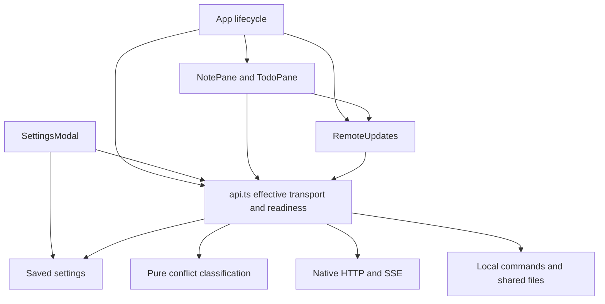

# Brooks-Lint Health Dashboard

- [Dashboard](#dashboard)
- [Module Dependency Graph](#module-dependency-graph)
- [Test Suite Map](#test-suite-map)
- [Top Findings](#top-findings)
  - [Warning](#warning)
- [Verification](#verification)
- [Recommendation](#recommendation)

## Dashboard

**Mode:** Health Dashboard

**Scope:** All committed changes on `28-show-local-files-when-server-unavailable` relative to `main`: parent `6f1c978..29383f3`, including the app submodule delta `6575653..69684e1` (25 app files). Reviewed transport state, reconciliation, native errors, app/pane ownership, controls, tests, documentation, and version metadata. The server submodule is unchanged. Uncommitted `todo.md` changes are excluded. No `.brooks-lint.yaml` exists in the parent or app root; balanced defaults apply.

**Composite Score:** 97/100

**Trend:** Previous Health Dashboard score 96; current score 97. The previous entry assessed a plan, not implementation, so this is not a comparable quality improvement.

- Code Quality: 95/100; F2 allows an obsolete conflict failure to change current transport readiness.
- Architecture: 95/100; F1 splits readiness ownership between transport and an accepted-snapshot shortcut that never restores it.
- Tech Debt: 100/100; no additional independent finding within the branch scope.
- Test Quality: 100/100; no independent obscurity or brittleness finding. Missing transition cases are included in the production findings rather than deducted twice.

Composite: `round(95 × 0.25 + 95 × 0.30 + 100 × 0.25 + 100 × 0.20) = 97`. Both findings are merge blockers despite the high aggregate score.

## Module Dependency Graph

No new import cycle or upward domain dependency was identified. The transport facade and composition-root fan-out are justified. The important architectural fault is behavioral: retaining accepted server snapshots and resetting mutation readiness are separate decisions, and the pane shortcuts do not consistently reconnect them. Typed request errors, whole-app fallback, and the local-write barrier are otherwise coherent design choices; neither per-resource partial application nor explicit reconnect is itself a defect.

## Test Suite Map

- Frontend unit/adapter layer: 20 `.test.ts` files, including 22 new transport fallback cases in `src/transportFallback.test.ts`.
- Frontend component/app integration layer: 24 `.test.tsx` files, including 17 new real-app fallback cases in `src/localFallback.test.tsx`. Both frontend layers run under jsdom; these are not native end-to-end tests.
- Total committed frontend suite: 707 passing tests across 44 files.
- Native unit/loopback layer: 63 registered library tests; 62 pass and one opt-in real-server restart test is ignored.
- Review-only integration probes: two real-App tests in a committed-source archive under `/tmp/opencode/ntr-review-28-69684e1`; both fail on the invariants described below. They were not added to the repository.
- Desktop/Android manual interaction checks were not performed. The existing external-server restart test was not enabled.

The boundary mocks, deferred commit tests, and fake timers provide useful safety coverage without a slow end-to-end dependency. However, successful fallback-to-server reconnect is not equivalent to reconnecting an already-active server, and late successful mutations are not equivalent to late rejected conflict choices. The two reproduced failures exercise those missing combinations.

## Top Findings

### Warning

**F1 — R5 Dependency Disorder: healthy same-URL Connect silently disables note saving. Priority: P1.**

Symptom: `app/src/components/SettingsModal.tsx:86–94` always calls `reconnectTransport`, including when the configured server is already active and unchanged. `app/src/api.ts:116–120,164–171` clears both readiness flags. For the same destination, `app/src/lib/remoteUpdates.ts:72–83` retains the accepted note snapshot. After reconciliation succeeds, `app/src/components/NotePane.tsx:253–265` takes its accepted-snapshot shortcut and returns without reaching `markResourceReady` at line 313. The new checks at lines 131 and 176 then silently reject debounce, blur, and pagehide persistence.

Source: *The Mythical Man-Month* — Conceptual Integrity; *A Philosophy of Software Design* — Information Leakage. The readiness invariant depends on both transport activation policy and pane-local snapshot shortcuts, rather than one complete transition contract.

Consequence: A user can click Connect on a healthy server, keep seeing the server badge and an editable note, and type content that is never saved. There is no transport error or loading status to explain the failure. The isolated probe reported `noteReady: false`, `tasksReady: true`, an empty connection status, and zero PUTs after advancing the save timer; the server note remained `base` while the editor displayed the new text. Closing the app can lose those unsaved edits.

Remedy: Make same-destination reinitialization preserve or explicitly reestablish note readiness from valid accepted evidence. Do not solve this by remounting the editor, adopting declined updates, or bypassing pending-save/draft checks. Audit forced initialization from data-directory changes for the same pattern. Add a real-App regression that starts healthy, clicks Connect without changing the URL, edits, advances debounce, and asserts actual server persistence; include dirty drafts and pending remote approvals as separate cases.

**F2 — R2 Change Propagation: a late rejected conflict upload disables the new local destination. Priority: P1.**

Symptom: `app/src/api.ts:588–596` unconditionally sets global `initialized = false` and `initializationFailed = true` when `resolveConflict` rejects. It does not check the original conflict's captured context before changing current state. `App.tsx:121–139` checks ownership only after calling that function, too late to prevent its global side effects. This differs from the guarded automatic reconciliation failure path at `api.ts:572–574`.

Source: *The Pragmatic Programmer* — Orthogonality; *Code Complete* — defensive error-handling discipline. A completion owned by one destination must not alter another destination's write authority.

Consequence: Start a Use local conflict upload to the server, leave its PUT pending, and trigger local fallback through a failed label GET. The local panes load and become writable without waiting on that unrelated server request, as intended. If the old PUT then rejects, both local mutation gates close and the status reports the old server uncertainty. No generation changes, so the app does not initialize the current local destination again. The real-App probe verified local note readiness was true before rejection and false afterward. Local persistence and task mutations remain blocked until another explicit transport initialization.

Remedy: Capture the conflict owner before awaiting application and guard all success/failure state changes with `isTransportCurrent(owner)`. Retain or log obsolete uncertainty under its original attempt without replacing the active destination's readiness or status. Keep uncertain-mutation reporting for failures that still belong to the current initialization. Add a real-App regression with a deferred conflict PUT, successful local fallback, and late rejection; assert both local resources remain writable and local edits persist. Also cover a switch to another server URL before the rejection.

## Verification

- Reran `npm test` in `app/`: all 707 committed tests passed across 44 files.
- Reran `npm run build` in `app/`: TypeScript and the production Vite build passed for version `0.15.24`.
- Reran `cargo test -j 1` in `app/src-tauri/`: 62 passed, one existing opt-in test ignored; binary and documentation test targets passed.
- Reran `cargo clippy --all-targets -j 1`: passed without warnings.
- Exported app commit `69684e1` with `git archive` to `/tmp/opencode/ntr-review-28-69684e1`, linked the installed node_modules, and added only the review probe file there. `npm test -- src/review28.test.tsx` fails both expected safety assertions. F1 is verified against actual fake-server contents after the save timer; F2 uses real App conflict controls and real fallback initialization, not manually granted readiness.
- No production code, committed tests, plan, version, or app submodule pointer was changed during review. Only this report and the parent health-history entry are committed. Unrelated `todo.md` work remains untouched.

## Recommendation

Do not merge until F1 and F2 are fixed and their isolated scenarios become permanent regressions. Prioritize the silent note-save failure, then scope conflict-error side effects to their original transport owner. Preserve the existing local-write barrier, typed failure classification, draft retention, and discovery-before-application behavior. The passing suite and build do not invalidate the two reproducible lifecycle failures; a focused architecture follow-up should verify that every forced initialization path either preserves valid readiness or restores it explicitly.
