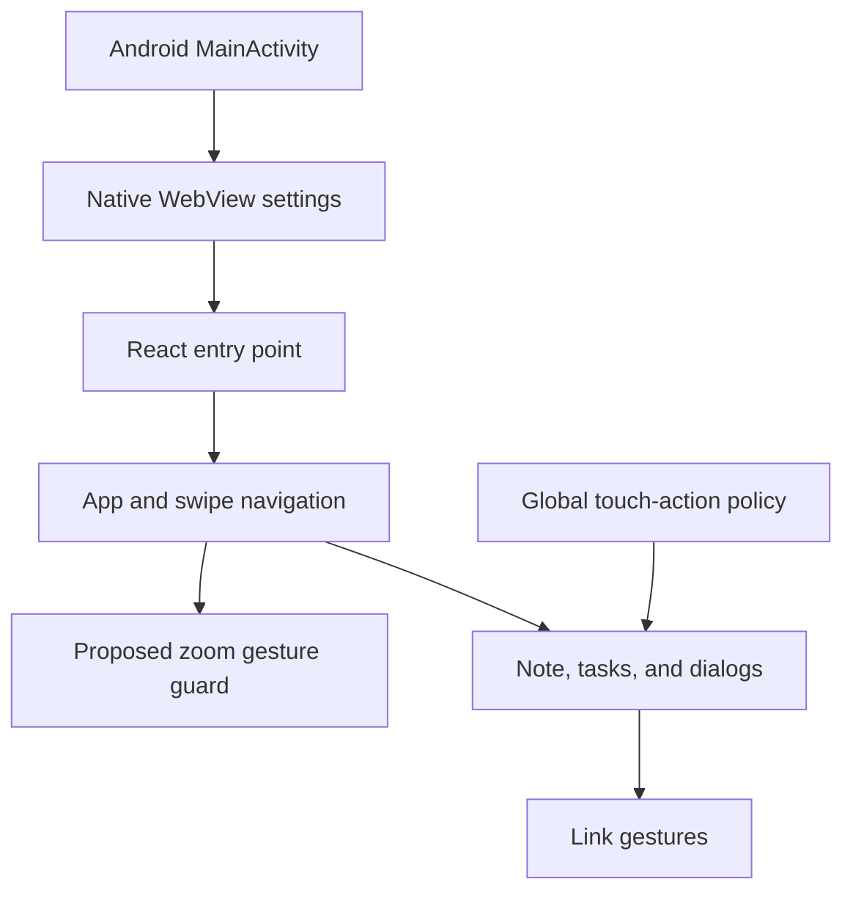

# Brooks-Lint Health Dashboard

- [Module Dependency Graph](#module-dependency-graph)
- [Test Suite Map](#test-suite-map)
- [Top Findings](#top-findings)
  - [Warning](#warning)
- [Recommendation](#recommendation)

**Mode:** Health Dashboard
**Scope:** `tasks/29-disable-zoom-gestures/2-plan.md` at `b17055e`, checked against relevant app code and tests. This scores the plan, not the implementation or platform support.
**Composite Score:** 99/100
**Trend:** 97 → 99 (+2) from the last Health Dashboard; scopes differ, so the scores are not directly comparable.

| Dimension | Score | Top Finding |
|-----------|-------|-------------|
| Code Quality | 100/100 | No plan-specific finding. |
| Architecture | 100/100 | No plan-specific finding. |
| Tech Debt | 100/100 | No plan-specific finding. |
| Test Quality | 95/100 | Cross-target multitouch and cancellation are not specified. |

Scores use balanced deductions and weights of 25%, 30%, 25%, and 20%, respectively. The code-quality dimension evaluates the proposed plan, not the unrelated current branch diff. No tests or device checks were run.

## Module Dependency Graph

## Test Suite Map

The app has frontend unit and component tests under `app/src/`, plus Rust native tests. The proposed guard and app interaction tests are not implemented yet. This plan-focused review did not classify every test or assess an end-to-end suite.

## Top Findings

### Warning

**T5 — Cross-target multitouch can evade swipe protection**

Symptom: `2-plan.md:43` requests a two-finger sequence but does not specify where each finger starts or test `touchcancel`. In `app/src/App.tsx:202-220`, the reset occurs only when a multi-touch `touchstart` reaches `.panes`; `onTouchEnd` neither checks remaining touches nor tracks cancellation. A second finger starting outside `.panes` can leave the first swipe armed, and ending that finger inside the panes may trigger navigation.

Source: *The Art of Unit Testing* — completeness of edge-path tests; *Working Effectively with Legacy Code* — Characterization Tests.

Consequence: A same-target synthetic multitouch test can pass while a real cross-target gesture changes panes, contradicting the acceptance criterion at `2-plan.md:61`. Cancellation can also leave stale swipe state unexamined.

Remedy: Specify behavior tests for a first touch inside `.panes`, a second touch outside it, and the first finger ending while the second remains down; also cover `touchcancel` followed by an end or new gesture. If reproduced, update swipe state handling to invalidate multi-touch or canceled sequences without breaking single-finger navigation, and verify both finger-release orders on a device where possible.

## Recommendation

Clarify the multitouch regression cases before implementation. The proposed platform checks appropriately distinguish synthetic event tests from physical zoom validation; retain that distinction and report unavailable devices and Android toolchains explicitly. A focused test-quality review is useful after the new tests exist.
