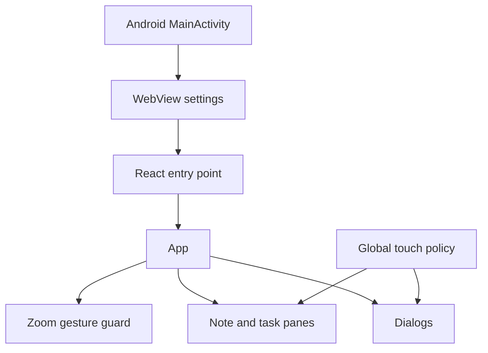

# Brooks-Lint Health Dashboard

- [Module Dependency Graph](#module-dependency-graph)
- [Test Suite Map and Verification](#test-suite-map-and-verification)
- [Top Findings](#top-findings)
  - [Warning](#warning)
- [Recommendation](#recommendation)

**Mode:** Health Dashboard
**Scope:** All branch changes against `main`: parent `151f7cb..6e903e2` and app submodule `69684e1..4240dfd`. The server gitlink is unchanged. This is a branch review, not an assessment of the entire project.
**Composite Score:** 99/100
**Trend:** Stable at 99 compared with the previous Health Dashboard, but that review assessed a plan, not implementation.

| Dimension | Score | Top Finding |
|-----------|-------|-------------|
| Code Quality | 100/100 | No additional finding in the changed code. |
| Architecture | 100/100 | No dependency disorder found in the change. |
| Tech Debt | 100/100 | No additional finding in the scoped change. |
| Test Quality | 95/100 | Cross-target multitouch can switch panes despite the new regression test. |

Balanced scoring uses weights of 25%, 30%, 25%, and 20%. The inherited swipe defect below is included because the task explicitly requires multitouch not to switch panes.

## Module Dependency Graph

## Test Suite Map and Verification

The app suite includes frontend unit and component/integration tests and Rust native tests; it is not classified exhaustively by layer here. The committed frontend suite passed 711 tests across 45 files, and `npm run build` passed during this review. An isolated temporary React/jsdom probe failed as described below; it was removed after execution. Implementation records 62 native tests passed and one ignored, plus a passing Clippy run. Android compilation and real-device gesture verification remain unavailable; synthetic events do not demonstrate native page-scale behavior.

## Top Findings

### Warning

**T5 — Cross-target multitouch still switches views**

Symptom: The new test at `app/src/App.test.tsx:54-76` sends both `touchstart` events to `.panes`. The existing handler at `app/src/App.tsx:204-222` resets its swipe only when the second start reaches `.panes`, and its end handler does not check remaining touches. A temporary probe started one finger in `.panes`, started another on `.bottom-nav`, and ended the first with the second still down; the view changed from `note` to `todo` instead of remaining on `note`.

Source: *The Art of Unit Testing* — completeness of edge-path tests; *Working Effectively with Legacy Code* — Characterization Tests.

Consequence: The committed suite passes while a two-finger gesture can unexpectedly change panes, violating `tasks/29-disable-zoom-gestures/2-plan.md:61`. This swipe behavior existed before the branch; the change does not establish the task's stated multitouch guarantee.

Remedy: Track and invalidate the swipe when a second touch begins anywhere in the document or when the sequence is canceled, without intercepting general touch input. Add regression tests for cross-target starts, both release orders, and cancellation, and check real-device behavior when available.

## Recommendation

Resolve the reproduced multitouch acceptance gap before declaring the task complete. Then validate Android compilation and physical touch and trackpad behavior on supported platforms; do not treat passing jsdom tests as proof of native zoom suppression. A focused test-quality review after those cases are added can check the remaining input coverage.
