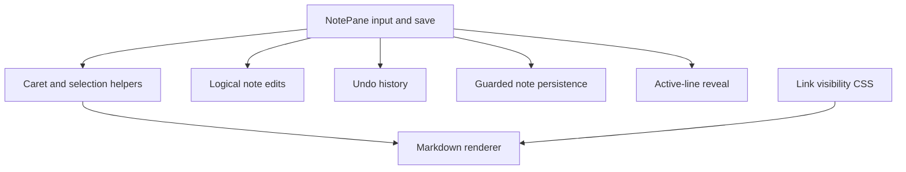

# Brooks-Lint Health Dashboard

- [Module Dependency Graph](#module-dependency-graph)
- [Test Suite Map](#test-suite-map)
- [Top Findings](#top-findings)
  - [Warning](#warning)
- [Recommendation](#recommendation)

**Mode:** Health Dashboard
**Scope:** `tasks/30-preserve-markdown-link-backspace/2-plan.md` at `5fbecf3`, checked against the relevant app editor, caret, and history code. Scores assess the plan, not an implementation or physical WebView behavior.
**Composite Score:** 98/100
**Trend:** 99 → 98 (-1) from the previous Health Dashboard; the scopes differ and are not directly comparable.

| Dimension | Score | Top Finding |
|-----------|-------|-------------|
| Code Quality | 95/100 | The plan does not resolve modifier provenance in `beforeinput`. |
| Architecture | 100/100 | No plan-specific dependency finding. |
| Tech Debt | 100/100 | No plan-specific debt finding. |
| Test Quality | 95/100 | The proposed caret check does not protect against hidden-node normalization. |

Scores use balanced deductions and weights of 25%, 30%, 25%, and 20%, respectively. No tests or device checks were run.

## Module Dependency Graph

## Test Suite Map

The app has frontend unit and component/integration tests, including `caret.test.ts`, `noteEdit.test.ts`, and `NotePane.test.tsx`, plus native Rust tests. The proposed tests are not implemented. This plan-focused review did not classify the entire suite or evaluate end-to-end coverage.

## Top Findings

### Warning

**R2 — Modified Backspace can reach the unqualified `beforeinput` path**

Symptom: `2-plan.md:26-27` instructs the handler to process `deleteContentBackward` and leave modified Backspace untouched, but it does not specify how the `beforeinput` handler distinguishes a preceding modified keydown. An `InputEvent` does not itself carry the keyboard modifier flags; some modified Backspace combinations may still generate `deleteContentBackward`. A keydown handler that simply returns for modifiers does not stop the later `beforeinput` listener from applying the join.

Source: *The Pragmatic Programmer* — Orthogonality; *Code Complete* — defensive handling of input paths.

Consequence: Depending on the WebView's event mapping, a modified deletion can be replaced by a one-newline join, despite the stated shortcut-preservation criterion. Testing only the keydown event would miss the subsequent handler.

Remedy: Define and test event-sequence ownership for modified keydown followed by `beforeinput`, including repeat, keyup, blur, and mobile input without keydown. Preserve the native modified operation without leaving stale state that suppresses later ordinary mobile deletion; characterize which combinations produce each input type on available hosts.

**T5 — Caret restoration is attempted before hidden link syntax is revealed**

Symptom: `2-plan.md:28` requires the existing `paint` path. `app/src/components/NotePane.tsx:122-124` calls `setEditorText` before `markEditLine`; `app/src/lib/caret.ts:102-105` renders fresh markup and restores the caret immediately, while `app/src/style.css:299-305` hides link markers until the line is marked. For a link ending the joined line, the desired offset resolves into the hidden closing marker. The plan tests the resulting logical offset in jsdom but does not specify the render/reveal/restore ordering or browser normalization of a selection in `display: none` content.

Source: *How Google Tests Software* — change coverage; *Working Effectively with Legacy Code* — Characterization Tests.

Consequence: A real WebView may normalize or reject that hidden-node selection before the active line is revealed, leaving the caret at the wrong position even though jsdom passes. This is a platform risk, not a reproduced device failure.

Remedy: Specify a safe ordering that reveals the destination line before final selection placement, or otherwise verifies and restores the intended visible logical boundary. Add a real-WebView check for caret position and the next typed character after a joined link; retain jsdom assertions as unit evidence, not native proof.

## Recommendation

Clarify modifier-event ownership and caret restoration ordering before implementation. The proposed test-quality dimension needs the most attention; run a focused test review after implementation and real-device verification where available.
