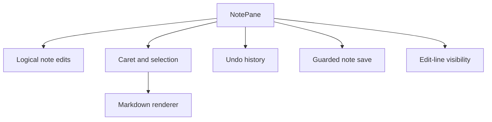

# Brooks-Lint Health Dashboard

- [Module Dependency Graph](#module-dependency-graph)
- [Test Suite Map and Verification](#test-suite-map-and-verification)
- [Top Findings](#top-findings)
  - [Warning](#warning)
- [Recommendation](#recommendation)

**Mode:** Health Dashboard
**Scope:** All branch changes against `main`: parent `e7d2b37..a547aaf` and app submodule `4240dfd..8dda72f`. The server gitlink is unchanged. The existing `todo.md` change was excluded.
**Composite Score:** 99/100
**Trend:** 98 → 99 (+1) from the previous Health Dashboard, which assessed the plan rather than the implementation.

| Dimension | Score | Top Finding |
|-----------|-------|-------------|
| Code Quality | 95/100 | Modifier release during a held Backspace loses sequence ownership. |
| Architecture | 100/100 | No dependency disorder found in the change. |
| Tech Debt | 100/100 | No additional scoped finding. |
| Test Quality | 100/100 | No separate finding beyond the missing sequence in the code-quality finding. |

Balanced scoring uses weights of 25%, 30%, 25%, and 20%. The composite is rounded half-up.

## Module Dependency Graph

## Test Suite Map and Verification

The app suite includes frontend unit and component/integration tests and native Rust tests; this review did not classify the entire suite by layer. During review, `npm test` passed 722 tests across 45 files and `npm run build` passed. A temporary focused React/jsdom probe failed as described below and was removed. Implementation recorded 62 native tests passed, one ignored, and a passing Clippy run. No real desktop WebView or Android input was available for this review; jsdom does not establish native deletion or caret behavior.

## Top Findings

### Warning

**R2 — Releasing a modifier during Backspace repeat changes event ownership**

Symptom: `app/src/components/NotePane.tsx:564-569` overwrites `modifiedBackspace.current` on every Backspace keydown, including auto-repeat. A focused probe pressed Ctrl+Backspace at the start of the second line of `a\nb`, released Ctrl while continuing to hold Backspace, and sent a repeated Backspace keydown without Ctrl. The repeat was prevented and the logical join executed, rather than leaving the held modified sequence native until Backspace keyup. The committed modifier test at `app/src/components/NotePane.test.tsx:149-173` releases the modifier but does not send another repeated keydown before Backspace keyup.

Source: *The Pragmatic Programmer* — Orthogonality; *The Art of Unit Testing* — completeness of edge-path tests.

Consequence: Releasing a modifier during an auto-repeating deletion can unexpectedly switch from the native modified operation to the custom line join. This contradicts the sequence-ownership policy in `tasks/30-preserve-markdown-link-backspace/2-plan.md:27` and can change the resulting note.

Remedy: Preserve the modified sequence through repeated Backspace events until its actual Backspace keyup or another explicit reset, distinguishing a fresh unmodified press from `repeat: true`. Add a regression covering modifier release before a repeat, subsequent beforeinput, and a fresh ordinary press after keyup.

## Recommendation

Correct the reproduced held-key ownership gap before merging. Validate the original deletion, caret placement, and mobile input on real supported WebViews when available; the passing synthetic suite cannot prove native behavior. A focused test-quality review can assess the input-event cases after the fix.
