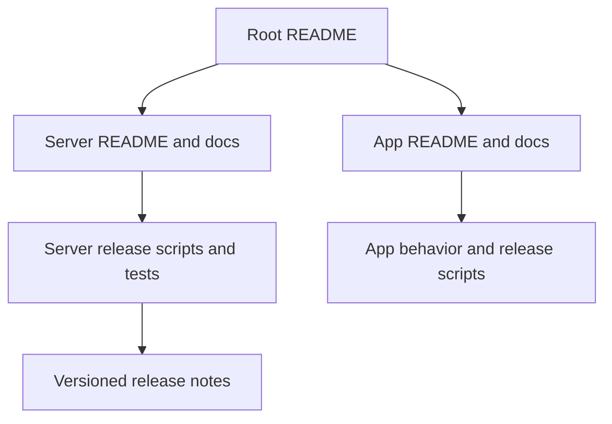

# Brooks-Lint Health Dashboard

- [Module Dependency Graph](#module-dependency-graph)
- [Test Suite Map](#test-suite-map)
- [Top Findings](#top-findings)
  - [Warning](#warning)
- [Recommendation](#recommendation)

**Mode:** Health Dashboard
**Scope:** `tasks/31-simplify-documentation/2-plan.md` at `53403da`, checked against the root, app, and server documentation and server release validation. Scores assess the plan, not the future edits or live publication state.
**Composite Score:** 98/100
**Trend:** 99 → 98 (-1) from the previous Health Dashboard; the scopes differ and are not directly comparable.

| Dimension | Score | Top Finding |
|-----------|-------|-------------|
| Code Quality | 95/100 | A server documentation commit changes release source identity. |
| Architecture | 100/100 | No plan-specific dependency finding. |
| Tech Debt | 100/100 | No additional plan-specific finding. |
| Test Quality | 95/100 | README release-mirror validation is not required after README edits. |

Scores use balanced deductions and weights of 25%, 30%, 25%, and 20%, respectively. This is a plan review; no tests or live service checks were run.

## Module Dependency Graph

## Test Suite Map

The server has Python release and recovery tests and Rust tests. The app has frontend and native tests. This review sampled the server release validation contract and documentation; it did not classify the entire suite or execute it.

## Top Findings

### Warning

**R2 — Server documentation commits change release source identity**

Symptom: `2-plan.md:14,41` calls for no release-state change and a server submodule commit without a version bump for prose-only changes. `server/docs/release-publication.md:11-15,23-25` states that publication binds the captured source commit and that changed source cannot retry an already bound version through the ordinary publisher. Even when release notes and scripts are untouched, a new server docs commit changes that captured source. The README says `0.2.9` is prepared, but the plan does not establish whether that version already has live publication evidence.

Source: *Software Engineering at Google* — backward compatibility and observable contracts; *Code Complete* — defensive handling of failure paths.

Consequence: If the current version is already bound to a prior commit, the documentation-only commit can make a normal same-version publication retry refuse. A local README statement cannot establish current remote state, so the impact is conditional, not a claim that publication has occurred.

Remedy: Add a pre-commit release-identity gate for server changes. Determine whether the version has accepted tag/release evidence using authorized read-only checks, or explicitly record that state as unknown. If evidence exists or cannot be established, retain the existing identity and seek a separately approved release/version decision rather than silently assuming a docs-only commit is release-neutral. Do not publish, alter tags, or perform recovery during this task.

**T5 — Server README simplification can break release validation**

Symptom: `2-plan.md:25,40` permits shortening the server README and makes documentation/link checks conditional, but does not require the server's available offline release validation after README edits. `server/scripts/release-data.py:157-166` requires the literal `Version <VERSION>` and a link to `docs/releases/<VERSION>.md` in that README; ordinary Markdown link checks do not enforce this mirror.

Source: *How Google Tests Software* — change coverage; *Working Effectively with Legacy Code* — Characterization Tests.

Consequence: A concise but otherwise valid README can break the release workflow before publication, despite passing link and whitespace checks.

Remedy: Preserve both README mirror requirements and run `./scripts/release.sh --validate` from `server/` whenever the server README or related release documentation changes. Also run the existing Python release tests when practical; report unavailable prerequisites and failures without invoking live publication.

## Recommendation

Resolve the server release identity gate and README validation before implementing the documentation rewrite. Keep safety-critical release and recovery details even where they limit shortening. After edits exist, use a focused test review to assess the documentation checks and any remaining release-validation gaps.
