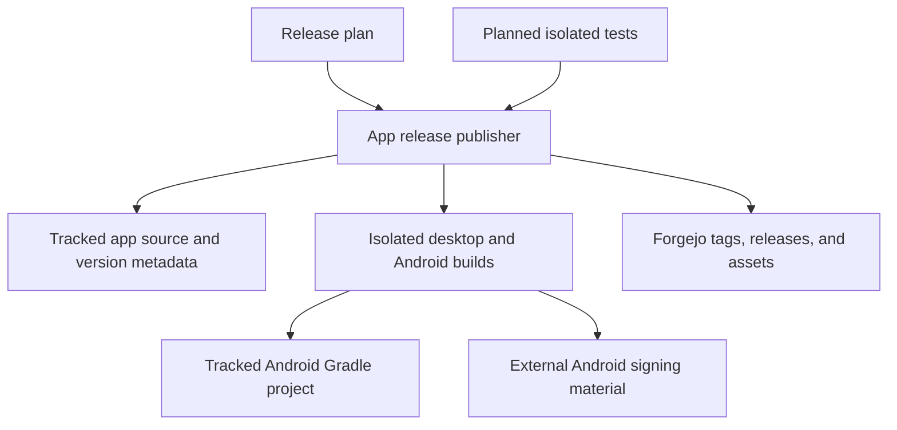

# Brooks-Lint Health Dashboard

- [Module dependency graph](#module-dependency-graph)
- [Top findings](#top-findings)
  - [Critical](#critical)
  - [Warning](#warning)
- [Recommendation](#recommendation)

**Mode:** Health Dashboard

**Scope:** Updated `tasks/32-align-app-release-process/2-plan.md`, checked against app release scripts and Android configuration. Scores assess the plan, not the entire project.

**Composite Score:** 91/100

| Dimension | Score | Top finding |
|-----------|-------|-------------|
| Code Quality | Skipped | No uncommitted diff; this is a plan review. |
| Architecture | 95/100 | Android project regeneration may replace tracked build configuration. |
| Tech Debt | 80/100 | Completed-release verification has no independent path. |
| Test Quality | 100/100 | No additional test-plan finding within this scope. |

The previous review's version, artifact inventory, isolated-build, and fake-service concerns are addressed in the plan. The previously identified critical finding was deliberately left unaddressed at the user's request and remains visible below.

## Module dependency graph

## Top findings

### Critical

**R6 — Completed-release verification has no independent path**

Symptom: `2-plan.md:29-32` requires a build and completed-release verification but does not define how to detect a completed release before building or reconstruct its original manifest without a rebuild. `2-plan.md:58-59` acknowledges nondeterministic signing and the deferred finding.

Source: Code Complete — defensive programming and explicit error paths.

Consequence: A retry can need unavailable signing tools or produce different digests and reject a valid release; a rebuilt manifest cannot establish the original artifact identity.

Remedy: If the user later chooses to address this finding, define a read-only remote-state preflight and verify a completed release using its tag-bound original manifest and remote asset bytes, without rebuilding or writing. Test nondeterministic builds and unavailable signing tools.

### Warning

**R5 — Android regeneration can change tracked source**

Symptom: `2-plan.md:29` directs the publisher to generate the Android project, but `app/src-tauri/gen/android/app/build.gradle.kts` and other Android project files are already tracked and include custom signing configuration.

Source: A Philosophy of Software Design — information hiding and preservation of invariants at boundaries.

Consequence: Regeneration may overwrite or alter tracked Gradle settings in the isolated checkout, so the built app may not correspond to the verified commit or may lose signing configuration.

Remedy: Build from the checked-out tracked Android project; regenerate only explicitly identified missing ignored files if required. Verify tracked files remain identical to the release commit before and after setup and build, and test that changes cause refusal before publication.

**R6 — Valid signatures do not establish Android update identity**

Symptom: `2-plan.md:23,29,38` requires signed APK and AAB files and rejects invalid signatures, but does not require their signing certificates to match each other or the expected existing app signing identity. `app/docs/android-signing.md:11` says losing the keystore prevents shipping updates.

Source: Domain-Driven Design — explicit domain invariants.

Consequence: Artifacts signed with a valid but wrong key can pass the planned checks yet fail to update existing installations, or APK and AAB releases can use different identities.

Remedy: Define a trusted expected certificate fingerprint and verify both artifacts against it before remote writes. Document how to establish or change the fingerprint, distinguish any app-store signing key from the upload key, and test wrong-key and mismatched-certificate cases.

## Recommendation

Clarify Android project preparation and signing identity before implementation. The completed-release finding remains deferred by user direction, not resolved. The composite uses balanced deductions and redistributes the skipped code-quality weight; local fake tests cannot prove live Forgejo or device behavior.
