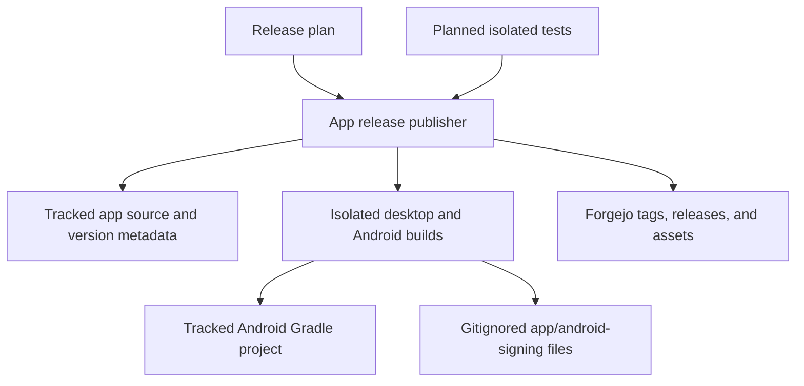

# Brooks-Lint Health Dashboard

- [Module dependency graph](#module-dependency-graph)
- [Top findings](#top-findings)
  - [Critical](#critical)
- [Resolved warnings](#resolved-warnings)
- [Recommendation](#recommendation)

**Mode:** Health Dashboard

**Scope:** `tasks/32-align-app-release-process/2-plan.md` at `1223717`, including local gitignored signing storage, APK-only distribution, tracked Android configuration preservation, and expected certificate verification. Scores assess the plan, not the entire project. No implementation changes or build tests were performed.

**Composite Score:** 95/100

**Trend:** 91 → 95 (+4) compared with the preceding review of this plan.

| Dimension | Score | Top finding |
|-----------|-------|-------------|
| Code Quality | Skipped | No uncommitted diff; this is a plan review. |
| Architecture | 100/100 | Both Android boundary concerns are addressed in the plan. |
| Tech Debt | 85/100 | Completed-release verification has no independent path. |
| Test Quality | 100/100 | No additional test-plan finding within this scope. |

Local `app/android-signing/` storage includes ignore rules, restrictive permissions, migration, preservation of original files, and encrypted backup guidance. AAB and Google Play App Signing remain excluded. Both preceding warnings are now addressed; no new warnings were identified. The earlier critical finding remains deferred by user direction.

The planned test map covers local validation and identity checks, isolated Git/build/service integration, and APK signature checks. Actual unit/integration/end-to-end counts cannot be assessed before those tests exist.

## Module dependency graph

## Top findings

### Critical

**R6 — Completed-release verification has no independent path**

Symptom: `2-plan.md:32-36` requires a build and completed-release verification but does not define how to detect a completed release before building or reconstruct its original manifest without a rebuild. `2-plan.md:67-68` acknowledges nondeterministic signing and the deferred finding.

Source: Code Complete — defensive programming and explicit error paths.

Consequence: A retry can need unavailable signing tools or produce different digests and reject a valid release; a rebuilt manifest cannot establish the original artifact identity.

Remedy: If the user later chooses to address this finding, define a read-only remote-state preflight and verify a completed release using its tag-bound original manifest and remote asset bytes, without rebuilding or writing. Test nondeterministic builds and unavailable signing tools.

## Resolved warnings

- Android regeneration: `2-plan.md:32,43,51,59` now requires building the tracked Android project without regeneration, checking tracked source after preparation and builds, refusing changes before publication, and testing that refusal.
- APK signing identity: `2-plan.md:33,43,51,59` now pins a trusted public certificate fingerprint independently of the supplied private key, checks each APK before remote writes, tests wrong-key and absent-fingerprint cases, and requires approval for intentional changes.

These are plan-level resolutions; implementation and device behavior remain unverified.

## Recommendation

No further warning-driven plan changes are needed from this review. Preserve the APK-only scope and local gitignored signing storage. The completed-release finding remains deferred by user direction, not resolved or silently approved. Balanced scoring gives architecture 100, debt 85, and test planning 100; redistributing the skipped code-quality weight yields 95. Local fake tests cannot prove live Forgejo or device behavior.
