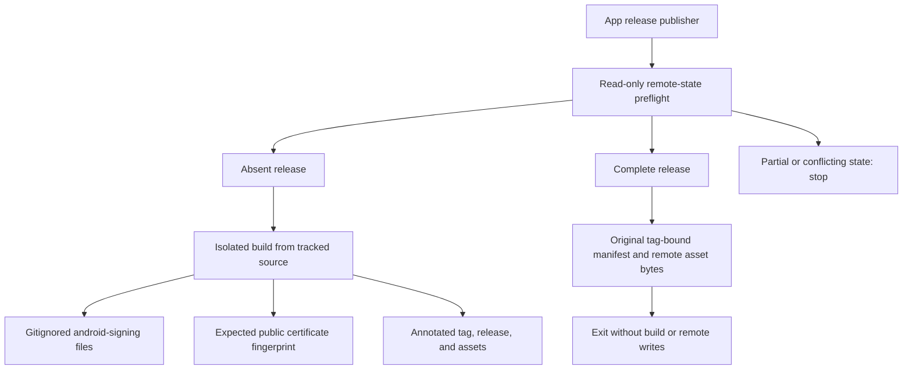

# Brooks-Lint Health Dashboard

- [Module dependency graph](#module-dependency-graph)
- [Top findings](#top-findings)
- [Resolved findings](#resolved-findings)
- [Recommendation](#recommendation)

**Mode:** Health Dashboard

**Scope:** `tasks/32-align-app-release-process/2-plan.md` at `06ac334`. This reviews the release plan, not implementation quality or live publication readiness. No implementation changes or build tests were performed.

**Composite Score:** 100/100

**Trend:** 95 → 100 (+5) compared with the preceding review of this plan.

| Dimension | Score | Top finding |
|-----------|-------|-------------|
| Code Quality | Skipped | No uncommitted diff. |
| Architecture | 100/100 | No remaining plan-level finding. |
| Tech Debt | 100/100 | Completed-release verification now has an independent path. |
| Test Quality | 100/100 | Planned tests cover the identified release failure paths. |

The planned test map includes local validation and identity checks, isolated Git/build/service integration, and APK signature checks. Actual unit/integration/end-to-end counts and test quality cannot be established before implementation.

## Module dependency graph

## Top findings

No remaining critical, warning, or suggestion findings were identified in this plan review. Previously deferred does not mean permanently suppressed: the critical finding is now resolved by explicit changes to the plan.

## Resolved findings

- Completed-release verification: `2-plan.md:31-32,44,56,64,72` now defines absent/complete/partial remote-state branching before build prerequisites. Complete releases use the original tag-bound manifest and downloaded remote bytes without rebuilding, signing-key access, dependency installation, tests, or remote writes. Tests cover missing build tools and keys, a nondeterministic fake builder, corrupted or inconsistent remote evidence, and concurrent state changes.
- Android tracked configuration: `2-plan.md:34,46,54,63` preserves the checked-out Android project, limits generation to identified ignored support files, checks tracked source after setup and build, and tests refusal before publication when it changes.
- APK signing identity: `2-plan.md:35,46,54,63` pins the trusted certificate fingerprint separately from secrets, verifies each release APK against it, tests wrong-key and missing-fingerprint cases, and requires explicit approval for intentional changes.
- Scope and secret storage: `2-plan.md:16,25,33,45,53,62` retains APK-only distribution, gitignored local `app/android-signing/`, restrictive permissions, safe migration, preservation of originals, and encrypted backup guidance. AAB and Google Play App Signing remain excluded.

These are plan-level resolutions, not claims that implementation, device updates, or live Forgejo compatibility have been verified.

## Recommendation

The plan is ready for implementation review gates with no further plan changes requested by this review. Preserve the separate read-only verification path and test its lack of build and signing dependencies explicitly. Real publication still requires separate approval, prepared credentials and tools, exclusive writers, and verification of deployed API compatibility. The score uses balanced deductions with the skipped code-quality weight redistributed across the other dimensions.
