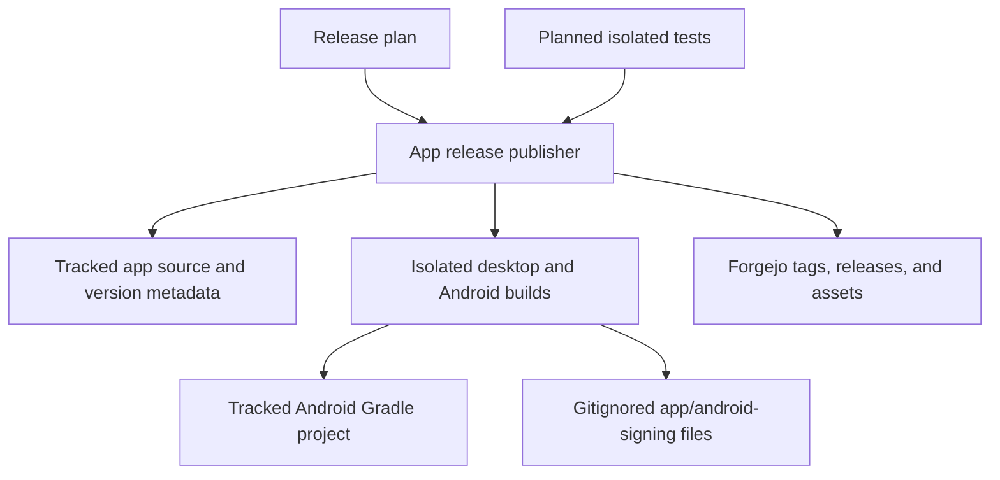

# Brooks-Lint Health Dashboard

- [Module dependency graph](#module-dependency-graph)
- [Top findings](#top-findings)
  - [Critical](#critical)
  - [Warning](#warning)
- [Recommendation](#recommendation)

**Mode:** Health Dashboard

**Scope:** `tasks/32-align-app-release-process/2-plan.md` at `e012c89`, including local gitignored signing storage and APK-only distribution. Scores assess the plan, not the entire project. No implementation changes or build tests were performed.

**Composite Score:** 91/100

**Trend:** Stable at 91 compared with the preceding review of this plan. Older project-wide history has a different scope and is not a comparable trend.

| Dimension | Score | Top finding |
|-----------|-------|-------------|
| Code Quality | Skipped | No uncommitted diff; this is a plan review. |
| Architecture | 95/100 | Android project regeneration may replace tracked build configuration. |
| Tech Debt | 80/100 | Completed-release verification has no independent path. |
| Test Quality | 100/100 | No additional test-plan finding within this scope. |

Local `app/android-signing/` storage now includes ignore rules, restrictive permissions, migration, preservation of original files, and encrypted backup guidance. AAB and Google Play App Signing are explicitly excluded; no findings request restoring them. The earlier critical finding remains deferred by user direction. The two remaining Android warnings are not resolved by changing the storage location or removing AAB.

The planned test map covers local validation and identity checks, isolated Git/build/service integration, and APK signature checks. Actual unit/integration/end-to-end counts cannot be assessed before those tests exist.

## Module dependency graph

## Top findings

### Critical

**R6 — Completed-release verification has no independent path**

Symptom: `2-plan.md:32-35` requires a build and completed-release verification but does not define how to detect a completed release before building or reconstruct its original manifest without a rebuild. `2-plan.md:63-64` acknowledges nondeterministic signing and the deferred finding.

Source: Code Complete — defensive programming and explicit error paths.

Consequence: A retry can need unavailable signing tools or produce different digests and reject a valid release; a rebuilt manifest cannot establish the original artifact identity.

Remedy: If the user later chooses to address this finding, define a read-only remote-state preflight and verify a completed release using its tag-bound original manifest and remote asset bytes, without rebuilding or writing. Test nondeterministic builds and unavailable signing tools.

### Warning

**R5 — Android regeneration can change tracked source**

Symptom: `2-plan.md:32` directs the publisher to generate the Android project, but `app/src-tauri/gen/android/app/build.gradle.kts` and other Android project files are already tracked and include custom signing configuration. Updating Gradle to read `android-signing/` does not remove the risk of subsequently regenerating that configuration.

Source: A Philosophy of Software Design — information hiding and preservation of invariants at boundaries.

Consequence: Regeneration may overwrite or alter tracked Gradle settings in the isolated checkout, so the built app may not correspond to the verified commit or may lose signing configuration.

Remedy: Build from the checked-out tracked Android project; regenerate only explicitly identified missing ignored files if required. Verify tracked files remain identical to the release commit before and after setup and build, and test that changes cause refusal before publication.

**R6 — Valid signatures do not establish Android update identity**

Symptom: `2-plan.md:25,32,41` requires a valid APK signature, and `2-plan.md:31` checks the existing certificate fingerprint during migration. The plan does not require every release APK's signer to match a trusted expected certificate for existing installations.

Source: Domain-Driven Design — explicit domain invariants.

Consequence: An APK signed with a valid but wrong key can pass the planned checks yet fail to update existing installations. Migration verification alone does not catch a later accidental key replacement.

Remedy: Record a trusted expected public certificate fingerprint separately from the private files and verify every release APK against it before remote writes. Document how to establish the fingerprint from the existing signing identity and how intentional changes require explicit approval. Test a cryptographically valid APK signed by the wrong key. No AAB or Google Play integration is needed.

## Recommendation

Keep the local gitignored signing directory and APK-only scope. Clarify tracked Android project preparation and per-release certificate identity checks before implementation. The completed-release finding remains deferred by user direction, not resolved. Balanced scoring gives architecture 95, debt 80, and test planning 100; redistributing the skipped code-quality weight yields 91. Local fake tests cannot prove live Forgejo or device behavior.
