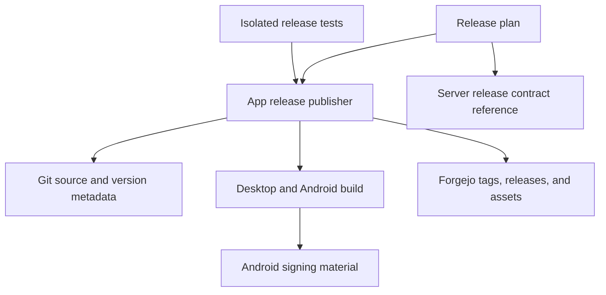

# Brooks-Lint Health Dashboard

- [Module dependency graph](#module-dependency-graph)
- [Top findings](#top-findings)
  - [Critical](#critical)
  - [Warning](#warning)
- [Recommendation](#recommendation)

**Mode:** Health Dashboard

**Scope:** `tasks/32-align-app-release-process/2-plan.md`, checked against the app and server release workflows. Scores assess the plan, not the entire codebase.

**Composite Score:** 91/100

| Dimension | Score | Top finding |
|-----------|-------|-------------|
| Code Quality | 95/100 | Expected artifact inventory is unspecified. |
| Architecture | 95/100 | Isolated builds lack a signing and dependency strategy. |
| Tech Debt | 80/100 | Completed-release verification may depend on a nondeterministic rebuild. |
| Test Quality | 95/100 | Fake service tests lack a fidelity contract. |

## Module dependency graph

## Top findings

### Critical

**R6 — Completed-release verification has no independent path**

Symptom: `2-plan.md:29-31` requires building artifacts before publication and reverifying completed releases, while `2-plan.md:55` notes that Android signing can be nondeterministic. It does not define how to identify a completed release before building or reconstruct its original manifest without a rebuild.

Source: Code Complete — defensive programming and explicit error paths.

Consequence: A retry can require unavailable build credentials or produce different digests and reject an otherwise valid release; comparing only to a rebuilt manifest cannot verify the original identity.

Remedy: Define a read-only preflight that detects complete, partial, and absent remote states. For a complete release, parse the manifest bound in the annotated tag, verify its source, settings, notes, targets, and downloaded remote asset bytes, and exit without rebuilding or writing. Test a nondeterministic build and missing signing tools on this path.

### Warning

**R5 — Isolated build inputs are not defined**

Symptom: `2-plan.md:29` requires an isolated build from the verified commit, but `app/docs/android-signing.md:11` places required signing material in a gitignored generated Android directory, and `app/scripts/build-release.sh:69-90` builds in the existing checkout's output directories.

Source: Clean Architecture — boundary between policy and external infrastructure.

Consequence: A clean source checkout may lack the signing and generated platform state needed to build, or reuse untracked build outputs that the plan intends to exclude.

Remedy: Specify an isolated checkout and fresh build/output directories, how dependencies and generated Android files are prepared, and how private signing material is supplied without entering the source or published artifacts. Include explicit checks that compiled outputs are fresh and signed.

**R6 — Artifact completeness is deferred to implementation**

Symptom: `2-plan.md:23,29` says to specify expected artifact types and reject missing outputs, but does not state which formats are required for each selected target. The existing builder collects AppImage, deb, rpm, APK, and AAB and only warns when none match (`app/scripts/build-release.sh:49-90`).

Source: Domain-Driven Design — Ubiquitous Language and explicit domain invariants.

Consequence: Different implementations can pass with different incomplete release sets, and a desktop or Android target could be reported as complete with important packages missing.

Remedy: Choose and document the exact required versus optional formats per target and platform, including APK and AAB signing verification, name collision rules, and the behavior when a required format cannot be built. Add a negative test for each missing required format.

**T5 — Fake endpoints do not establish remote verification fidelity**

Symptom: `2-plan.md:30,35-37` makes Forgejo asset-byte verification a prerequisite and tests fake endpoints, but does not define the download/authentication contract or tests for pagination, redirects, malformed responses, and asset content mismatches.

Source: How Google Tests Software — change coverage over coverage illusion.

Consequence: Tests may pass against a simplified fake while the real service cannot securely retrieve or verify all assets, making publication fail after remote writes or misclassify a release.

Remedy: Define and validate the specific Forgejo API and authenticated asset-download behavior before writes, including pagination, redirect credential safety, size limits, and byte hashes. Test realistic responses and failure cases; clearly mark live compatibility as unverified unless separately approved and checked.

**R1 — Version and release identity serialization remain ambiguous**

Symptom: `2-plan.md:21-22` leaves the canonical version source and the format of the annotated tag's bound identity unspecified; `app/package-lock.json:3,9` has two root version fields to verify.

Source: A Philosophy of Software Design — information hiding and precise interfaces.

Consequence: Implementers may select incompatible version authorities or serialize identity differently between creation and verification, allowing missed mismatches or making releases impossible to reverify.

Remedy: Choose a canonical version file, enumerate both npm lockfile root fields and other mirrors, and specify a versioned canonical tag payload and manifest encoding, including exact comparison and malformed-input refusal tests.

## Recommendation

Update the plan before implementation, starting with the read-only completed-release verification path and its manifest contract. Then define isolated signing inputs and the artifact inventory. The score uses balanced deductions and weighted plan-scoped findings; it does not measure existing application quality.
