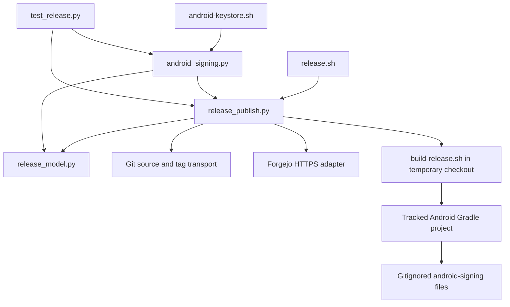

# Brooks-Lint Health Dashboard

- [Module dependency graph](#module-dependency-graph)
- [Top findings](#top-findings)
  - [Warning](#warning)
- [Verification and test map](#verification-and-test-map)
- [Recommendation](#recommendation)

**Mode:** Health Dashboard

**Scope:** All changes on `32-align-app-release-process` against parent `main`: parent `826cabd..9f8634b`, including app submodule `4fc1a91..2f4f7e9` (20 changed app files). Parent README, submodule pointer, and implementation report were also reviewed. Server implementation is unchanged. No `.brooks-lint.yaml` was found; balanced defaults apply.

**Composite Score:** 96/100

**Trend:** First implementation review for this task. The preceding 100/100 entry assessed the plan, not the implementation, and is not a comparable baseline.

| Dimension | Score | Top finding |
|-----------|-------|-------------|
| Code Quality | 100/100 | No additional R1/R2 finding in the branch scan. |
| Architecture | 95/100 | F3: build scratch cleanup also destroys recovery artifacts. |
| Tech Debt | 90/100 | F1–F2: release identity and absence evidence are not strict enough. |
| Test Quality | 100/100 | No separate T1/T2 finding; missing regression cases are specified with F1–F3. |

The composite is `100 × 0.25 + 95 × 0.30 + 90 × 0.25 + 100 × 0.20 = 96`. Each finding is deducted once. This score does not certify readiness for live publication.

## Module dependency graph

No dependency cycle was found. Sharing `git` and `run` through the publisher is not itself scored as a problem; the concrete lifetime mismatch is recorded in F3.

## Top findings

### Warning

**F1 — R6: Tag identity can include inputs absent from its source commit**

Symptom: `app/scripts/release_model.py:65-101` reads settings/notes from the working tree and hashes every regular `scripts/release*` match, including ignored files. `app/scripts/release_publish.py:49-54` relies on Git status rather than comparing those inputs with committed blobs. Two isolated probes passed the production source check with adapted local transport: adding ignored `scripts/release.local`, and modifying release notes marked `skip-worktree`. Both published successfully, but a fresh checkout of the identical commit refused verification with `Release identity changed`.

Source: Domain-Driven Design — explicit identity invariants; The Pragmatic Programmer — distinguish authoritative knowledge from incidental copies.

Consequence: A supposedly commit-bound release can depend on host-only files or uncommitted notes. The immutable tag cannot be reverified from a normal clean checkout of its own source, even though the original publisher reports success.

Remedy: Define a finite tracked input set and read identity/settings/notes from the captured commit's regular blobs. Either reject hidden index flags/local divergence or compare working inputs directly with those blobs before writes. Add fresh-clone verification regressions for ignored `release*.local` files and masked notes/settings edits; ignored host files must not enter the identity, and uncommitted identity changes must not publish.

**F2 — R6: HTTP 200 JSON null is mistaken for confirmed release absence**

Symptom: `app/scripts/release_publish.py:95-137` returns Python `None` both for HTTP 404 and for a successfully decoded HTTP 200 body of `null`. `publish()` at lines 325-350 treats that value as absence. An isolated probe using the actual `Forgejo.release()`/JSON decoder with a 200 `null` response reached a real temporary Git tag push and a simulated release POST before eventually refusing with `Release disappeared during verification`.

Source: Code Complete — defensive programming and explicit error-path validation.

Consequence: Malformed or ambiguous API evidence permits publication writes instead of stopping at preflight. A bad endpoint/proxy response can therefore leave a tag and partial release, contrary to the promised unknown-state refusal.

Remedy: Preserve HTTP status separately from decoded content. Only a verified 404 may represent absence; a 200 release response must be a valid release object or cause immediate refusal. Add a transport-to-orchestration regression for 200 `null`, not just direct fake-adapter `None`, asserting no build, tag push, or API write.

**F3 — R5: Publication failure discards the exact artifact needed for approved recovery**

Symptom: `app/scripts/release_publish.py:303-322` owns artifacts inside `TemporaryDirectory` and yields them into publication at lines 339-362. Any upload failure unwinds that context and deletes the artifact directory. A probe used the actual isolated build entry point with fake tools, rejected the first upload before acceptance, and observed an existing remote version tag, zero remote assets, no surviving original APK, and no persistent local release directory. Original signing inputs were correctly preserved.

Source: Clean Architecture — ownership boundaries between release policy and disposable build infrastructure.

Consequence: The tag already binds the original APK digest, but neither remote storage nor the checkout retains those exact bytes. Since signed APK rebuilds can differ, separately approved recovery may be unable to finish that identity without replacing/deleting the tag or abandoning the version. Stopping writes is correct; deleting the only non-secret recovery evidence is avoidable.

Remedy: Before the first remote write, retain verified artifact bytes and their canonical manifest in a user-owned gitignored staging directory keyed by version/source/identity. Never retain signing keys or passwords there. Continue to clean temporary signing/build inputs, but preserve publication artifacts after uncertain writes and document their inspection and eventual cleanup. Test that a rejected first upload leaves the exact tag-bound APK and manifest available without changing originals or enabling automatic retry.

## Verification and test map

- Passed: all 36 release tests. The changed suite contains nine local-contract tests, nine publication tests, eight transport tests, five signing tests, and five build/source tests. These mix unit and temporary-repository integration tests; there are no real SDK/device or live Forgejo end-to-end tests.
- Passed: 722 frontend tests across 45 files, `npm run build`, 62 native library tests (one existing server-dependent test ignored), and `cargo clippy --all-targets --locked`.
- Passed: Bash syntax checks for all three changed entry points, credential-free `release.sh --validate`, and app `git diff --check`.
- Reproduced F1–F3 with `/tmp/opencode/ntr32_review_probes.py`. The probes used temporary local repositories, simulated API state, and fake build/signing tools. Transport destination checks were adapted only for local Git; no real repository publication or actual signing-key access occurred. The probe file is outside the project; only this report and review history are committed.
- Publication tests replace `source` and `build` and use `FakeForgejo`; focused tests cover those adapters separately. That is a reasonable isolation choice, but it leaves the concrete transport/orchestration and fresh-checkout invariants above unprotected. Their remedies include the missing regression cases rather than counting duplicate test findings.
- Android key tooling, genuine signed APK/device updates, deployed Forgejo behavior, and real desktop bundles remain unverified. The explicit unset certificate fingerprint and refusal of new Android publication are documented setup constraints, not additional findings. AAB/Google Play support remains intentionally excluded.
- The implementation report records pre-existing Rust formatting failures in untouched `.rs` files; this review did not alter or reformat them and did not rerun that check. No fixes were applied to implementation or tests.

## Recommendation

Address F1 and F2 before real publication, then retain non-secret artifacts for F3 recovery. Preserve the completed-release read-only path and the existing refusal to overwrite partial states. The suite is fast and its existing cases pass, but the reproduced gaps mean those results are not sufficient for release sign-off. Architecture and debt would benefit from a focused follow-up review after fixes; no live publication is approved by this report.
