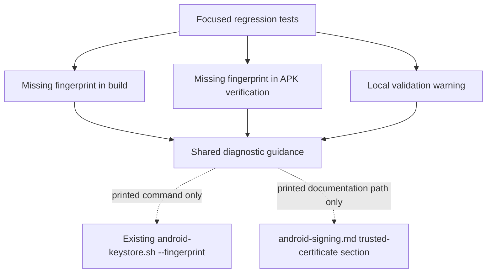

# Brooks-Lint Health Dashboard

- [Module dependency graph](#module-dependency-graph)
- [Top findings](#top-findings)
- [Review coverage](#review-coverage)
- [Recommendation](#recommendation)

**Mode:** Health Dashboard

**Scope:** `tasks/33-android-signing-error-guidance/2-plan.md` at `cb78de8`, checked against existing fingerprint guards, CLI error handling, signing helper, and signing documentation. This is a plan review, not a whole-project assessment. No implementation changes or tests were run. No `.brooks-lint.yaml` was found; balanced defaults apply.

**Composite Score:** 100/100

**Trend:** First review of this task's plan. The previous dashboard scored task 32's implementation at 96/100; its different scope is not a comparable baseline.

| Dimension | Score | Top finding |
|-----------|-------|-------------|
| Code Quality | Skipped | No implementation diff. |
| Architecture | 100/100 | Existing helper and documentation are reused without new runtime dependencies. |
| Tech Debt | 100/100 | One shared guidance string avoids diagnostic duplication. |
| Test Quality | 100/100 | Planned cases cover diagnostic content, CLI behavior, and prohibited side effects. |

## Module dependency graph

## Top findings

No critical, warning, or suggestion findings were identified within this plan's scope.

## Review coverage

- The scope directly addresses the user's request: expose an existing script command and documentation path in the reported error. No new setup abstraction or automatic key operation is introduced.
- `app/scripts/release_publish.py:273,302,381` contains the three existing diagnostics identified by the plan. Preserving their prefixes, stderr behavior, refusal status, and successful local-validation status limits compatibility changes.
- `app/scripts/android_signing.py:112-128` implements the referenced `--fingerprint` command, and `app/docs/android-signing.md:35-43` provides the referenced trusted-certificate section. The plan correctly distinguishes displaying a public fingerprint from configuring trust or creating a replacement key.
- The planned test map includes focused guard tests, isolated CLI stderr/status tests, temporary-null-configuration validation, and existing configured-certificate/read-only verification regressions. Future test counts and implementation quality cannot be established yet; live publication and real key access are explicitly excluded.
- The patch-version, version-mirror, configured notes path, README link, submodule-pointer, and implementation-report updates are consistent with the existing workflow. Their coordinated changes stay inside one release bounded context rather than constituting unrelated change propagation.
- Task 32's three unresolved code-review warnings are explicitly outside this diagnostic-only task. This clean plan review neither resolves nor dismisses those inherited release risks.

## Recommendation

Proceed with the narrowly scoped implementation and planned offline regression tests. Preserve the distinction between printing instructions and executing signing setup. No plan changes are requested; the score applies only to this plan and does not approve actual release publication.
