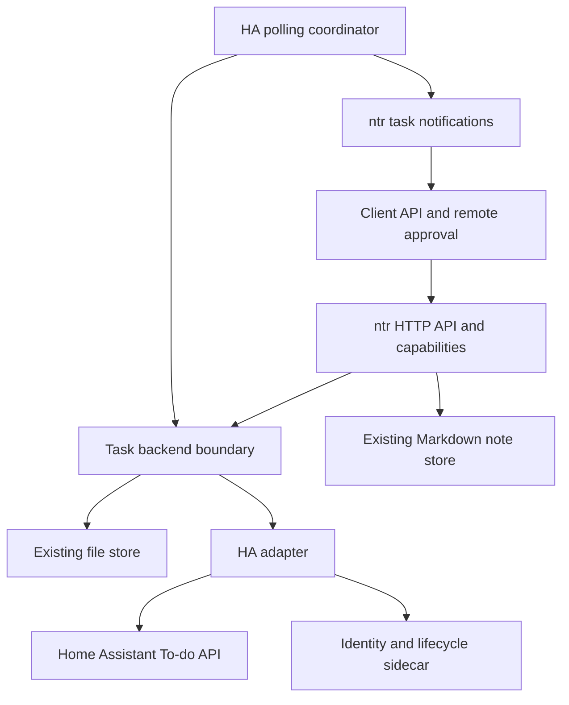

# Plan Review

- [Dashboard](#dashboard)
- [Goal Alignment](#goal-alignment)
- [Module Dependency Graph](#module-dependency-graph)
- [Top Findings](#top-findings)
- [Validation Review](#validation-review)
- [Recommendation](#recommendation)

## Dashboard

**Mode:** Health Dashboard

**Scope:** `tasks/35-homeassistant-todo/3-plan.md` at `7705306`, checked against `1-goal.md` and relevant client/server contracts. This is a plan review, not an implementation health assessment. No `2-design.md` or `.brooks-lint.yaml` exists.

**Composite Score:** 95/100

**Trend:** Previous Health Dashboard score was 100; this score is 5 lower, but the task and scope differ, so this is not evidence of codebase decline.

| Dimension | Score | Result |
| --- | --- | --- |
| Code Quality | Not scored | No implementation diff; reviewed plan clarity under the other dimensions. |
| Architecture | 95/100 | Mutation/poll snapshot ownership is not specified. |
| Tech Debt | 90/100 | Lifecycle metadata and datetime editing need explicit contracts. |
| Test Quality | 100/100 | Broad risk-based validation is planned; add the concrete regression cases below. No independent test-design finding. |

Balanced deductions: 5 per Warning. Code Quality is omitted because there is no implementation diff. Redistributed weights are Architecture `0.30/0.75`, Tech Debt `0.25/0.75`, and Test Quality `0.20/0.75`; the weighted result is 94.67, rounded to 95. Three Warning findings; no Critical or Suggestion findings. Scores assess the plan only.

## Goal Alignment

The plan follows the accepted server-mediated architecture. HA credentials and certificate trust stay on ntr server, certificate validation remains enabled, existing task files are preserved, and Markdown notes stay file-backed. One configured list, no automatic migration, and unchanged local-only mode are explicit first-version limits. A backend boundary is justified by the two current implementations; there is no evidence of speculative framework work.

No approved UI mockup exists. The datetime editor behavior below needs a written interaction decision before implementation; this review does not silently introduce a datetime picker.

## Module Dependency Graph

Proposed dependencies, not implemented modules:

Keep HA wire types and TLS details inside the adapter. Keep reconciliation policy and capabilities in the client transport layer rather than duplicating backend checks in each component.

## Top Findings

**F1 [R6] Domain Model Distortion — External completion cannot satisfy the existing edit contract (Warning)**

Symptom: Plan lines 33–34 retain ntr creation dates in a sidecar but require null lifecycle dates for external HA completions whose actual completion date is unknown. A task created in ntr and later completed in HA can therefore have `completed=true`, a known creation date, and `completion_date=null`. `app/src/labels.ts:70–81` rejects this combination, while the server's todo.txt serialization cannot encode its creation date without a completion date. The general instruction to preserve DTO/raw consistency does not resolve that conflict.

Source: Domain-Driven Design — Bounded Context and anti-corruption layer; Software Engineering at Google — backward compatibility.

Consequence: Editing externally completed ntr-created tasks can fail, or an implementation can drop creation metadata or invent completion history to fit the old format. This is a bounded interoperability gap in a planned workflow, not an established production defect.

Remedy: Define the exact projection for unknown external completion dates before implementation. For example, retain creation history privately in the sidecar but expose both dates as null while completed without a known completion date, restoring creation on reopen; alternatively extend the DTO and client serializer deliberately. Specify invalidation of old completion dates after external reopen/recomplete. Add an end-to-end adapter-to-client-edit contract test for create in ntr, complete in HA, edit in ntr, reopen, restart, and externally complete again.

**F2 [R6] Domain Model Distortion — Datetime round trips lack a date-editor interaction contract (Warning)**

Symptom: Plan lines 19 and 41 require preserving offset-bearing due tokens while keeping the date-only UI, and point mainly to task-text helpers. `app/src/components/EditTaskModal.tsx:48,125` binds the complete `tags.due` value to an HTML `type="date"` input. An offset-bearing datetime is not a valid date-input value. `app/src/lib/taskDates.ts:18–21` also recognizes only date-only values for metadata display. The plan does not distinguish untouched datetime, intentional date replacement, and intentional clearing in that form.

Source: Domain-Driven Design — explicit translation between bounded contexts; A Philosophy of Software Design — Information Hiding and Leakage.

Consequence: HA datetime tasks can show an empty due control despite retaining a due value, making preservation and removal ambiguous. A helper-only fix can retain hidden times or discard them after a user changes the date. This affects imported/external datetime tasks, not ordinary date-only tasks.

Remedy: Name the editor and display changes explicitly. Keep the original due value separate from the editable date and track user intent. Define whether changing the date preserves the time/offset or intentionally converts to date-only; expose that choice clearly without requiring a datetime picker. Define a reachable clear action. Add component-level tests for untouched save, description-only save, changed date, clear, cancel, and task switching, including positive/negative offsets and file-mode regression cases.

**F3 [R2] Change Propagation — Whole-list mutation refresh can hide another writer's change (Warning)**

Symptom: Plan lines 40 and 53–55 combine post-mutation whole-list refreshes, comparison snapshots, origin-filtered notifications, and duplicate suppression without specifying who advances the comparison baseline. The existing origin contract in `server/src/api.rs:87–101` assumes a mutation's memory/disk update contains only that mutation. A refreshed HA list can also contain external edits made before or during the ntr request; an ntr lock cannot serialize those external writers.

Source: The Pragmatic Programmer — Orthogonality; Software Engineering at Google — Hyrum's Law and observable event contracts.

Consequence: If a mutation refresh advances the baseline and emits only an origin-filtered event, the initiating client can miss the external change, and the next poll sees no difference. The plan promises that external changes bypass origin filtering, but does not provide the ownership rule needed to ensure it. This is a specific concurrent-update protection gap, not evidence that current file-backed events are defective.

Remedy: Define one coordinator that orders polling and mutation snapshots. Only tag a delta as self-originated when it can be attributed to the confirmed mutation; emit an unfiltered rescan for additional or uncertain deltas, including changes discovered by the pre-write read. Prefer an extra safe rescan over suppressing an unproven duplicate. Test an external edit to item B between the pre/post reads of an ntr edit to item A, with the initiating client subscribed using its own client ID. Assert that it receives a rescan and the remote approval flow offers B's change.

## Validation Review

Inspected the existing transport, lifecycle serializer, date editor/display, remote-update identity, server state/startup, and representative API/component tests. The relevant suite map contains 45 frontend test files, four server source files with unit-test modules, two server Rust integration-test files, and eight native source files with unit-test modules. These are file counts, not executed test counts or a full test-pyramid assessment. No new HA tests exist yet, as expected for a plan.

The planned fake HA, TLS failures, uncertain mutations, reconciliation protection, and disposable-list smoke test are appropriate. Preserve those tests and add the cross-boundary scenarios in F1–F3. Use deterministic poll control and explicit concurrency barriers rather than sleeps. No tests or live HA operations were run for this review.

## Recommendation

Revise the plan before implementation to resolve F1–F3. Prioritize lifecycle/raw projection and the editor's due-value intent, then specify mutation/poll event provenance. Keep the accepted architecture, certificate policy, and migration limits unchanged. No implementation or plan changes were made by this review.
