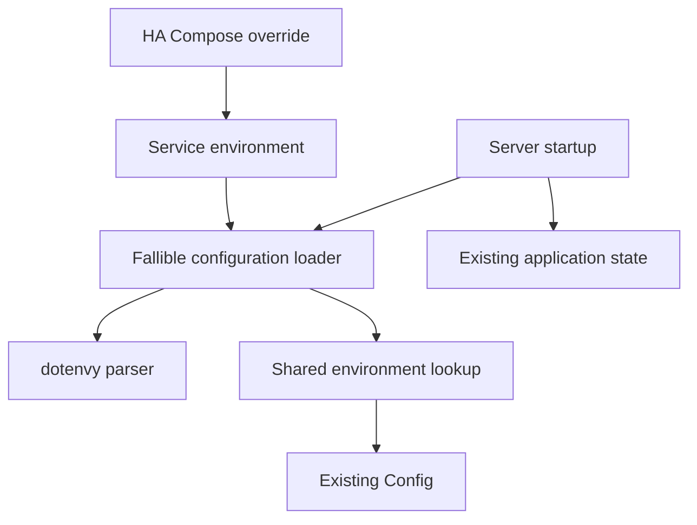

# Plan Review

- [Dashboard](#dashboard)
- [Module Dependency Graph](#module-dependency-graph)
- [Top Findings](#top-findings)
- [Recommendation](#recommendation)

## Dashboard

**Mode:** Health Dashboard

**Scope:** Task 36 plan at `ad56c81`, accepted goal, existing server startup/configuration, and Compose/docs contracts. No design file or project Brooks configuration exists. This assesses a plan, not implemented code; no tests were run for this review.

**Composite Score:** 100/100

| Dimension | Score | Result |
| --- | --- | --- |
| Code Quality | Not scored | No implementation diff yet. |
| Architecture | 100/100 | Explicit startup loading and shared lookup keep file parsing out of domain/HTTP code. |
| Tech Debt | 100/100 | Existing environment-only API, precedence, defaults, token-file ownership, and base Compose behavior are preserved. |
| Test Quality | 99/100 | Make unreadable-file fixtures independent of runtime privileges. |

Balanced scoring deducts one point for the Suggestion below. With no implementation diff, weights are `0.30/0.75`, `0.25/0.75`, and `0.20/0.75`; 99.73 rounds to 100. No Critical or Warning findings. The previous dashboard score was 95 for a different task; the scores are not a codebase trend.

The plan matches the goal and accepted suggestions. Exact working-directory lookup, immutable environment merging, fail-before-open behavior, sanitized errors, and an opt-in Compose override protect existing deployments. No UI changes or pending design approval are involved. Existing server tests provide unit/API/TLS seams; the proposed process tests cover the new startup boundary without needing client changes.

## Module Dependency Graph

## Top Findings

**F1 [T2] Test Brittleness — Permission-only unreadable-file fixtures depend on runtime privileges (Suggestion)**

Symptom: The validation plan requires unreadable-file coverage without specifying a deterministic fixture. A permission-bit-only fixture can remain readable when tests run as root or under different container permissions.

Source: xUnit Test Patterns — Erratic Test; The Art of Unit Testing — Test isolation.

Consequence: A local startup error-path test can pass or fail depending on test-runner privileges rather than loader behavior. This is a limited test-design recommendation, not evidence of a production defect.

Remedy: Exercise a deterministic non-regular-file/read failure, such as a directory at the selected `.env` path. Add permission-bit coverage only when the runner can establish that the file is genuinely unreadable. Assert sanitized output and no resource writes in the child-process case.

## Recommendation

Proceed after recording F1's deterministic fixture requirement in the plan. Keep the accepted runtime precedence, exact-path lookup, token-file storage, and opt-in Compose scope unchanged. No implementation or plan changes were made during this review.
