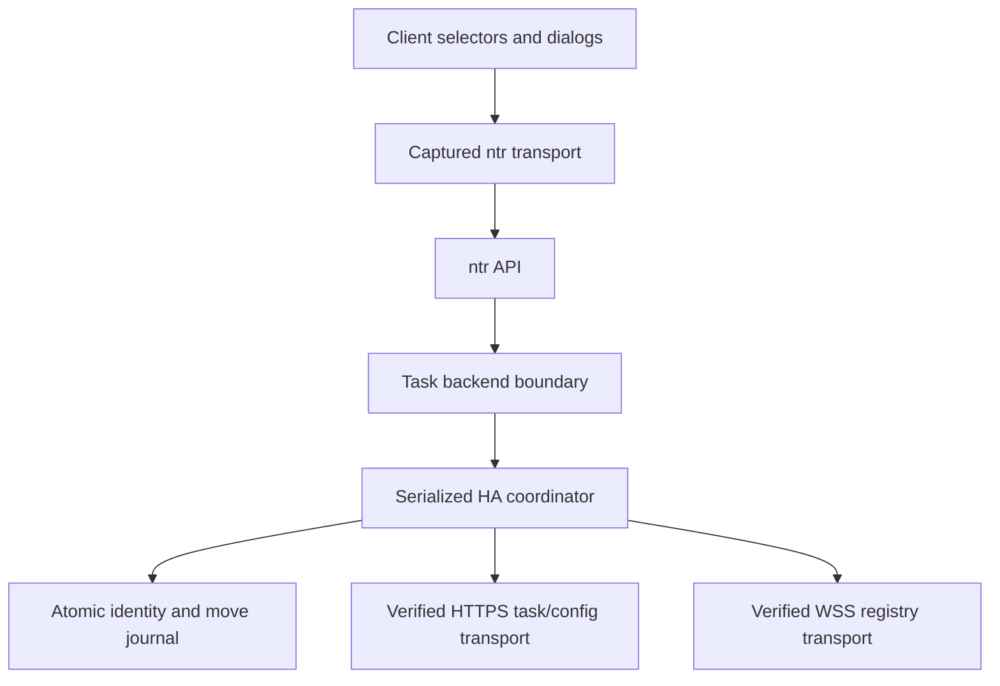

# Plan Review

- [Dashboard](#dashboard)
- [Module Dependency Graph](#module-dependency-graph)
- [Findings](#findings)
- [Recommendation](#recommendation)

## Dashboard

**Mode:** Health Dashboard

**Scope:** Task 37 plan at `3be4a2c`, accepted goal and decisions, existing server coordinator/API/backend boundary, and client transport/edit/project seams. No implementation diff; no tests run. No `.brooks-lint.yaml` exists; balanced defaults apply. This is a plan assessment, not a production health claim.

**Composite Score:** 96/100

| Dimension | Score | Result |
| --- | --- | --- |
| Code Quality | Not scored | No implementation diff. |
| Architecture | 100/100 | Explicit catalog/routing separates list identity from summary tokens. |
| Tech Debt | 90/100 | Recovery admission and destructive-management exposure need explicit contracts. |
| Test Quality | 99/100 | Add catalog-only approval characterization. |

Weighted score: `(100 × .30 + 90 × .25 + 99 × .20) / .75 = 96.4`, rounded to 96. Previous Health Dashboard score 100 concerned task 36, not the same scope; not a codebase trend. Existing suite map from task 36: 42 server unit tests, 22 integration tests, and a real client/server HTTPS serializer contract; additional client tests exist but were not recounted in this plan-only review.

## Module Dependency Graph

## Findings

**F1 [R6] Recovery journal lacks an explicit admission/release contract (Warning)**

Symptom: The plan blocks replay for the source task but does not define how target copies are identified to ordinary task mutations or how a user resolves the block. Source: Domain-Driven Design — Aggregate invariants; Code Complete — Defensive programming. Consequence: A partial move's target could be edited/deleted through ordinary CRUD while the journal still treats it as a verified copy; an unresolved source can remain permanently blocked. This is a bounded gap in the planned recovery workflow, not an observed implementation defect. Remedy: Expose read-only pending-operation diagnostics and an explicit abandon/reconcile endpoint. Block writes to both recorded participants while pending. Reconciliation must verify current source/target state; abandonment never deletes tasks or replays writes, preserves separate identities for retained copies, and requires renewed confirmation for a new move.

**F2 [R6] Administrator token broadens an unauthenticated API's destructive scope (Warning)**

Symptom: Existing ntr routes use permissive CORS and no authentication; new routes would forward administrative config-entry deletion. Source: Clean Architecture — Policy boundaries; Software Engineering at Google — Backward compatibility. Consequence: An unchanged deployment can gain list-management privileges beyond task CRUD merely by upgrading with an admin HA token. Remedy: Gate list creation/rename/deletion behind explicit server-side `HA_MANAGE_LISTS` opt-in, default false; check actual token permissions as well. Document trusted-network/authenticated-proxy requirements. Moves remain separately confirmed task operations. Never expose token or private registry/config data in API responses.

**F3 [T5] Catalog-only updates need approval-path characterization (Suggestion)**

Symptom: Catalog changes reuse task events while the current remote coordinator compares task arrays; an empty-list rename may not change any task DTO. Source: Working Effectively with Legacy Code — Characterization Tests; How Google Tests Software — Change coverage. Consequence: A locally fetched catalog could bypass review or stay stale even when the event arrives. Remedy: Define catalog refresh as display/routing metadata only, invalidate open destructive confirmations when it changes, and test empty-list create/rename/remove independently from task-array changes. Task edits and numeric-ID use still require existing task approval guards.

## Recommendation

Update the plan with F1–F3 before implementation. The goal and confirmed behaviors remain unchanged. Keep HA's non-atomic cross-list/delete limitations explicit and isolate registry transport from domain routing. No implementation or plan changes were made during this review.
