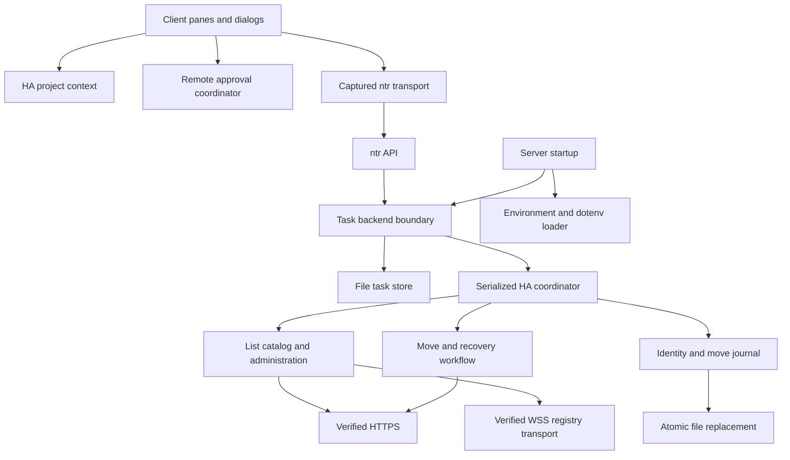

# Branch Review

- [Dashboard](#dashboard)
- [Scope and plan alignment](#scope-and-plan-alignment)
- [Module Dependency Graph](#module-dependency-graph)
- [Top Findings](#top-findings)
- [Verification and test suite map](#verification-and-test-suite-map)
- [Recommendation](#recommendation)

## Dashboard

**Mode:** Health Dashboard

**Scope:** Current branch `37-ha-lists-as-projects`, parent `main...e5fa147` with merge base `9c913b1`; includes tasks 35–37 and the parent Compose changes. Expanded submodule changes: app `841a7e3..337a457` (40 files), server `235900a..db752b8` (33 files), plus 15 parent paths. Supporting unchanged code was inspected where the changes depend on it. No `.brooks-lint.yaml` was found; balanced defaults apply.

**Composite Score:** 98/100

| Dimension | Score | Top Finding |
| --- | --- | --- |
| Code Quality | 95/100 | F1: A concurrent catalog-only change can be hidden from its mutation author. |
| Architecture | 100/100 | No actionable new dependency/layering finding in the scoped scan. |
| Tech Debt | 95/100 | F2: The move journal uses atomic replacement without durable flush ordering. |
| Test Quality | 100/100 | No separate T1/T2 finding; existing tests miss the two conditions below. |

Two Warning findings; no Critical or Suggestion findings. Each finding is deducted in one dimension only. Weighted score: `95 × .25 + 100 × .30 + 95 × .25 + 100 × .20 = 97.5`, rounded half-up to 98. This bounded score is not merge approval. The preceding score of 96 assessed a plan, not this implementation; it is not a comparable quality trend.

## Scope and plan alignment

- Checked the latest `3-plan.md`, accepted goal, prior plan review, and implementation report. No `2-design.md` exists; the plan explicitly reuses existing dialogs without mockups.
- Explicit entity-qualified routing, empty-list discovery, schema migration, admin opt-in, verified HTTPS/WSS, confirmed moves, recovery admission, and no automatic replay are implemented. File/local behavior and Markdown notes retain their existing boundaries.
- Prior plan F1 is addressed with pending-operation diagnostics, operation IDs, blocked participant lists, and read-only reconciliation/abandonment. Blocking both lists is a documented conservative choice. F2 below concerns persistence ordering, not missing recovery endpoints.
- Prior plan F2 is addressed with default-off `HA_MANAGE_LISTS`, administrator checks, and unauthenticated-API trust warnings. The external-writer race is documented rather than incorrectly presented as transactional.
- Prior plan F3 is partly addressed: catalog refresh is separate from task acceptance and invalidates open confirmations. F1 below identifies an event-provenance gap that can prevent that refresh from being triggered.
- Earlier dotenv changes preserve exact working-directory lookup, environment precedence, sanitized fail-before-store startup errors, and opt-in Compose injection. Parent Compose now references an existing `Dockerfile`; the removed development override and credential mounts were included in the review, with no separate evidenced defect identified.
- Versions and release mirrors are updated to server `0.2.12` and app `0.15.32`. No fixes were implemented during this review. Existing uncommitted `app/package-lock.json` changes were not modified or staged; frontend execution used the installed dependencies, not a fresh install of the committed lockfile.

## Module Dependency Graph

The graph shows runtime responsibilities, not every Rust type import. The backend selects infrastructure at the composition boundary; separate list and move modules keep those workflows out of HTTP handlers. No speculative abstraction or dependency-cycle finding was justified by this scan.

## Top Findings

**F1 [R2] Change Propagation — Catalog-only external changes inherit a self-only task origin (Warning)**

Symptom: `server/src/homeassistant.rs:903–911` chooses the author origin by comparing task snapshots only. `publish` at lines 528–535 also compares catalogs, but then consumes the changed catalog baseline using that same origin. If an empty list is renamed externally during an otherwise self-only task write, the only event is attributed to the author. `server/src/api.rs:543–545` filters that event from the author's SSE connection.

Source: The Pragmatic Programmer — Orthogonality; A Philosophy of Software Design — Information Leakage.

Consequence: The initiating client can miss an external catalog change even though the plan requires authors to receive concurrent external changes. The following poll sees the already-consumed baseline and emits nothing. A successful current-client mutation usually reloads its catalog itself, limiting the impact, but the server's event contract remains incorrect for SSE consumers that rely on notifications. A disposable external probe reproduced exactly one `Some("author")` event for a task create plus concurrent empty-list rename, followed by zero events on the next poll. No task loss was observed; Warning reflects a bounded notification defect.

Remedy: Include catalog identity/name changes in the proof of a self-only mutation before retaining the author origin. Publish `origin: None` when the catalog changes during the write. Add a server SSE regression for a catalog-only external delta during mutation, asserting the author receives it and later polling does not need to repair a lost notification. Keep client task acceptance separate from catalog refresh.

**F2 [R6] Domain Model Distortion — Atomic journal replacement is treated as durable intent (Warning)**

Symptom: `server/src/ha_moves.rs:102–107` saves move intent before copying and lines 145–169 save the identified target before source deletion. Both saves reach `server/src/homeassistant.rs:433–437` and the unchanged `server/src/atomicfile.rs:15–17`, which only call `fs::write` and `fs::rename`. Neither file contents nor the containing directory are synchronized to durable storage. The new move workflow relies on this existing helper as its durable safety boundary.

Source: Domain-Driven Design — Aggregate invariants; Code Complete — Defensive programming.

Consequence: Atomic visibility does not establish persistence ordering against independent HA writes. A host/power failure can leave an HA copy or deletion committed while the persisted sidecar still predates its intent or verified UID. Recovery can then lose its write block or the information needed to transfer the original numeric ID. Process-abort and returned-I/O-error tests do not establish power-loss durability. No actual power-loss corruption was reproduced, and target verification still protects ordinary source deletion; Warning is limited to the unfulfilled durable-journal guarantee.

Remedy: Use a journal persistence primitive that writes and synchronizes the temporary file, renames it, then synchronizes the parent directory before admitting the next HA mutation. Surface persistence failures before advancing the workflow. Keep atomic journal transitions for completion and abandonment, and verify flush/error ordering through an injectable persistence seam. Document any unsupported platform or filesystem durability limits.

## Verification and test suite map

| Check | Result |
| --- | --- |
| Server `CARGO_TARGET_DIR=/tmp/opencode/ntr-review-target cargo test --locked` | Passed: 52 library tests and 22 integration tests. |
| Server `cargo fmt --check` | Passed. |
| Server locked Clippy, all targets, `-D warnings` | Passed using the fresh review target directory. |
| App `NODE_OPTIONS=--no-experimental-webstorage npm test` | Passed: 762 tests across 48 files. |
| App `npm run build` | TypeScript and Vite production build passed. |
| App `npm run test:release` | Passed: 52 hermetic release-tool tests; no real publication. |
| App `npm run test:ha-contract` | Passed against generated-CA loopback HTTPS/WSS fixtures and the real Rust server, using the review target directory. |
| Server Compose Python test | Passed: one configuration-rendering test; no container started. |
| Parent and expanded submodule branch whitespace checks | Passed. |
| Targeted catalog-provenance probe | Reproduced F1 using unmodified production Rust code and a temporary fault-injected fixture outside the repository. |

Suite map: the server's 52 library tests comprise 30 isolated unit tests and 22 disposable HA/TLS adapter tests; its separate integration binaries add 14 API, five startup, and three task-date tests. Frontend tests combine pure units, component tests, and mocked-native pane/transport integration. The one serializer/server contract exercises real HTTPS/WSS but is not a native desktop E2E test. No native desktop or live-HA E2E run was performed during this review. The prior implementation records missing native development libraries; that limitation remains unverified here. The suite is fast and has useful failure-injection seams; no pyramid-ratio finding is justified.

The first server run reused cached binaries with an obsolete compiled `CARGO_MANIFEST_DIR`, causing 22 fixture-startup failures. Rebuilding in a fresh target directory resolved all failures; this was not classified as a source defect. No dependencies were installed and no tracked implementation files were changed.

No live HA operations, deployment credentials, container startup, publication, push, or destructive fault testing was used. The F1 probe lives under `/tmp/opencode/ntr-review-probe`; its fixture models a concurrent rename and does not validate a real HA installation. F2 is established by the persistence call chain, not by a simulated power failure.

## Recommendation

Correct the journal durability boundary and catalog-event provenance before relying on the advertised recovery and notification guarantees. Keep the current opt-in administration, explicit confirmations, no-replay recovery, and external-writer limitations. If a deeper follow-up is needed, use the focused tech-debt review on persistence ordering. This review records findings only; implementation and plan files remain unchanged.
