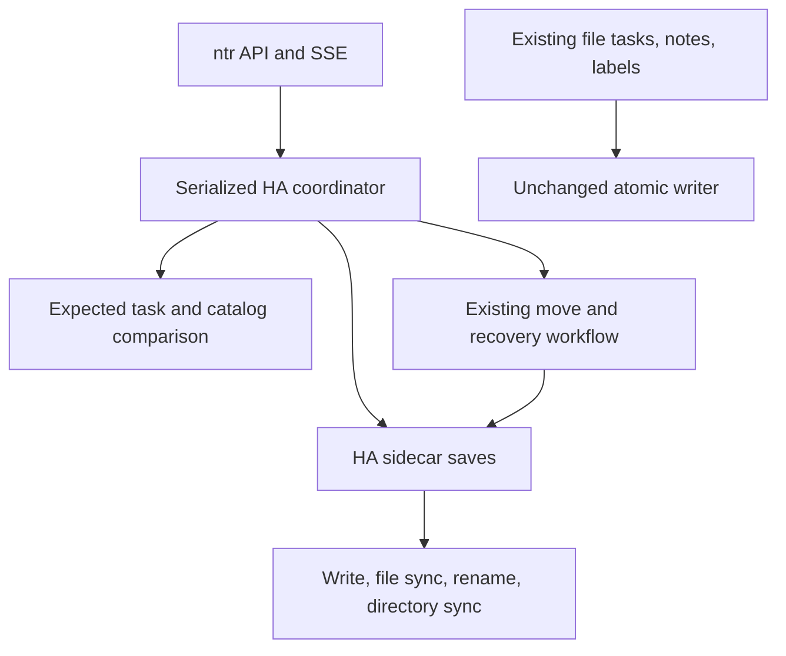

# Plan Review

- [Dashboard](#dashboard)
- [Module Dependency Graph](#module-dependency-graph)
- [Findings](#findings)
- [Recommendation](#recommendation)

## Dashboard

**Mode:** Health Dashboard

**Scope:** Task 38 goal and plan at `8cb453b`, task 37 review F1/F2, HA coordinator/save/move call chains, existing atomic writer, and notification/TLS test seams. Plan review only; no implementation changes or new tests run. No project Brooks configuration or design file exists.

**Composite Score:** 100/100

| Dimension | Score | Result |
| --- | --- | --- |
| Code Quality | Not scored | No implementation diff for this task yet. |
| Architecture | 100/100 | A scoped durable writer and private persistence seam leave file/local paths unchanged. |
| Tech Debt | 100/100 | Explicit task-plus-catalog provenance and flush ordering address both reviewed invariants. |
| Test Quality | 100/100 | Deterministic one-shot fixture changes and persistence faults cover success and failure boundaries. |

With no implementation diff, weights are `.30/.75`, `.25/.75`, and `.20/.75`. No deductions; no Critical, Warning, or Suggestion findings. The preceding 98 was an implementation review with different scope, not a directly comparable trend. Existing suite map: 30 isolated server unit tests, 22 HA/TLS adapter tests, 22 separate integration tests, and one serializer/server contract; frontend tests are outside the planned change.

## Module Dependency Graph

## Findings

No actionable findings remain in the proposed plan. The server-only scope matches the goal and needs no UI approval. Durable completion and recovery use the same persistence boundary as intent; pre-rename and post-rename failures are explicitly distinct. Storage sync remains a local durability contract, not an HA transaction or proof against physical power loss.

## Recommendation

Proceed without changing the goal. Clarify two implementation details in the plan: exercise relative-parent normalization without changing process-wide working directories in parallel tests, and assert that pre-rename failures preserve the previous destination while post-rename failures remain conservative. Keep the private seam narrow and verify that schema migration also uses the durable writer. No fixes were implemented during this review.
