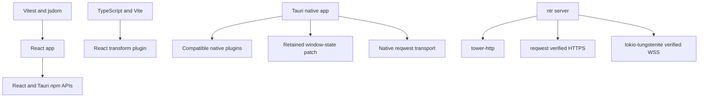

# Plan Review

- [Dashboard](#dashboard)
- [Module Dependency Graph](#module-dependency-graph)
- [Findings](#findings)
- [Recommendation](#recommendation)

## Dashboard

**Mode:** Health Dashboard

**Scope:** Task 39 plan at `476dd17`, goal, npm audit/outdated metadata, Cargo dry-run updates, dependency manifests, Vite/Vitest/TypeScript configuration, and existing native/HA contract seams. Plan review only; no implementation changes or tests run. No project Brooks configuration or design file exists.

**Composite Score:** 100/100

| Dimension | Score | Result |
| --- | --- | --- |
| Code Quality | Not scored | No implementation diff for task 39. |
| Architecture | 100/100 | Existing transport, TLS, native plugin, and build boundaries are retained. |
| Tech Debt | 100/100 | Compatible major upgrades are explicit; patched/native-only exceptions are documented. |
| Test Quality | 100/100 | Clean install, audits, native checks, and both serializer contracts cover the upgrade seams. |

No Critical, Warning, or Suggestion findings. With no implementation diff, weights are `.30/.75`, `.25/.75`, and `.20/.75`; all dimensions score 100. Earlier plan/review scores concern different scopes and are not a trend. Existing suite map: 762 frontend tests, 82 server tests, 52 app release-tool tests, and two real serializer contracts; native tests exist and their current total will be recorded after execution.

## Module Dependency Graph

## Findings

No actionable plan findings. The goal permits dependency and required compatibility updates, not new features or relaxed tests. The Node engine range matches the current stable jsdom/Vitest requirements. Required Linux native library metadata is now available through pkg-config, so native tests should be attempted rather than carrying forward the old environment blocker. Retaining the custom window-state patch and Android-only major pin is justified until their platform-specific behavior can be validated.

## Recommendation

Proceed. Clarify that the production dependency audit must remain clean, the full audit must be rerun after `npm ci`, and any remaining npm advisories need an explicit recorded exception rather than forced incompatible overrides. Verify the resolved server TLS provider/trust setup through the existing generated-CA rejection and WSS tests; source compilation alone is insufficient. No implementation fixes were made during this review.
