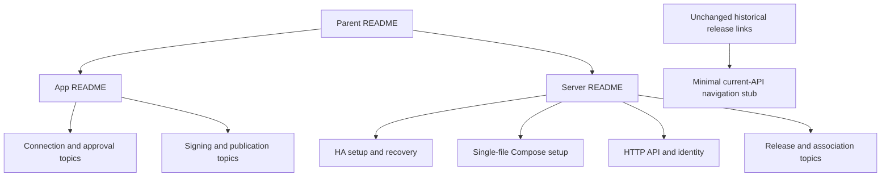

# Plan Review

- [Dashboard](#dashboard)
- [Module Dependency Graph](#module-dependency-graph)
- [Findings](#findings)
- [Recommendation](#recommendation)

## Dashboard

**Mode:** Health Dashboard

**Scope:** Task 40 accepted goal and plan at `18d7b6d`, maintained README/topic inventory, historical links to the old format guide, version validators, and signing-doc test expectations. Plan review only; no implementation changes or tests run. No project Brooks configuration or UI design exists.

**Composite Score:** 100/100

| Dimension | Score | Result |
| --- | --- | --- |
| Code Quality | Not scored | Documentation plan, not a production implementation diff. |
| Architecture | 100/100 | Dedicated topic pages retain clear ownership; no runtime/module changes. |
| Tech Debt | 100/100 | Duplicate/version-specific prose is removed without hiding safety contracts. |
| Test Quality | 100/100 | Link/anchor, protected-history, metadata, and signing-guidance checks cover documentation risks. |

No Critical, Warning, or Suggestion findings. Weights without an implementation diff are `.30/.75`, `.25/.75`, and `.20/.75`; no deductions. Earlier scores assess different scopes, not a comparable trend. Existing relevant suite map: 52 app release-tool tests, server Python release/Compose tests, plus offline app/server validators. Runtime suites remain outside this documentation-only change.

## Module Dependency Graph

## Findings

No actionable findings. The plan follows the user's accepted documentation-only scope. Replacing the old guide with a minimal navigation stub removes its instructions without breaking unchanged historical release links. Source behavior, task data, existing signing identity, and the user's pending file/pointer changes remain protected. The required version changes are metadata-only and add new notes rather than rewriting historical releases.

## Recommendation

Proceed. Make the retained safety/command checklist visible in the implementation results, including admin opt-in, no-auth exposure, no-replay recovery, durability limits, signing-key loss, and non-destructive publication. Read credential paths from the actual release configuration instead of repeating stale prose defaults. Preserve the signing guide's `trusted-certificate` anchor and verify a literal format-branding search across maintained prose separately from the legacy filename exception. No implementation changes were made during this review.
