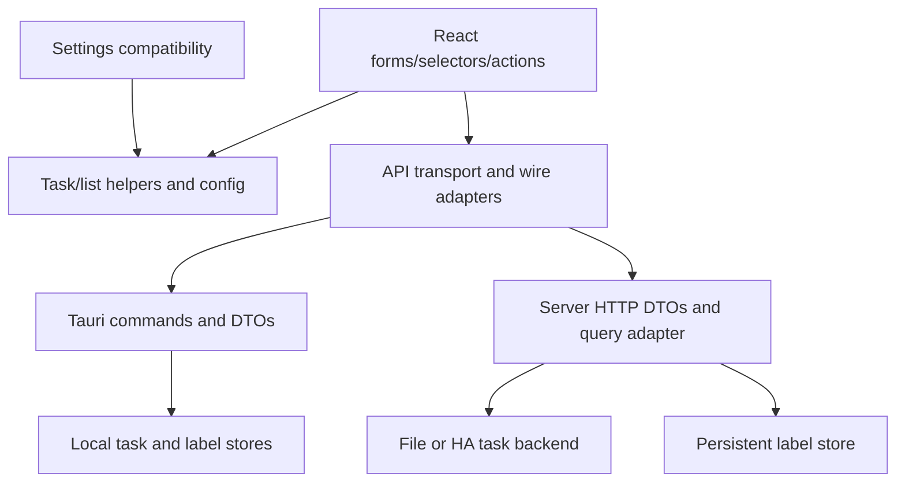

# Plan Review

- [Dashboard](#dashboard)
- [Module Dependency Graph](#module-dependency-graph)
- [Findings](#findings)
- [Recommendation](#recommendation)

## Dashboard

**Mode:** Health Dashboard

**Scope:** Task 41 goal and plan at `259fe44`, frontend task/label models and transport, preferences, Rust domain/DTO/label stores, and related test/contract boundaries. Plan review only, not a whole-project health certification. No Brooks configuration exists; balanced defaults apply. No implementation changes or new test execution occurred.

**Composite Score:** 100/100

**Trend:** Stable at 100; prior records reviewed different task scopes.

| Dimension | Score | Result |
| --- | --- | --- |
| Code Quality | Not scored | No production diff yet. |
| Architecture | 100/100 | Stable protocol details remain at explicit adapters rather than component/domain naming. |
| Tech Debt | 100/100 | A coordinated terminology change avoids parallel domain names without forcing a storage migration. |
| Test Quality | 100/100 | Plan requires independent old-wire/storage fixtures, preferences, UI regressions, and actual HTTP/native contracts. |

No deductions; non-PR weights are `.30/.75`, `.25/.75`, and `.20/.75`. Suite map: 48 frontend test files, Rust inline/native suites and three server integration test files, two app contract scripts, plus app/server release-tool Python suites. File counts are not executed test counts.

## Module Dependency Graph

## Findings

No actionable findings in the proposed plan. Domain naming follows the accepted goal, while retaining legacy protocol keys is an intentional compatibility tradeoff, not incomplete renaming. Stable serialization attributes and a single frontend conversion boundary avoid requiring simultaneous deployment of every client. Retaining literal task content and projection terminology prevents unrelated semantic edits.

## Recommendation

Proceed. During implementation, verify every task-returning route and labels backup path crosses the adapter, not just list reads. Keep independent old-wire fixtures for successful mutation readbacks as well as labels/filter requests. Preserve old sort direction and avoid changing raw task content while mechanically renaming code. Record the known stale server release assertion separately rather than weakening it.
