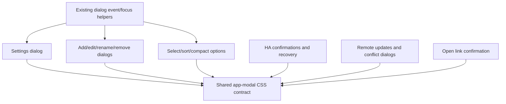

# Plan Review

- [Dashboard](#dashboard)
- [Module Dependency Graph](#module-dependency-graph)
- [Findings](#findings)
- [Recommendation](#recommendation)

## Dashboard

**Mode:** Health Dashboard

**Scope:** Task 42 goal/plan at `8209b5d`, Settings and other dialog templates, shared CSS, and existing lifecycle/preview/picker tests. Plan review only; no implementation changes or tests run. No Brooks configuration exists; balanced defaults apply.

**Composite Score:** 100/100

**Trend:** Stable at 100; prior scores covered different task plans.

| Dimension | Score | Result |
| --- | --- | --- |
| Code Quality | Not scored | No implementation diff yet. |
| Architecture | 100/100 | One opt-in CSS surface serves existing independently owned dialogs; no lifecycle wrapper is introduced. |
| Tech Debt | 100/100 | Consolidation removes duplicated shell rules without changing content-specific layout ownership. |
| Test Quality | 100/100 | Planned template/appearance checks complement existing behavior coverage, with browser limitations explicit. |

No findings or deductions; non-PR weights are `.30/.75`, `.25/.75`, and `.20/.75`. Suite map: 48 frontend test files including modal lifecycle, settings, edit, nested selectors, HA administration/moves, retained rename/removal, and update-preview coverage; app release-tool suite has 52 tests. These are existing inventories, not test execution in this review.

## Module Dependency Graph

## Findings

No actionable findings. The requested reference is an existing UI, so a new design preview is unnecessary. The plan explicitly preserves title-free remote previews, content-specific widths, native top-layer behavior, and all recovery/confirmation semantics. CSS opt-in is a bounded shared dependency, not a runtime cross-layer refactor. DOM/computed-style tests are not substituted for real-browser layout evidence.

## Recommendation

Proceed. Remove competing old ID/class shell rules rather than layering another override block. Check form and non-form dialogs for doubled margins/gaps. Explicitly test the open-only layout selector, shared sticky-footer background, long-content wrapping, and all app-owned dialog templates. Keep lifecycle handlers/ARIA/content byte-equivalent except for the shared styling marker.
