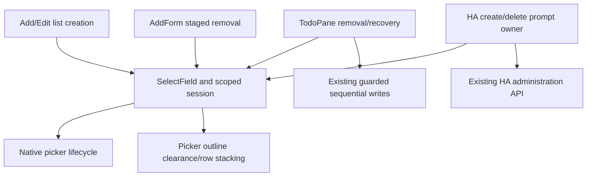

# Plan Review

- [Dashboard](#dashboard)
- [Module Dependency Graph](#module-dependency-graph)
- [Findings](#findings)
- [Recommendation](#recommendation)

## Dashboard

**Mode:** Health Dashboard

**Scope:** Task 43 goal/plan at `134a3f7`, selector sessions, Add/Edit list creation, staged/global removal owners, HA prompts, and picker overflow/focus CSS. Plan review only; no implementation changes or tests run. No Brooks configuration exists; balanced defaults apply.

**Composite Score:** 100/100

**Trend:** Stable at 100; previous records cover different task plans.

| Dimension | Score | Result |
| --- | --- | --- |
| Code Quality | Not scored | No production diff yet. |
| Architecture | 100/100 | Reuses scoped selector sessions rather than global click/reopen behavior. |
| Tech Debt | 100/100 | Navigation ownership stays with existing components; outline fixes stay within the scroll surface. |
| Test Quality | 100/100 | Planned cancellation, stale-session, no-write, busy, and appearance coverage addresses changed behavior. |

No deductions; non-PR weights are `.30/.75`, `.25/.75`, and `.20/.75`. Existing suite map: 49 frontend test files/789 tests, including 19 appearance checks and nested list/lifecycle/HA coverage, plus 52 app release-tool tests. These inventories are not test runs during review.

## Module Dependency Graph

## Findings

No actionable findings in the plan. Returning to an already-owned picker avoids introducing automatic UI replay across destinations. Keeping existing recovery/write modules unchanged limits authority changes. The requested minimal copy changes apply to local removal/draft text; HA destructive safety warnings remain separate. Outline padding and local stacking preserve both focus indicators and scrolling.

## Recommendation

Proceed. Resolve/clear session references once when a child closes; repeated native close events must not restore a newer picker. Keep scope identity explicit in the generic selector instead of importing transport policy into it. Review update must still close retained picker and compact-option stacks before approval. Test the newly intended return behavior rather than deleting existing no-write/draft/busy assertions when their old closed-picker expectations change.
