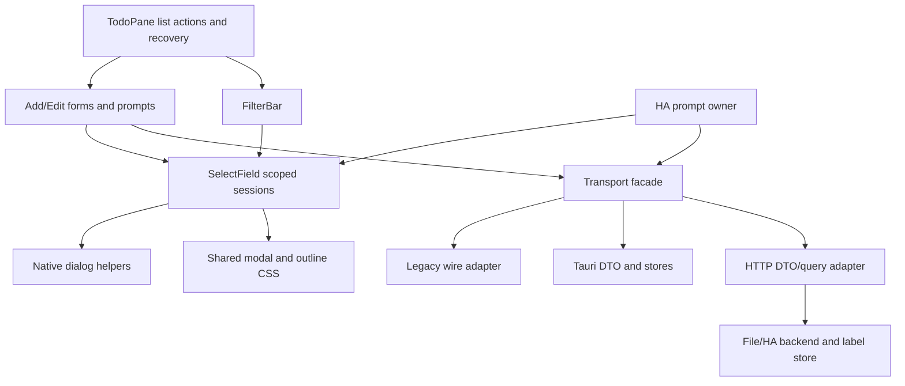

# Code Review

- [Dashboard](#dashboard)
- [Scope and plan compliance](#scope-and-plan-compliance)
- [Module Dependency Graph](#module-dependency-graph)
- [Findings](#findings)
  - [Suggestion](#suggestion)
- [Verification](#verification)
- [Recommendation](#recommendation)

## Dashboard

**Mode:** Health Dashboard

**Scope:** Full unmerged branch through parent `6a7f8b2`, app `0f1a8f2`, and server `eb699b1`, relative to local `main`. Parent merge-base is `3b8ad78`; submodule bases are app `e4725a8` and server `c81c7e9`. This includes tasks 41–43, not only task 43's incremental diff from stacked parent `42-settings-modal-styling` at `ea535a8`. Reviewed 13 parent paths, 84 app paths, and 17 server paths. No Brooks configuration exists; balanced defaults apply.

**Composite Score:** 100/100

**Trend:** Stable at 100; the previous record was a plan review, not a comparable implementation-health trend.

| Dimension | Score | Result |
| --- | --- | --- |
| Code Quality | 100/100 | No actionable production-code defect found in the inspected diff. |
| Architecture | 100/100 | Compatibility adapters and scoped picker ownership preserve existing boundaries. |
| Tech Debt | 100/100 | Coordinated domain renaming/shared styling is intentional; no unsupported abstraction or layering finding. |
| Test Quality | 99/100 | One Suggestion: add real-browser coverage for visual/native-dialog boundaries. |

Totals: zero Critical, zero Warning, one Suggestion. The single test-quality deduction is 1; weighted score is `100×.25 + 100×.30 + 100×.25 + 99×.20 = 99.8`, rounded half-up to 100. This score is not browser/device sign-off.

## Scope and plan compliance

- Task 41: List terminology spans UI, files/types/helpers, native/server domain fields, and docs. Legacy HTTP `projects`/`project`, labels storage, and old sort preferences remain explicit compatibility boundaries. Wire adapters cover list and mutation readbacks plus local label backups; independently named legacy fixtures preserve literal task content. Type-only imports do not introduce runtime cycles.
- Task 42: All 13 production dialog templates use the Settings-style surface. Shared shell/field rules replace competing rules, closed dialogs stay hidden, wide previews retain scrolling, and update previews remain title-free. Native system dialogs are excluded.
- Task 43: Retained sessions restore Add/Remove focus without implicit writes; generation/scope/connection checks prevent obsolete session authority. Cancel/Escape/backdrop return preserves drafts/selection; busy removal and explicit approval/recovery remain guarded. Review update closes picker/options stacks. Outline clearance/local row stacking and requested copy match the plan. Context-removal copy and HA deletion warnings remain separate.
- No approved `2-design.md` exists for these tasks; plans use the existing UI/reference and explicit user requests. No conflicting design artifact was found. Final app/server versions are `0.15.37`/`0.2.16`; multiple app version steps reflect the three stacked tasks, not dependency updates.

## Module Dependency Graph

## Findings

### Suggestion

**T5 — Suggestion: cover native top-layer focus and outline geometry in a real browser.**

- **Symptom:** `app/src/components/ModalAppearance.test.tsx:47–56,117–123` checks synthetic dialog shells/CSS declarations; `app/src/test/dialog.ts:4–20,36–48` models native cancel, label activation, and queued close delivery. These tests cannot measure clipping, stacking/hit testing, or actual native modal focus restoration.
- **Source:** The branch changes exactly those browser-owned boundaries in `app/src/components/SelectField.tsx:40–65` and `app/src/style.css:555–588`. This is a change-coverage limitation, consistent with *How Google Tests Software* and *Working Effectively with Legacy Code*, not evidence that the DOM tests are invalid.
- **Consequence:** A layout/top-layer regression could leave the unit/component suite green. No such browser failure was reproduced, no serious exposure was established, and the implementation reports explicitly disclose the limitation; therefore this is a bounded regression-protection Suggestion, not a blocking defect.
- **Remedy:** Add a small real Chromium/WebKit or supported-device scenario at desktop/narrow widths: focus Add/Rename at scroll edges, inspect the full outline, cancel local/HA child dialogs with button/Escape/backdrop, assert focus/selection returns, and exercise busy refusal plus Review update stack closure. Keep existing fast DOM tests. This recommendation was not implemented during review.

No Critical or Warning findings. Stable protocol names, high orchestration fan-out, coordinated rename edits, and separate Add/Edit session owners were checked as intentional tradeoffs rather than automatically flagged as decay.

## Verification

Fresh review checks:

- Frontend: all 833 tests across 49 files passed; TypeScript/production build and offline app release validation passed.
- App native: `cargo test --locked` passed 63 tests; the one opt-in real-server restart test remains ignored in this run.
- Server: `cargo test --locked` passed 84 tests (61 library, 15 API, five startup, three task-date tests); offline release validation passed.
- Actual local/file-server task contract and generated-CA loopback HA HTTPS/WSS contract passed. Optional pre-removal old-server checks were skipped because `OLD_NTR_SERVER_BIN` was unset.
- App release-tool suite: all 52 tests passed in this review; its simulated publication messages were hermetic fixture output.
- Main-relative metadata checks confirmed exact version/release-pointer changes only, unchanged dependency versions/signing identity, and byte-identical pre-existing release/vendor content. Task 43's protected-scope checker passed links/anchors, shell syntax, prior task preservation, native/server/write/recovery invariance for the incremental task, original `todo.md`/`command.md` hashes, and whitespace. Main-relative parent/app/server whitespace checks passed.

Suite map also includes 52 app release-tool tests and the 68-test server Python publication/recovery/Compose portfolio. The full server Python suite was not rerun here; its pre-existing hard-coded `0.2.9` consumer assertion is documented and baseline-reproduced in implementation reports, not introduced by this branch or counted as a new finding. No clippy rerun, browser screenshots, device/live HA operations, publication, deployment, merge, or push occurred during review.

## Recommendation

No code-fix blocker found within the reviewed scope. Keep browser/device visual and native-focus sign-off outstanding, and add the focused real-browser regression when tooling is available. This stage changes only this report and review history; implementation code and plans are unchanged.
